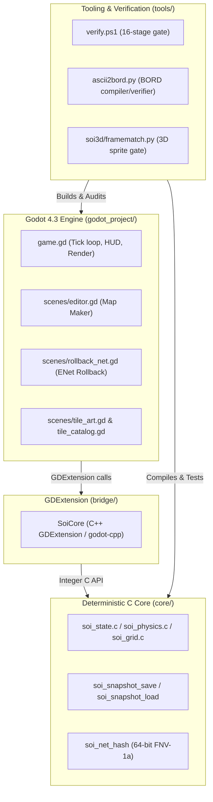

# Step On It! Remastered — AI Agent & Developer Handbook

> **Audience**: AI Agents (Antigravity, Aider, Claude Code, Cursor, Windsurf) & Human Contributors  
> **Status**: Living document — update after architectural changes, new tools, or gate modifications.  
> **Last Updated**: October 2026

---

## 1. System Architecture & Tech Stack

This project is a faithful, modern preservation and remaster of the 1996 Mac PowerPC game **Step On It!** (Casady & Greene / Webfoot Technologies).



### The 4 Architectural Layers

1. **Deterministic C Core (`core/`)**:
   - Freestanding, integer-only C99/C17 game simulation.
   - Contains movement/physics, all 16 enemy behaviors, weapons, score/tally, and level loading.
   - No Godot dependencies, no OS calls, no heap allocations during tick execution.
   - State snapshotting (`soi_snapshot_save` / `soi_snapshot_load`) takes $\sim0.07\ \mu\text{s}$ via `memcpy`.
   - Simulation state hashes to a 64-bit FNV-1a hash (`soi_net_hash`) across all active elements.

2. **C++ GDExtension Bridge (`bridge/`)**:
   - Thin `godot-cpp` wrapper exposing the C core as a `SoiCore` Godot node.
   - Compiled using portable **Zig** (`bridge/build_zig.ps1`) without requiring MSVC.
   - Strictly handles glue, memory mapping, and type conversions — zero game logic.

3. **Front-End (`godot_project/`)**:
   - **Godot 4.3** with GDScript.
   - `scenes/game.gd`: Main game scene, tick dispatch, input routing, dual-presentation rendering (ORIGINAL ↔ REMASTERED).
   - `scenes/editor.gd`: In-engine visual Map Maker supporting 19×13, 28×19, and 38×26 boards.
   - `scenes/tile_catalog.gd`: Canonical catalog of all authentic blocks, goodies, enemies, and interactive objects.
   - `scenes/tile_art.gd`: Centralized tile resolver and sprite loader with 4× HD and 3D frame overlay caches.
   - `scenes/rollback_net.gd`: ENet star-hub rollback netcode with 64-snapshot ring buffer and monotonic scheduling.
   - `scenes/audio.gd`: Multi-stream audio engine supporting original 8-bit sound and enhanced AudioSR 16-bit sound.

4. **Tools & Pipelines (`tools/`)**:
   - Python 3.10+ and PowerShell automation.
   - Asset decoding, AI upscaling (Real-ESRGAN / AudioSR), Blender 3D procedural models, and verification suites.

---

## 2. Environment & Execution Invariants (MANDATORY RULES)

When working on this codebase in PowerShell on Windows, you **MUST** follow these invariants without exception:

### A. Virtualenv Executables
- **NEVER** run bare commands like `python`, `pytest`, `ruff`, or `mypy`.
- Always use the explicit virtual environment path:
  ```powershell
  .venv\Scripts\python.exe <script>.py
  .venv\Scripts\pytest.exe
  ```

### B. Shell Commands
- Windows PowerShell **does not have** Unix utilities (`grep`, `sed`, `awk`, `cat -flags`).
- Use PowerShell native cmdlets or Git commands:
  - Search: `git grep "<pattern>"` or `Select-String -Path <path> -Pattern "<pattern>"`
  - Inspect files: `Get-Content <path>` (or the agent `read_file` tool)

### C. Godot CLI Invocations
- Godot executable path: `D:\SOI-tools\godot\Godot_v4.3-stable_win64_console.exe`
- **Headless Node scripts**: **NEVER** pass a script extending `Node` or `Control` to `-s` / `--script`. Godot requires `SceneTree` or `MainLoop` for `-s` and will hang silently.
- **Always invoke scenes via their `.tscn` URI**:
  ```powershell
  & "D:\SOI-tools\godot\Godot_v4.3-stable_win64_console.exe" --headless --path godot_project res://scenes/<scene>.tscn -- <args>
  ```

### D. Off-Screen Rendering for Visual Tests & Screenshots
- Godot's `--headless` mode initializes a dummy rendering device that **produces completely blank viewports**.
- To capture valid screenshots or visual verification images in CI or background tasks without a pop-up window:
  ```powershell
  & "D:\SOI-tools\godot\Godot_v4.3-stable_win64_console.exe" --resolution 640x480 --position 9000,9000 --path godot_project res://scenes/<scene>.tscn -- <args>
  ```
  Position `(9000, 9000)` moves the window off the visible desktop while Vulkan continues full hardware presentation.

### E. AppData Path Integrity
- Never drop the `antigravity` segment when referencing agent data directories:
  - Correct: `C:\Users\<user>\.gemini\antigravity\brain\...`
  - Incorrect: `C:\Users\<user>\.gemini\brain\...`

---

## 3. The 16-Stage Verification Gate (`tools/verify.ps1`)

Before committing any non-trivial code changes or completing a task, run the full verification gate:

```powershell
powershell -ExecutionPolicy Bypass -File tools/verify.ps1
```

All 16 stages must output `[PASS]` and conclude with `ALL STAGES PASSED`:

| # | Stage Name | Target File / Command | Description |
|---|---|---|---|
| 1 | `core: mechanic unit tests` | `tests/test_mechanics.c` | Compiles and executes all 69 sections of C core unit tests covering movements, weapons, enemies, scoring, and combat. |
| 2 | `core: harness + determinism` | `tests/harness.c` | Verifies identical 64-bit state hashes across multiple runs from the same seed. |
| 3 | `core: rollback synctest` | `tests/test_synctest.c` | Forces 8-tick divergent rollbacks across all 152 campaign boards; asserts 0 state mismatches. |
| 4 | `core: fixture-replay selftest` | `tools/fixture_replay.py` | Replays an recorded inputs fixture against `board_401.bord` through `soi_core.dll`. |
| 5 | `core: creeper chain simulation`| `tools/verify_creepers.c` | Simulates and asserts deterministic walking block mechanics across all 15 creeper boards. |
| 6 | `tools: ascii2bord unit tests` | `tools/test_ascii2bord.py`| Tests text-to-binary compilation of level formats. |
| 7 | `tools: ascii2bord roundtrip` | `tools/ascii2bord.py verify-roundtrip` | Asserts byte-exact roundtrip decompile $\to$ compile across all 152 original boards. |
| 8 | `art: 3D sprite frames` | `tools/soi3d/framematch.py --check` | Compares 3D rendered sprite frames against 2D reference sprites for IoU and $\Delta E$ color fidelity. |
| 9 | `bridge: GDExtension build` | `bridge/build_zig.ps1` | Recompiles `godot-cpp` and `soi_bridge.dll` using Zig C++. |
| 10 | `godot: import clean` | Godot CLI `--editor --headless` | Validates resource loading and compiles all GDScript files without syntax/parse errors. |
| 11 | `godot: run + screenshot` | `game.tscn -- --shot` | Runs game off-screen at `(9000, 9000)` and captures a rendered frame to `media/screenshots/`. |
| 12 | `net: rollback soak test` | `tools/test_net_soak.ps1` | 1,200 ticks with simulated 120ms latency and 30ms jitter; verifies 0 desyncs across hundreds of rollbacks. |
| 13 | `net: 3-player adversarial soak`| `tools/test_net_adversarial.ps1` | 3-player Star-Hub packet forwarding under asymmetric packet loss conditions. |
| 14 | `net: edge cases & peer drops` | `tools/test_net_edge_cases.ps1` | Tests Join Code Crockford Base32 parsing, mid-match peer drops, and host disconnect recovery. |
| 15 | `net: online progression & retry`| `tools/test_net_progression.ps1`| Verifies dual-instance headless campaign level transitions and retry synchronization. |
| 16 | `editor: headless map editor self-test`| `editor.tscn -- --test-editor` | Exercises editor grid allocation across all 3 sizes, round-trip serialization, and tile catalog integrity. |

---

## 4. Tile System & BORD Format Specifications

### Cell 32-Bit Encoding
Each grid cell in memory is a 32-bit unsigned integer formatted as:

$$\text{Cell} = (\text{Payload} \ll 16) \mid (\text{Flags} \ll 8) \mid \text{LowByteType}$$

- **Behavior Variant Flags (Bits 8–15)**:
  - `0x0100` (`FLAG_BACKGROUND`): Non-solid decorative mesh / background layer.
  - `0x0200` (`FLAG_BREAKABLE`): Standable solid that can be shattered by head-bonking or weapons.
  - `0x0300` (`FLAG_WALL`): Permanent, indestructible standable wall (`FLAG_BACKGROUND | FLAG_BREAKABLE`).
  - `0x1200` (`FLAG_HIDDEN`): Special hidden block (`0x1000 | FLAG_BREAKABLE`). Payload contains the hidden pickup tile ID.

### The 25 Authentic Block Families
Original boards do not use arbitrary IDs for blocks. Block families exist at regular step-6 intervals:

$$\text{Tile ID} = 0\text{x}07 + 6k \quad (k \in [0, 24])$$

Full 32×32 pixel sprites correspond to frame index $t + 1$:

| $k$ | Type ID | Frame | Name | $k$ | Type ID | Frame | Name |
|:---:|:---:|:---:|:---|:---:|:---:|:---:|:---|
| 0 | `0x07` | 8 | White Block | 13 | `0x55` | 86 | Green Square |
| 1 | `0x0D` | 14 | Red Block | 14 | `0x5B` | 92 | Blue Square |
| 2 | `0x13` | 20 | Green Block | 15 | `0x61` | 98 | Pink Square |
| 3 | `0x19` | 26 | Blue Block | 16 | `0x67` | 104 | Black Diamond |
| 4 | `0x1F` | 32 | Pink Block | 17 | `0x6D` | 110 | White Diamond |
| 5 | `0x25` | 38 | White Ball | 18 | `0x73` | 116 | Red Diamond |
| 6 | `0x2B` | 44 | Red Ball | 19 | `0x79` | 122 | Green Diamond |
| 7 | `0x31` | 50 | Green Ball | 20 | `0x7F` | 128 | Blue Diamond |
| 8 | `0x37` | 56 | Blue Ball | 21 | `0x85` | 134 | Pink Diamond |
| 9 | `0x3D` | 62 | Pink Ball | 22 | `0x8B` | 140 | Question Block |
| 10 | `0x43` | 68 | Black Ring | 23 | `0x91` | 146 | Concrete Block |
| 11 | `0x49` | 74 | White Ring | 24 | `0x97` | 152 | Wire Mesh |
| 12 | `0x4F` | 80 | Red Ring | | | | |

> [!WARNING]
> **Legacy Alias Pitfall (`0x0387`)**:
> `0x0387` is low-byte `0x87`, which corresponds to frame 136 — a 16×16 break/shrink animation fragment. It is **not** an authentic block family and renders as a glitched green corner when stretched. Never use `0x0387` for full blocks; use the canonical 25 block families above.

### Discrete Player 3 (Crimson) Tiles
To maintain byte-exact compatibility with the 152 original boards while supporting 3 players:
- `0x0933`: Red Key (P3 Key)
- `0x0934`: Closed Red Door (P3 Lock)
- `0x0935`: Opened Red Door (P3 Exit)

### EXT1 Trailer Format
Custom maps and extended campaign boards append an `EXT1` trailer to the `.bord` file:
- Magic: `EXT1` (4 bytes big-endian)
- CRC-16-CCITT: Validates the trailer against corrupt reads.
- Fields: Custom grid dimensions ($W \times H$), P3 spawn point, 4 Versus spawn points, starting lives, default game mode, victory rules, friendly fire, and custom map name.
- Preserved identically by `tools/ascii2bord.py` and `godot_project/scenes/editor.gd`.

---

## 5. Map Editor Architecture

The Map Editor (`godot_project/scenes/editor.gd`) provides an authentic classic Mac System 7 authoring experience:

- **Canonical Inventory (`scenes/tile_catalog.gd`)**:
  Exposes structured dictionaries for Blocks (25 families $\times$ 4 variants), Transporters (10), Stop/Go switches (15), Doors & Keys (12), Goodies (21), Enemies (19), and Spawns.
- **Remastered Tile Art (`scenes/tile_art.gd`)**:
  Translates cell IDs into sprite frames. Merges 4× HD sprites (`extracted/sprites_hd/`) with procedural 3D renders (`extracted/sprites_3d_frames/`). Caches linear-filtered mipmapped textures and computes 1:1 logical scale.
- **Mathematical 1:1 Square Grid**:
  Grid cells are guaranteed square regardless of window aspect ratio using uniform zoom:
  $$\text{zoom} = \min\left(\frac{W_{\text{avail}}}{C \times 32}, \frac{H_{\text{avail}}}{R \times 32}\right)$$
  Framed inside a classic 3D beveled metallic bezel.
- **Collapsible Left Palette**:
  StarCraft / Warcraft II-style tree navigation with tile count badges (`▼ Blocks 25`, `▼ Transporters 10`, etc.), quick `[X] Eraser`, and variant selector chips (`[Wall | Brk | Bkg | Hid]`).
- **Classic Mac Menu Bar**:
  High-resolution Apple logo with canvas-rendered drop shadows and crisp Chicago typography.
- **Map Properties Modal**:
  Configures board dimensions ($19\times13$, $28\times19$, $38\times26$), game modes (Co-op, Compete, Versus), victory conditions (Lives, Score, Door), friendly fire, and bonus timers.
- **CLI Commands**:
  - Test: `godot --headless --path godot_project res://scenes/editor.tscn -- --test-editor`
  - Screenshot: `godot --resolution 640x480 --position 9000,9000 --path godot_project res://scenes/editor.tscn -- --editorshot`

---

## 6. Rollback Netcode & Determinism Principles

When modifying netcode or simulation physics, strictly adhere to these algorithmic principles:

1. **Monotonic Input Scheduling**:
   Under adaptive rollback delay, never assign `target_tick = current_tick + BASE_DELAY` unconstrained. If `BASE_DELAY` drops, the new tick can collide with a previously scheduled tick, causing input clobbering. Always enforce:
   $$\text{target\_tick} = \max(\text{current\_tick} + \text{BASE\_DELAY}, \text{last\_scheduled\_tick} + 1)$$

2. **Deterministic Peer Drops**:
   Never drop a disconnected player directly inside an asynchronous ENet callback. Rollbacks will wipe or shift the drop. Instead:
   - Bind disconnects to $\text{peer\_drop\_tick} = \text{last\_confirmed\_tick} + 1$.
   - Confirm and zero subsequent inputs on both host and clients.
   - Apply the drop inside both the live simulation loop and the resimulation loop.

3. **Audio & Visual Resimulation Gating**:
   During rollback resimulation (`is_resimulating == true`), all audio cues (`Audio.play()`), screen shakes, and particle spawns **must be suppressed** to avoid sound stuttering and duplicate visuals.

---

## 7. Quick Developer Runbook

### Clean Rebuild of C Core & GDExtension
```powershell
# Rebuild the GDExtension bridge DLL
powershell -ExecutionPolicy Bypass -File bridge/build_zig.ps1
```

### Run C Core Unit Tests Standalone
```powershell
# Compile and execute the 69 test sections
& "D:\SOI-tools\zig-windows-x86_64-0.13.0\zig.exe" cc -std=c17 -O2 -Wall -Wextra -Icore/include -Icore/src core/src/*.c tests/test_mechanics.c -o test_mechanics.exe
.\test_mechanics.exe
Remove-Item test_mechanics.exe, test_mechanics.pdb -ErrorAction SilentlyContinue
```

### Run 152-Board Byte-Exact Roundtrip Test
```powershell
.venv\Scripts\python.exe tools/ascii2bord.py verify-roundtrip extracted/levels
```

### Launch Headless Map Editor Self-Test
```powershell
& "D:\SOI-tools\godot\Godot_v4.3-stable_win64_console.exe" --headless --path godot_project res://scenes/editor.tscn -- --test-editor
```

### Capture Off-Screen Editor Screenshot
```powershell
& "D:\SOI-tools\godot\Godot_v4.3-stable_win64_console.exe" --resolution 640x480 --position 9000,9000 --path godot_project res://scenes/editor.tscn -- --editorshot
```
The output image will be saved cleanly to `media/screenshots/editor_palette_verified.png`.
