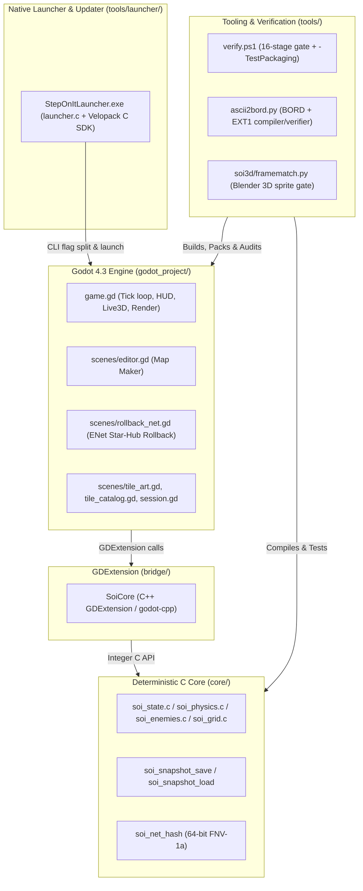

# Step On It! Remastered — AI Agent & Developer Handbook

> **Audience**: AI Agents (Antigravity, Aider, Claude Code, Cursor, Windsurf) & Human Contributors  
> **Status**: Living workspace rule & cold-start handoff guide — update after architectural, tool, or gate changes.  
> **Last Updated**: November 2026

---

## 1. System Architecture & Tech Stack

This project is a faithful preservation and remaster of the 1996 Mac PowerPC game **Step On It!** (Casady & Greene / Webfoot Technologies).



### The 5 Architectural Layers

1. **Deterministic C Core (`core/`)**:
   - Freestanding, integer-only C99/C17 game simulation (`sizeof(SoiWorld) == 17060` bytes).
   - Contains movement/physics, all 16 enemy behaviors, weapons, PvP/Versus rules, score/tally, and `BORD`+`EXT1` level loading.
   - Zero Godot dependencies, zero OS calls, zero heap allocations during tick execution.
   - State snapshotting (`soi_snapshot_save` / `soi_snapshot_load`) takes $\sim0.07\ \mu\text{s}$ via `memcpy`; state hashes via 64-bit FNV-1a (`soi_net_hash`).

2. **C++ GDExtension Bridge (`bridge/`)**:
   - Thin `godot-cpp` wrapper exposing the C core as a `SoiCore` Godot node (stamps `SOI_BUILD_ID` from git SHA).
   - Compiled via portable **Zig** (`bridge/build_zig.ps1`) without requiring MSVC. Zero game logic lives here.

3. **Front-End (`godot_project/`)**:
   - **Godot 4.3** with GDScript (`Session` and `Audio` autoload singletons).
   - `scenes/session.gd`: Mode/board/controller routing, high scores, and **`Session.ext_path(rel)`** packaged-safe external asset resolver.
   - `scenes/game.gd` & `scenes/live3d.gd`: Main game scene, tick dispatch, interpolated 3D tween frames, and real-time GLTF Live3D rig rendering.
   - `scenes/main_menu.gd`: Title screen, board picker, offline/online lobbies, Crockford Base32 join codes, and controller slot claiming.
   - `scenes/editor.gd`, `scenes/tile_catalog.gd`, `scenes/tile_art.gd`: Classic Mac System 7 Map Maker ($19\times13$, $28\times19$, $38\times26$).
   - `scenes/rollback_net.gd`: ENet Star-Hub rollback netcode with 64-snapshot ring buffer, monotonic input scheduling, and `headless_relay.tscn`.
   - `scenes/audio.gd`: Multi-stream audio engine supporting original 8-bit SFX, cleaned 16-bit `wav_hd`, and AudioSR `wav_ai`.

4. **Packaging & Auto-Update Launcher (`tools/launcher/launcher.c`, `tools/publish_velopack.ps1`)**:
   - `StepOnItLauncher.exe` (compiled from `launcher.c` with Velopack `velopack_libc`) checks for delta updates, splits Godot engine flags from `--` game flags, and spawns `StepOnIt.exe` + `StepOnIt.pck` alongside mirrored `extracted/` assets (installed via Velopack to `%LocalAppData%\StepOnIt\current\StepOnItLauncher.exe`).
   - `update_config.json` & private-repo flow: `tools/publish_velopack.ps1` always writes `update_config.json` with `-RepoUrl` (default `https://github.com/seanstappas/step-on-it-remastered`; never ships a placeholder or token). With `-UploadToGitHub`, it resolves `$env:GITHUB_TOKEN` or falls back to `gh auth token`, skips `vpk download github` on a zero-release repo, and passes the token to `vpk`. `SOI_UPDATE_URL` overrides `update_config.json` for local smoke tests (`tools/test_velopack_local.ps1`).
   - Token lookup & embedded fallback: `StepOnItLauncher.exe` resolves GitHub tokens in order `SOI_UPDATE_TOKEN` env var -> `%LOCALAPPDATA%\StepOnIt\update_token.txt` (managed by `--set-update-token <token>` / `--clear-update-token`, which exit without launching) -> `"update_token"` in `update_config.json` -> build-time XOR-masked embedded token compiled into `StepOnItLauncher.exe` (unless `SOI_DISABLE_EMBEDDED_TOKEN=1`) -> anonymous; tokens are never logged. On the dev PC, `tools/set_release_token.ps1` saves the read-only `github_pat_...` token outside git to `%LOCALAPPDATA%\StepOnIt\release_embed_token.txt` (rejecting broad `gho_`/`ghu_` tokens), and `tools/publish_velopack.ps1` generates a transient XOR header during compilation so `update_config.json` and git stay token-free. See [docs/remaster/TESTING_WITH_FRIENDS.md](docs/remaster/TESTING_WITH_FRIENDS.md).

5. **Tools, RE Reference & Asset Pipelines (`tools/`, `analysis/`, `docs/`, `plan/`)**:
   - `extracted/` base SD sprites, audio, palettes, and 152 `.bord` levels **are tracked in git** (4,300+ files), as is `analysis/decomp/` (Ghidra PowerPC decompilation `FUN_<addr>.c`).
   - `raw_game/`, `refs/`, `media/`, `bridge/godot-cpp/`, and heavy generated renders (`extracted/sprites_3d_frames/`, `extracted/pict_hd*`, `extracted/sprites_uhd/`) are **local/gitignored** on disk.

---

## 2. Environment & Execution Invariants (MANDATORY RULES)

### A. Portable Toolchain Paths (`D:\SOI-tools\`) & Virtualenv
- **Python**: **NEVER** invoke bare `python`, `py`, `pytest`, `ruff`, or `mypy`. Always use `.venv\Scripts\python.exe` (or `.venv\Scripts\pytest.exe`).
- **Zig Compiler**: `D:\SOI-tools\zig\zig-windows-x86_64-0.13.0\zig.exe` (note the `\zig\` parent folder!).
- **Godot 4.3 Console**: `D:\SOI-tools\godot\Godot_v4.3-stable_win64_console.exe`
- **Other Local Tools**: `D:\SOI-tools\blender\`, `D:\SOI-tools\velopack\`, `D:\SOI-tools\realesrgan\`, `D:\SOI-tools\ghidra\`.

### B. Windows PowerShell & Native Wildcard Splatting
- Windows PowerShell does **not** have Unix `grep`, `sed`, `awk`, or `cat -flags` (use `git grep` or `Select-String`).
- PowerShell does **not** expand wildcard globs (`core/src/*.c`) for native binaries like `zig.exe`. Always enumerate explicitly:
  ```powershell
  $srcs = (Get-ChildItem core/src/*.c).FullName
  & $Zig cc -std=c17 -Icore/include @srcs ...
  ```

### C. Godot CLI, Off-Screen Rendering & Concurrency
- **Always invoke `.tscn` scenes, never `-s` on `Node` scripts**:
  ```powershell
  & "D:\SOI-tools\godot\Godot_v4.3-stable_win64_console.exe" --headless --path godot_project res://scenes/<scene>.tscn -- <args>
  ```
- **Off-Screen Visual Capture**: `--headless` uses a dummy renderer (blank images). For screenshots/videos without desktop pop-ups, omit `--headless` and pass `--resolution 640x480 --position 9000,9000` (do **not** minimize the window, or Vulkan stops presenting).
- **Single Heavy GPU Job at a Time**: Run **at most one** Blender render or non-headless Godot job concurrently — parallel heavy GPU workloads can destabilize the host PC.

### D. GDScript & Packaged Path Hygiene (`Session.ext_path()`)
- **External Assets**: **NEVER** hardcode `ProjectSettings.globalize_path("res://../extracted/...")` in runtime or editor GDScript; `res://../` fails inside exported `.pck` packages. Always resolve through `Session.ext_path("<subpath>")` (e.g. `Session.ext_path("levels")`, `Session.ext_path("sprites_hd/" + folder)`). Gate `res://../media/screenshots` behind `OS.has_feature("editor")` with fallback to `user://screenshots`.
- **GDScript Preloads & `InputEvent` Safety**:
  - Prefer explicit `const X = preload("res://scenes/...")` over bare `class_name` across scripts so `--headless` CLI runs do not depend on a prior `--editor` cache pass.
  - Never name static functions on preloaded scripts `get_name()`, `get_class()`, `get_path()`, or `duplicate()` (collides with `Resource`/`Object` methods on the `GDScript` instance).
  - Never check `event.echo` on `InputEventJoypadButton` or `InputEventMouseButton` (`echo` exists only on `InputEventKey`).

---

## 3. Verification Gate (`tools/verify.ps1`) & Test Suites

Before completing any non-trivial change, run the full 16-stage gate:

```powershell
powershell -ExecutionPolicy Bypass -File tools/verify.ps1
```

| # | Stage Name | Target | What It Verifies |
|---|---|---|---|
| 1 | `core: mechanic unit tests` | `tests/test_mechanics.c` | All 69 sections of C core mechanics, weapons, AI, Co-op/Compete/Versus, and regressions. |
| 2 | `core: harness + determinism` | `tests/harness.c` | Identical 64-bit state hashes across multi-run executions from the same seed. |
| 3 | `core: rollback synctest` | `tests/test_synctest.c` | 1,000 ticks of continuous 8-tick divergent rollbacks across all 152 boards (0 hash mismatches). |
| 4 | `core: fixture-replay selftest` | `tools/fixture_replay.py` | Recorded input replay against `board_401.bord` via `soi_core.dll`. |
| 5 | `core: creeper chain simulation`| `tools/verify_creepers.c` | 20,000-tick walking-block chain simulation across all 15 Creeper boards. |
| 6 | `tools: ascii2bord unit tests` | `tools/test_ascii2bord.py`| Text-to-binary `.bord` + `EXT1` compilation and edge cases. |
| 7 | `tools: ascii2bord roundtrip` | `tools/ascii2bord.py` | Byte-exact decompile $\to$ compile roundtrip across all 152 original boards. |
| 8 | `art: 3D sprite frames` | `tools/soi3d/framematch.py --check` | Gates all published 3D sprite sets against SD references ($\text{IoU} \ge 0.85$, $\Delta E \le 16$). |
| 9 | `bridge: GDExtension build` | `bridge/build_zig.ps1` | Compiles C core + `godot-cpp` into `godot_project/bin/soi_bridge.*.dll` with `SOI_BUILD_ID`. |
| 10 | `godot: import clean` | `--editor --headless --quit` | Validates resource imports and compiles all GDScripts with zero parse/compile errors. |
| 11 | `godot: run + screenshot` | `game.tscn -- --shot` | Renders off-screen at `(9000, 9000)` and writes verification frame to `media/screenshots/`. |
| 12 | `net: rollback soak test` | `tools/test_net_soak.ps1` | 10,000-tick 3-peer soak under 120ms lag, 30ms jitter, and rift-stall recovery (0 desyncs). |
| 13 | `net: 3-player adversarial soak`| `tools/test_net_adversarial.ps1` | 3-player Star-Hub relay under asymmetric packet loss and random fuzz inputs. |
| 14 | `net: edge cases & peer drops` | `tools/test_net_edge_cases.ps1` | Tick-0 peer drops, Crockford Base32 join codes, build-ID mismatch gating, host disconnect. |
| 15 | `net: online progression & retry`| `tools/test_net_progression.ps1`| Dual-instance campaign board advances, challenge rounds, and retry sync. |
| 16 | `editor: headless map editor` | `editor.tscn -- --test-editor` | Grid sizing ($19\times13$, $28\times19$, $38\times26$), EXT1 odd/even roundtrip, catalog & path audits. |

**Additional Targeted Suites & CI**:
- **Packaging & Delta Update Smoke Test**: `powershell -ExecutionPolicy Bypass -File tools/verify.ps1 -TestPackaging` (invokes `tools/test_velopack_local.ps1`: builds v1.0.0 + v1.0.1 `<5 MB` delta, installs to `%TEMP%`, verifies launch).
- **152-Board Winnability Audit**: `tools/verify_winnable.c` (verifies static reachability across all 152 boards).
- **UI/Controller/Editor Adversarial Suite**: `res://scenes/test_adversarial_m1.tscn` (348 assertions covering joypad claiming, resize clamping, EXT1 parity, hidden block prefixes).
- **Native Launcher CLI Suite**: `tests/test_launcher_cli.c` (18 assertions verifying engine vs `--` user flag splitting).
- **GitHub Actions CI**: `.github/workflows/verify.yml` runs `tools/verify.ps1` on `[self-hosted, windows]`.

---

## 4. Tile System, 3D Sprites & BORD/EXT1 Format

### Cell 32-Bit Encoding
$$\text{Cell} = (\text{Payload} \ll 16) \mid (\text{Flags} \ll 8) \mid \text{LowByteType}$$

- **Behavior Variant Flags (Bits 8–15)**:
  - `0x0100` (`FLAG_BACKGROUND`): Non-solid decorative mesh / background layer.
  - `0x0200` (`FLAG_BREAKABLE`): Standable solid shattered by head-bonking or weapons.
  - `0x0300` (`FLAG_WALL`): Permanent indestructible wall (`0x0100 | 0x0200`).
  - `0x1200` (`FLAG_HIDDEN`): Hidden pickup block (`0x1000 | 0x0200`). **Invariant**: Bits 16–31 (`Payload`) **must** include the `0x0900` pickup prefix (e.g. `0x0917` for Gold Coin, not `0x0017`) so block-break unpacking preserves `CELL_DOOR (0x0800)` + goody art.

### The 25 Authentic Block Families ($\text{Tile ID} = 0\text{x}07 + 6k,\ k \in [0, 24]$, full $32\times32$ frame $= t + 1$)

| $k$ | Type | Frame | Name | $k$ | Type | Frame | Name |
|:---:|:---:|:---:|:---|:---:|:---:|:---:|:---|
| 0 | `0x07` | 8 | White Block | 13 | `0x55` | 86 | Green Square |
| 1 | `0x0D` | 14 | Red Block | 14 | `0x5B` | 92 | Blue Square |
| 2 | `0x13` | 20 | Green Block | 15 | `0x61` | 98 | Pink Square |
| 3 | `0x19` | 26 | Blue Block | 16 | `0x67` | 104 | Black Diamond |
| 4 | `0x1F` | 32 | Pink Block | 17 | `0x6D` | 110 | White Diamond |
| 5 | `0x25` | 38 | White Ball | 18 | `0x73` | 116 | Red Diamond |
| 6 | `0x2B` | 44 | Red Ball | 19 | `0x79` | 122 | Green Diamond |
| 7 | `0x31` | 50 | Green Ball | 20 | `0x7F` | 128 | Blue Diamond |
| 8 | `0x37` | 56 | Blue Ball | 21 | `0x85` | 134 | Pink Diamond |
| 9 | `0x3D` | 62 | Pink Ball | 22 | `0x8B` | 140 | Question Block |
| 10 | `0x43` | 68 | Black Ring | 23 | `0x91` | 146 | Concrete Block |
| 11 | `0x49` | 74 | White Ring | 24 | `0x97` | 152 | Wire Mesh |
| 12 | `0x4F` | 80 | Red Ring | | | | |

> [!WARNING]
> **Legacy Alias Pitfall (`0x0387`)**: Low-byte `0x87` is frame 136 (a $16\times16$ break animation fragment, not a block family). Never emit `0x0387` for blocks.

- **Discrete Player 3 (Crimson) Tiles**: `0x0933` (Red Key), `0x0934` (Closed Red Door), `0x0935` (Opened Red Door — non-supportive).
- **EXT1 Trailer (`24` bytes)**: Magic `EXT1` + custom $W\times H$ + P3 spawn + 4 Versus spawns + lives/mode/victory/FF flags + big-endian CRC-16-CCITT over bytes `0..21`. **Invariants**: Always scan backward with step `-1` (legacy/padded boards may have odd byte lengths), and clamp `p1_spawn`, `p2_spawn`, `p3_spawn`, and all 4 `vs_spawns` when downsizing grids.
- **3D Sprite Remaster Pipeline**: Procedural Blender builders live in `tools/soi3d/builders/` and publish to `extracted/sprites_3d_frames/` (+ `tw/` tweens and `extracted/sprites_live/` GLTF rigs). Always read `plan/SPRITE_REMASTER_PROCESS.md` (§H & §F) and activate the `soi3d-sprite-review` skill when modifying 3D sprites.

---

## 5. Rollback Netcode & Core Determinism Invariants

1. **Monotonic Input Scheduling**: Never compute `target_tick = current_tick + BASE_DELAY` unconstrained; if RTT drops, `BASE_DELAY` shrinks and clobbers an already-confirmed tick. Always enforce `target_tick = max(current_tick + BASE_DELAY, last_scheduled_tick + 1)`.
2. **Deterministic Peer Drops**: Never mutate `SoiWorld` inside async ENet callbacks. Bind disconnects to `peer_drop_tick = last_confirmed_tick + 1` (handling tick-0 drops before any input arrives without host/client off-by-one divergence), zero/confirm future inputs, and apply `_core.drop_player()` inside both live and resimulation loops.
3. **Post-Parse State Restoration & Resimulation Gating**: Restore carried-over player stats (`keep[]`) *after* `BORD` and `EXT1` headers finish parsing. Suppress `Audio.play()`, screen shake, and duplicate particle spawns whenever `is_resimulating == true`.

---

## 6. Quick Developer Runbook

```powershell
# 1. Rebuild C Core + GDExtension DLL
powershell -ExecutionPolicy Bypass -File bridge/build_zig.ps1

# 2. Run C Core Mechanic Unit Tests Standalone (69 sections)
$Zig = "D:\SOI-tools\zig\zig-windows-x86_64-0.13.0\zig.exe"
$srcs = (Get-ChildItem core/src/*.c).FullName
& $Zig cc -std=c17 -O2 -Wall -Wextra -Icore/include -Icore/src @srcs tests/test_mechanics.c -o test_mechanics.exe
.\test_mechanics.exe
Remove-Item test_mechanics.exe, test_mechanics.pdb -ErrorAction SilentlyContinue

# 3. Run 152-Board Byte-Exact Roundtrip & Winnability Checks
.venv\Scripts\python.exe tools/ascii2bord.py verify-roundtrip extracted/levels

# 4. Run Headless Map Editor & Adversarial UI Self-Tests
$Godot = "D:\SOI-tools\godot\Godot_v4.3-stable_win64_console.exe"
& $Godot --headless --path godot_project res://scenes/editor.tscn -- --test-editor
& $Godot --headless --path godot_project res://scenes/test_adversarial_m1.tscn

# 5. Capture Off-Screen Verification Screenshot
& $Godot --resolution 640x480 --position 9000,9000 --path godot_project res://scenes/editor.tscn -- --editorshot

# 6. Build & Smoke-Test Velopack Windows Installer + Delta Update
powershell -ExecutionPolicy Bypass -File tools/verify.ps1 -TestPackaging
```
