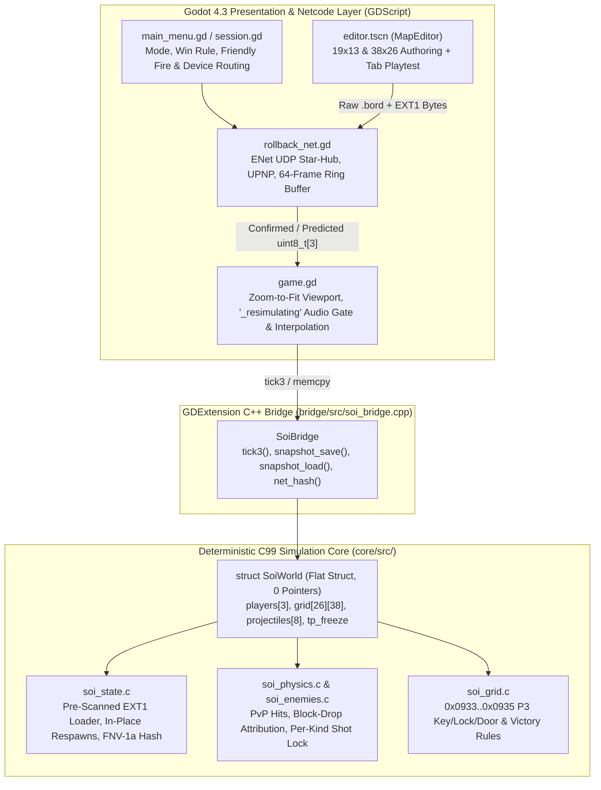
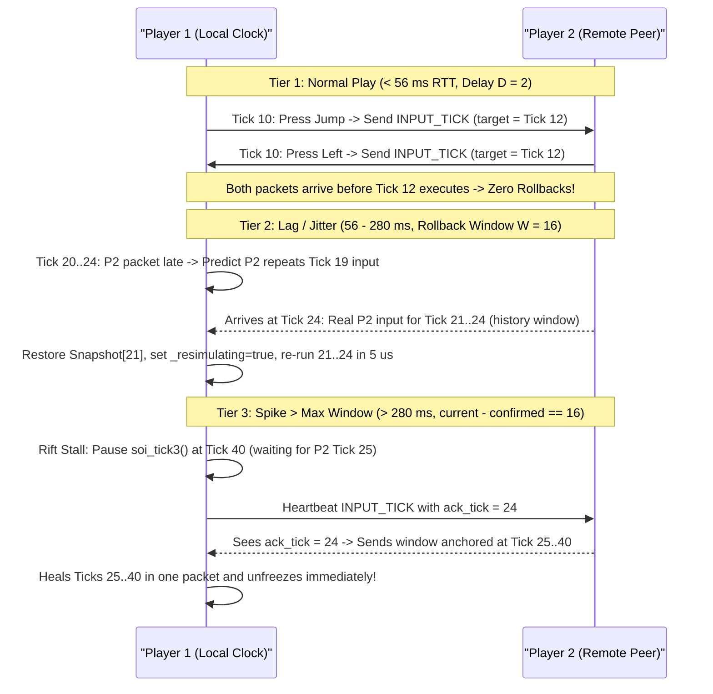
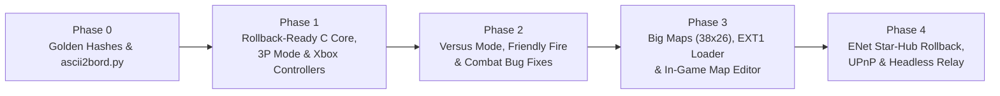

# Step On It! (`steps`) — Multiplayer, 3-Player, Versus, Big Maps & Map Maker Master Plan


> [!IMPORTANT]
> **Scope & Provenance**: This master plan reconciles the architectures, empirical C benchmarks, and 6-lens Goldfish design reviews from `steps-gemini` and `steps-claude` against the C99 simulation core (`core/`) and Godot 4.3 front-end (`bridge/`, `godot_project/`) in `~/tmp/repos/steps`.


---


## 1. Executive Summary & Architectural Decisions


| Pillar | Target Solution | Key Technical Parameters |
| :--- | :--- | :--- |
| **1. Online Multiplayer & Rollback Netcode** | **Hybrid 2-Tick Delay (`D = 2`) + Deterministic Rollback (`W = 16` ticks)** over Godot `ENetConnection` (`UDP`) in `rollback_net.gd` (~250 LOC) backed by raw C struct `memcpy` (`soi_snapshot_save`/`load`). | `sizeof(SoiWorld)` = **6,892 B** (8,260 B with 38×26 Big Maps); `memcpy` = **0.07–0.14 µs**; single tick = **0.07–0.27 µs**; 8-tick rollback = **~5 µs** in C. 64-frame ring buffer = **~431–528 KB** RAM. |
| **2. Topology & NAT Traversal** | **Star-Hub P2P Packet Forwarding via P1** (`P2 <-> P1 <-> P3`) with **symmetric peer rollback** (zero host advantage). 3 connection tiers: (1) In-game `UPNP` + Base32 Join Code, (2) Direct IP over Tailscale/LAN, (3) Bundled `--headless --relay=7777` in the same binary. | 24-byte unreliable UDP input datagram carrying a **16-frame sliding window** of `uint8_t` inputs (`T` down to `T-15`), `ack_tick`, and periodic 64-bit `soi_net_hash`. |
| **3. Lag Escalation & Fault Tolerance** | **4-Tier Latency Handling**: `0–56 ms` absorbed by `D = 2`; `56–280 ms` handled by Rollback (`W = 16`); `280–5,000 ms` enters **Rift Stall** (temporary lockstep freeze + ack-anchored catch-up); `> 5,000 ms` triggers deterministic `DROP_PEER` (3P continues 1v1; 2P ends cleanly). | Includes **Clock-Rift Equalization** ($\pm 2\%$ tick-accumulator nudge when ahead by `> RTT / 2`) and optional **Adaptive Delay** (`D = 2..4` for `> 140 ms` ping). |
| **4. 3-Player Mode (`SOI_MAX_PLAYERS = 3`)** | Expand `w->players[3]`, add `soi_tick3` & spiral fallback spawn `soi_spawn_player3`, Red/Crimson palette shader (`p3_tint.gdshader`), and discrete P3 tile triplet **`0x0933` (Red Key), `0x0934` (Red Lock), `0x0935` (Red Door)**. | Works out-of-the-box on all shipped Co-op boards (`401–501`, universal key/door), all Versus modes, and custom 3P Compete maps (shipped `1001–1050` Compete stays 2P or allows P3 any-door entry). |
| **5. Versus / Duels (`SOI_MODE_VERSUS`) & Friendly Fire** | Add `SOI_MODE_VERSUS = 3` plus a decoupled `w->friendly_fire` toggle (forced `1` in Versus; optional `0/1` in Co-op/Compete). Support **3 Victory Rules**: **Elimination (`SOI_WIN_LIVES`)**, **High Score (`SOI_WIN_SCORE`)**, and **Door Race (`SOI_WIN_DOOR`)**. | Both weapons (`kind = 0` ball, `kind = 1` arrow) hit players; Speed-Shoe (`0x32`) lethal body checks; 120-tick `last_attacker` block-drop kill credit; per-kind projectile lock; reserved player projectile slots; dry-board ammo regen; safe farthest-spawn respawns. |
| **6. Big Maps (`38×26`), `.bord` `EXT1` & Map Maker** | Parameterize grid up to **`38×26` (2x area)** with **zoom-to-fit** rendering below the fixed 48 px HUD. Append a **pre-scanned 24-byte `EXT1` trailer** after the `.bord` `0x00000000` terminator. Two-stage tooling: `tools/ascii2bord.py` CLI first, then in-game `editor.tscn` (`MapEditor`). | Pre-scanning `"EXT1"` in `soi_load_level` sets `w->grid_cols`/`grid_rows` *before* tile loading so `col >= 19` / `row >= 13` tiles are not dropped. Custom maps auto-sync to peers in `MATCH_INIT`. |
| **7. Xbox Controller Support (XInput)** | Per-player `device_id` routing (`-1` KB1, `-2` KB2, `0..3` Joypads) + Lobby *"Press A to Join"* assignment and hotplug pause handling. **Analog stick hysteresis deadzone** (engage `> 0.50`, release `< 0.35`). | Button A  `SOI_IN_JUMP` (`1 << 2`), X  `SOI_IN_BLOCK_HIGH` (`1 << 3`), B  `SOI_IN_BLOCK_LOW` (`1 << 4`), RB/RT  `SOI_IN_ARROW` (`1 << 5`), LB/LT  `SOI_IN_BALL` (`1 << 6`). |





---


## 2. Source-Verified Codebase Bugs & Desync Hazards (Mandatory Fixes)


Inspecting `~/tmp/repos/steps` uncovered **12 pre-existing bugs and architectural traps** that would cause instant desyncs, infinite death loops, or broken 3-player/PvP mechanics if left unaddressed:


| # | Bug / Hazard | Exact Source Location | Root Cause | Mandatory Fix |
| :--- | :--- | :--- | :--- | :--- |
| **B1** | **Multi-Player Respawn Deadlock** | `core/src/soi_state.c:470-503` (`check_respawns`) | `check_respawns` waits until `living_players == 0` and calls `reload_board_on_death`. When P1 dies while P2 is alive, P1 lies dead on the floor forever. | In Compete and Versus, respawn each dead player individually in-place after `respawn_timer` expires (`90` ticks) while `p->lives > 0` without reloading the board. |
| **B2** | **Bonus-Runout Infinite Death Loop on Respawn** | `core/src/soi_state.c:490-500, 619-636` | At `line 634`, `p->bonus_time < 0` clamps `bonus_time = 0`, **zeroes `p->invuln = 0`**, and calls `soi_player_hit`. Because `check_respawns` never resets `rp->bonus_time` (nor `fast`, `jump_t`, `dstep`, `in_pend`, `buf`, `buf_t`), a player who dies from timer runout respawns with `bonus_time = 0` and dies every 3 ticks until all lives are lost. | In `check_respawns`, reset `rp->bonus_time` from the `.bord` header (`be16(w->bord_data + 0x0E)`, fallback `5000`) and zero `fast`, `jump_t`, `dstep`, `in_pend`, `buf`, and `buf_t`. |
| **B3** | **Multi-Hit Farming on Dying Players (`SOI_ST_DEAD`)** | `core/src/soi_physics.c:306-315, 713-719` | `soi_player_hit` sets `p->ground_state = SOI_ST_DEAD` and launches the ~45-tick death parabola, but **leaves `p->alive = 1` and `p->invuln = 0`** until `p->y >= IN_AIR_DEATH_Y` calls `commit_death`. Checking only `!p->alive` allows a projectile to hit a somersaulting corpse on every overlapping frame (`+1000` score and `kills++` per tick). | Guard all PvP projectile and body-check collisions with `p->ground_state != SOI_ST_DEAD`, and despawn rolling balls (`kind = 0`) immediately upon hitting a player. |
| **B4** | **P3 Silver Coin (`0x0A`), Lock (`0x0907`) & Door (`0x0904`) Collisions** | `core/src/soi_grid.c:289, 325-336, 399` | Key formula `player + 7` maps P3 (`player = 3`) to `10` (`0x0A`), which is `SOI_TILE_COIN_SILVER` (`+500` pts). Lock formula `t - 3` lands on `0x0907` (Universal Key), and Door formula `player + 1` lands on `0x0904` (Universal Lock, blocked by `t <= 3u` at `line 289`). | Allocate discrete P3 tile IDs: **`0x0933` (Red Key), `0x0934` (Red Lock), `0x0935` (Opened Red Door)** with explicit branches in `soi_pickup_check` and `game.gd:_draw_cell`. |
| **B5** | **`.bord` Trailer Parse Order Drops Big-Map Tiles** | `core/src/soi_state.c:273-368`, `core/src/soi_grid.c:12, 23` | `soi_set_cell` calls `soi_in_bounds(col, row)` during the `0x18` tile loop. If the `EXT1` trailer at the end of `.bord` is parsed *after* the tile loop, every tile at `col >= 19` or `row >= 13` is silently rejected. | Pre-scan for the `"EXT1"` trailer (checking `off` and `off + 2` after the `0x00000000` terminator) at the very top of `soi_load_level` before placing players or reading tile records. |
| **B6** | **Mode Clamping, Key Leak & `w->challenge` Death Bypass** | `soi_state.c:164, 295, 307`, `soi_grid.c:232`, `soi_physics.c:312` | (1) `soi_set_play_mode` rejects modes `> SOI_MODE_COMPETE (2)`. (2) `give_key` shares keys with all players whenever `play_mode != SOI_MODE_COMPETE`. (3) `soi_load_level` sets `w->challenge = 1` on any board with a Knight or Gargoyle, and `commit_death` (`soi_physics.c:312`) returns early when `w->challenge == 1`, preventing life loss or respawns in Versus. | Widen `soi_set_play_mode` to `SOI_MODE_VERSUS (3)`; make `give_key` per-player in both `COMPETE` and `VERSUS`; force `w->challenge = 0` when `play_mode == SOI_MODE_VERSUS`. |
| **B7** | **Weapon Naming Inversion (`ARROW` vs. `BALL`)** | `core/src/soi_enemies.c:1330-1397`, `soi_physics.c:670-673` | `SOI_IN_ARROW` (`1 << 5`) calls `soi_ball_fire`, which consumes `p->balls` and fires `kind = 1` (straight horizontal Magic Arrow). `SOI_IN_BALL` (`1 << 6`) calls `soi_projectile_fire`, which consumes `p->arrows` and fires `kind = 0` (4-state terrain-hugging Magic Ball). | Preserve C internals for replay compatibility, but document and label HUD counters, controller prompts, and editor pickups by actual behavior (`Straight Arrow` vs. `Rolling Ball`). |
| **B8** | **7-Second Disarm Lock & 8-Slot Projectile Pool Starvation** | `core/src/soi_enemies.c:1296-1304, 1512`, `soi_core.h:26` | `player_has_projectile` blocks firing *any* weapon while a player's 500-tick (~7.0 s) rolling ball (`kind = 0`) is alive. Worse, all players and enemies share `w->projectiles[8]`; enemy fire on busy boards fills all 8 slots and silently drops player shots. | Split `player_has_projectile(w, player, kind)` by `kind` when `friendly_fire != 0`, cap `kind = 0` life to `180` ticks (2.5 s) in PvP, and reserve 1 projectile slot per active player (`8 - active_players` max hostile slots). |
| **B9** | **Block Creation Over Living Players** | `core/src/soi_physics.c:118` (`block_toggle`) | `block_toggle` checks `if (soi_enemy_at(w, col1 - 1, row1 - 1) >= 0) return;` but never checks `soi_player_at`, allowing players to entomb opponents or trap spawn points inside solid blocks. | Add `if (soi_player_at(w, col1 - 1, row1 - 1) >= 0) return;` to `block_toggle`, and shatter any breakable block occupying a chosen respawn cell in `check_respawns`. |
| **B10** | **`soi_serialize` Hash Blindness & Uninitialized `bord_data` Tail** | `core/src/soi_state.c:864-965`, `soi_internal.h:166-259` | `soi_serialize` (4,066 B) omits `bonus_div`, `level_loaded`, `input_assist`, `in_pend`/`buf`/`buf_t`, `prev_pcol`/`prev_prow`, and all 577 B of `sw_*` switch state. `soi_state_hash` only hashes those 4,066 B, making it blind to switch or input-buffer desyncs. | Keep `soi_serialize` untouched for `.soisnap` v1 files. Add `soi_snapshot_save`/`load` (`memcpy` of `SoiWorld`), zero-pad `w->bord_data` in `soi_load_level`, and hash all simulation fields in `soi_net_hash`. |
| **B11** | **`input_assist` Wipe on Reload & Local `F2` Desync** | `core/src/soi_state.c:131, 433`, `godot_project/scenes/game.gd:1268` | `soi_next_level` and `reload_board_on_death` re-init `SoiWorld` and restore `rng_seed` and `play_mode`, **dropping `w->input_assist`**. Meanwhile, pressing `F2` in `game.gd:1268` calls `_core.set_input_assist()`, mutating physics locally mid-match. | Save/restore `w->input_assist` (and `friendly_fire`, `victory_rule`) across `soi_next_level` and `reload_board_on_death`. Lock `input_assist` to `MATCH_INIT` during netplay and decouple `F2` art toggling from `set_input_assist`. |
| **B12** | **GDScript `_tp_frames`, `_sg_*` Switch State, `111 Hz` Default & Meta-Keys** | `godot_project/scenes/game.gd:125, 1410-1462, 1700-1729`, `session.gd:11` | (1) `_tp_frames` pauses `_core.tick()` in GDScript for 211 frames on teleport. (2) `_sg_toggled` duplicates `w->sw_*` in GDScript. (3) `session.gd:11` defaults `speed = 0` (`111 Hz`, not `71 Hz`). (4) `Esc` (`abort_game`), `Enter` (`_advance_level`), and `P` mutate state locally. | Move `tp_freeze` into `SoiWorld` (disabled in Compete/Versus); drive switch visuals from C `w->sw_*`; sync `speed` (default `2` = `71 Hz`) in `MATCH_INIT`; route tally confirm via bit 7 (`SOI_IN_META_CONFIRM`) and make `Esc` open a local Leave overlay in netplay. |


---


## 3. Pillar 1: Deterministic Rollback Netcode & Transport Architecture


### 3.1 Why Hybrid 2-Tick Delay (`D = 2`) + 16-Tick Rollback (`W = 16`) Wins


1. **Odd-Tick Input Cadence (`frame_parity`) Makes `D = 2` Free**:
  - In `core/src/soi_state.c:524-537`, normal players without Speed Shoes (`ip->fast == 0`) only sample inputs on odd ticks (`(w->tick & 1u) != 0u`, ~35.7 Hz at the 71.4 Hz medium speed):
    ```c
   const int sample = ((w->tick & 1u) != 0u) || ip->fast > 0;
   if (w->input_assist) {
       ip->in_pend |= ins[i];
       if (sample) { ip->input = ip->in_pend; ip->in_pend = 0; }
   } else if (sample) {
       ip->input = ins[i];
   }
    ```
  - Furthermore, `godot_project/scenes/game.gd:55` already interpolates visual rendering over `SMOOTH_DELAY = 2.0` ticks (`28 ms`).
  - Scheduling local inputs for `current_tick + 2` (`D = 2`) adds **zero perceived latency** over offline play and absorbs up to **56 ms RTT with zero rollbacks**.
2. **Rollback (`W = 16` ticks, 64-Frame Ring Buffer) Eliminates Stalls up to ~280 ms**:
  - When RTT exceeds 56 ms or Wi-Fi/Tailscale packets jitter, the engine predicts each remote player's input by repeating their last confirmed `uint8_t` bitmask (`pred[p][t] = confirmed[p][t - 1]`).
  - When a packet arrives with a mispredicted input at `t_recv < current_tick`, the engine restores `ring_buffer[t_recv % 64]` via `memcpy`, sets `_resimulating = true`, re-runs `soi_tick3()` from `t_recv` to `current_tick` (taking **~5 µs** in C), prunes render history `_hist` and `_grid_snaps` for ticks $\ge t_{\text{recv}}$, and sets `_resimulating = false`.
3. **Zero-Lag Local Audio via `_resimulating` Gate**:
  - During normal ticks (`_resimulating == false`), sound effects and debris particles fire immediately with zero artificial delay.
  - During rollback fast-forward ticks (`_resimulating == true`), `Audio.play()` and transient particle spawns in `game.gd` are suppressed so rollbacks never "machine-gun" duplicate sounds.


### 3.2 C Core Snapshot & Full-State Hash API (`soi_core.h` / `soi_state.c`)


Keep `soi_serialize` (4,066 B) and `soi_state_hash` untouched so existing `.soisnap` v1 fixtures remain 100% compatible. Add three dedicated rollback functions to `core/include/soi_core.h` and expose them on `SoiBridge`:


```c
/* Returns sizeof(struct SoiWorld) for ring-buffer allocation. */
size_t soi_snapshot_size(void);


/* Raw memcpy of struct SoiWorld (~0.07 us). */
void soi_snapshot_save(const SoiWorld *w, uint8_t *dst_buf);
void soi_snapshot_load(SoiWorld *w, const uint8_t *src_buf);


/* 64-bit FNV-1a hash over all deterministic simulation fields of SoiWorld
* (including bonus_div, level_loaded, input_assist, per-player in_pend/buf/buf_t,
* prev_pcol/prev_prow, sw_* switch arrays, and tp_freeze; excluding transient
* sfx_queue/fx_queue output buffers). */
uint64_t soi_net_hash(const SoiWorld *w);
```


### 3.3 Wire Protocol & Packet Formats (`rollback_net.gd`)


All online traffic runs over Godot's built-in `ENetConnection` (`UDP`) using two channels:
* **Channel 0 (Reliable Ordered)**: `MATCH_INIT`, `BOARD_LOAD`, `DROP_PEER`.
* **Channel 1 (Unreliable Unsequenced)**: `INPUT_TICK`, `PING_RIFT`.


#### Packet 1: `MATCH_INIT` / `BOARD_LOAD` (Channel 0, Reliable)
Sent before Tick 0 of each board to guarantee identical simulation parameters across all peers:
```text
+0x00: uint8_t  pkt_type      (0x01 = MATCH_INIT, 0x02 = BOARD_LOAD)
+0x01: uint8_t  num_players   (2 or 3)
+0x02: uint8_t  local_slot    (assigned seat: 0 = P1, 1 = P2, 2 = P3)
+0x03: uint8_t  play_mode     (1 = Co-op, 2 = Compete, 3 = Versus)
+0x04: uint8_t  victory_rule  (0 = Lives, 1 = Score, 2 = Door)
+0x05: uint8_t  friendly_fire (0 or 1)
+0x06: uint8_t  input_assist  (0 or 1 — locked for entire match)
+0x07: uint8_t  speed_idx     (default 2 = 71 Hz; host-selectable 0..4)
+0x08: uint8_t  base_delay    (default 2 ticks)
+0x09: uint8_t  start_lives   (default 2 in C = 3 total lives)
+0x0A: uint16_t bord_len      (big-endian length, up to 8,192 B)
+0x0C: uint32_t rng_seed      (initial deterministic seed)
+0x10: uint8_t  bord_bytes[]  (exact raw .bord + EXT1 payload)
```


#### Packet 2: `INPUT_TICK` (Channel 1, Unreliable — 28 Bytes)
Sent every tick by each peer. Carries a **16-frame sliding window** of `uint8_t` input bitmasks anchored at `head_tick` (or `peer_ack_tick + 16` during Rift Stall recovery):
```text
+0x00: uint8_t  pkt_type      (0x10 = INPUT_TICK)
+0x01: uint8_t  player_slot   (0 = P1, 1 = P2, 2 = P3)
+0x02: int16_t  tick_rift     (local_tick - latest_remote_tick, for clock sync)
+0x04: uint32_t head_tick     (newest tick in inputs[0])
+0x08: uint32_t ack_tick      (highest contiguous confirmed tick from remote peer)
+0x0C: uint32_t hash_tick     (confirmed tick for desync check, every 8 ticks)
+0x10: uint32_t state_hash32  (lower 32 bits of soi_net_hash at hash_tick)
+0x14: uint8_t  inputs[8..16] (sliding window: inputs[k] = bitmask at head_tick - k)
```
* **Input Byte Bitmask (`uint8_t`)**:
 - Bit 0 (`0x01`): `SOI_IN_LEFT`
 - Bit 1 (`0x02`): `SOI_IN_RIGHT`
 - Bit 2 (`0x04`): `SOI_IN_JUMP`
 - Bit 3 (`0x08`): `SOI_IN_BLOCK_HIGH`
 - Bit 4 (`0x10`): `SOI_IN_BLOCK_LOW`
 - Bit 5 (`0x20`): `SOI_IN_ARROW` (fires `kind = 1` Straight Arrow)
 - Bit 6 (`0x40`): `SOI_IN_BALL` (fires `kind = 0` Rolling Ball)
 - Bit 7 (`0x80`): `SOI_IN_META_CONFIRM` (advances post-round tally/victory screen deterministically)


### 3.4 Latency Escalation, Rift Stall & Clock-Rift Equalization





| Condition | Mechanism | Behavior |
| :--- | :--- | :--- |
| **Clock Drift ("One-Sided Rollback")** | **Half-RTT Rift Equalization** | Each peer computes `rift = (local_tick - remote_tick) - (rtt_ticks / 2)`. If `rift > 1.5` ticks for 30 consecutive frames, the faster peer stretches its tick accumulator by `+2%` (or skips 1 sub-step) until both clocks center. |
| **High Transcontinental Ping (`> 140 ms`)** | **Adaptive Base Delay (`D = 2..4`)** | Default `D = 2` (`28 ms`). If rolling average RTT exceeds `140 ms` (`10` ticks), lobby or auto-tuner can bump `D` to `3` or `4` ticks so rollbacks stay 4 frames. |
| **Lag Spike Exceeds `W = 16` (`> 280 ms`)** | **Rift Stall + Ack-Anchored Catch-Up** | When `current_tick - last_confirmed_tick == W`, `soi_tick3()` pauses so `ring_buffer` cannot overwrite unconfirmed snapshots. Remote peer inspects `ack_tick` and transmits input windows starting at `ack_tick + 1` until caught up. Shows *"Waiting for Player X..."* after `500 ms`. |
| **Full Disconnect (`> 5,000 ms`)** | **Deterministic `DROP_PEER` / Timeout** | In a 3P match, P1 stamps a reliable `DROP_PEER(slot, target_tick)` message; surviving peers set `w->players[slot].active = 0; eliminated = 1;` on `target_tick` and finish 1v1. In a 2P match, transitions cleanly to the lobby with a disconnect banner. |


### 3.5 Star-Hub Topology & 3-Tier Connection Model


* **Why Star-Hub P1 Forwarding Beats 3-Peer Mesh**:
 - In a 3-player session, P2 and P3 connect **only** to P1 (`P2 <-> P1 <-> P3`). Whenever P1 receives an `INPUT_TICK` from P2, P1 immediately forwards those 28 bytes to P3 (and vice versa).
 - P2 and P3 never have to open router ports to each other, yet **all 3 peers run symmetric local rollback** (`P1` does not broadcast authoritative state, so `P1` has zero host input-delay advantage).
* **3 Connection Tiers (Zero External Server Repo)**:
 1. **Tier 1 — In-Game `UPNP` Host + Join Code**: P1 clicks *Host Online*; a background `Thread` runs Godot's `UPNP.discover()` + `add_port_mapping(7777, 7777, "StepOnIt", "UDP")` and encodes ` external_ip:7777` into a short clipboard Join Code (`SOI-XXXX-XXXX`).
 2. **Tier 2 — Direct IP (Tailscale / LAN)**: Peers paste a Tailscale IP (`100.x.y.z:7777`) or LAN IP (`192.168.x.y:7777`) directly; works when UPnP is disabled on home routers.
 3. **Tier 3 — Bundled Headless Relay (`--headless --relay=7777`)**: Launching the **exact same game binary** with `--headless --relay=7777` on any VPS runs an ~80-line stateless UDP room forwarder for players behind strict Carrier-Grade NAT (CGNAT) without Tailscale.


---


## 4. Pillar 2: 3-Player Mode (`SOI_MAX_PLAYERS = 3`)


### 4.1 C Core & GDExtension Expansion
1. **Header Constants (`core/include/soi_core.h`)**:
  - Raise `#define SOI_MAX_PLAYERS 3` (from `2`).
  - Add `void soi_tick3(SoiWorld *w, uint8_t p1_in, uint8_t p2_in, uint8_t p3_in);` (keeping `soi_tick(w, p1, p2)` as a wrapper calling `soi_tick3(w, p1, p2, 0)` so all existing tests and Python scripts compile unmodified).
  - Add `void soi_spawn_player3(SoiWorld *w);` and `void soi_limit_players(SoiWorld *w, int max_players);`.
2. **Spawn Fallback Algorithm (`soi_spawn_player3` in `core/src/soi_state.c`)**:
  - If the `.bord` file contains an `EXT1` trailer with an explicit P3 spawn `(p3_col, p3_row)`, spawn P3 there with block template `0x020D` (Red player block, sprite 104).
  - Otherwise, test `(col = 9, row = 1)` (top-center) and spiral outward via Manhattan distance from midpoint `(p1_spawn + p2_spawn) / 2` to find the first `2`-tile-tall empty column (`CELL_EMPTY` at `(c, r)` and `(c, r-1)` with solid floor or ladder-free support at `(c, r+1)`), defaulting to `p1_spawn` if none is found.


### 4.2 Discrete P3 Key, Lock & Door Tile Triplet (`0x0933..0x0935`)
To avoid colliding with `0x0A` (Silver Coin), `0x0907` (Universal Key), and `0x0904` (Universal Lock) in `core/src/soi_grid.c`:
* **`0x0933`**: **P3 Red Key** (pickupable only by `player == 3`, sets `p->keys |= (1u << 10)`).
* **`0x0934`**: **P3 Red Lock** (unlocked when `player == 3` holds `0x0933`, converting cell to `0x0935`).
* **`0x0935`**: **P3 Opened Red Door** (triggers board win for `player == 3` on entry).


| Game Mode | Board Set | How Player 3 Works |
| :--- | :--- | :--- |
| **Co-op (`SOI_MODE_COOPERATE`)** | Shipped Boards `401–501` & Custom | Shipped Co-op boards use Universal Key `0x0907`, Universal Lock `0x0904`, and Universal Door `0x0901`. **3-Player Co-op works across all 101 shipped boards immediately.** |
| **Compete (`SOI_MODE_COMPETE`)** | Shipped Boards `1001–1050` & Custom | Empirical scan showed 0/50 shipped Compete boards have universal keys/doors (all use P1 Blue + P2 Green pairs). Default shipped Compete to 2P, or enable a lobby toggle (*"3P Compete: P3 Can Use Any Key/Door"*), and use `0x0933..0x0935` on custom 3P Compete boards. |
| **Versus (`SOI_MODE_VERSUS`)** | Any Shipped (`401–501`, `1001–1050`) or Custom Board | **Elimination (`SOI_WIN_LIVES`)** and **High Score (`SOI_WIN_SCORE`)** require no P3 doors and work on all 152 shipped boards + custom arenas with 2 or 3 players. **Door Race (`SOI_WIN_DOOR`)** works on Co-op boards (shared door race) and custom 3-door boards. |


### 4.3 P3 Visuals & HUD (`godot_project/scenes/game.gd`)
* **Red/Crimson Shader (`p3_tint.gdshader`)**: Remaps the P1 green/blue tunic pixels to Crimson Red (`#E53935` highlight, `#8E0000` shadow) for P3's character sprite, block (`0x020D`), key (`0x0933`), lock (`0x0934`), and door (`0x0935`).
* **3-Column Top HUD (`48 px` bar)**: Dynamically splits the 608 px top bar into 3 equal `202 px` panels when `num_players == 3` (`P1 Blue | P2 Green | P3 Red`), displaying Lives/Kills, Score, Ammo (`Arrows` / `Balls`), Held Keys, and Bonus Timer.


---


## 5. Pillar 3: Versus / Duels Mode (`SOI_MODE_VERSUS`) & Friendly Fire


### 5.1 Mode Definition, Decoupled Friendly Fire & Victory Rules
Add to `core/include/soi_core.h`:
```c
#define SOI_MODE_VERSUS 3


typedef enum SoiVictoryRule {
   SOI_WIN_LIVES = 0, /* Last player standing (default 3 lives) */
   SOI_WIN_SCORE = 1, /* Highest score when goodies cleared / timer expires */
   SOI_WIN_DOOR  = 2  /* First player to unlock and exit their door */
} SoiVictoryRule;
```
* **Decoupled `w->friendly_fire`**:
 - Forced to `1` when `w->play_mode == SOI_MODE_VERSUS`.
 - Optional lobby checkbox (`0` or `1`) in **Co-op** (`SOI_MODE_COOPERATE`) and **Compete** (`SOI_MODE_COMPETE`) so friends can enable PvP weapon hits and block-drops during normal campaign play.
* **Original Enemies Active**:
 - Shipped board enemies remain active in Versus. Dying to an enemy, pit fall, or bonus timer runout deducts 1 life from the victim (unless caused by an opponent's block-drop within 120 ticks, which awards the frag to the attacker).


### 5.2 PvP Combat Mechanics & Arena Balance (`soi_physics.c` & `soi_enemies.c`)


1. **Direct Projectile Hits (`weapon_hit_player`)**:
  - Inside `soi_projectiles_update` (`core/src/soi_enemies.c`), when `w->friendly_fire != 0` and a player-owned projectile (`pr->owner >= 1 && pr->owner <= 3`) overlaps another player `v != pr->owner`:
  - Check `v->active && v->alive && !v->eliminated && v->ground_state != SOI_ST_DEAD && v->invuln == 0`.
  - Call `soi_player_hit(w, v_idx)`, despawn `pr->active = 0` (for **both** `kind = 1` straight arrows and `kind = 0` rolling balls), increment `attacker->kills++`, and add `+1000` to `attacker->score`.
2. **Speed-Shoe Lethal Body Check (`p->fast > 0`)**:
  - When a player has active Speed Shoes (`p->fast > 0` from goody `0x32`, `core/src/soi_grid.c:445`) and collides horizontally (`|p1->x - p2->x| < 20 && |p1->y - p2->y| < 24`) with an opponent who does *not* have Speed Shoes (and `invuln == 0`, `ground_state != SOI_ST_DEAD`), the charging player body-checks the opponent (`soi_player_hit`), earning `+1000` score and `kills++`. (If both have Speed Shoes, they bounce apart `vx = -vx` with `SFX_BONK`).
3. **Indirect Block-Drop Kill Attribution (`last_attacker`, `attacker_ttl = 120`)**:
  - Add `uint8_t last_attacker;` and `uint16_t attacker_ttl;` to `struct SoiPlayer` (`core/src/soi_internal.h`).
  - Whenever Player $A$ shatters or toggles a block at `(col, row)` (`block_toggle` at `soi_physics.c:106` or head-bonk at `soi_physics.c:253`) and Player $B$ was supported by `(col, row)` (`B->row == row - 1 && abs(B->x - col*32) <= 24`), set `B->last_attacker = A; B->attacker_ttl = 120;` (~1.7 seconds, decremented each tick until `B` lands safely on solid ground).
  - If Player $B$ dies to a pit (`y >= IN_AIR_DEATH_Y`) or enemy while `B->attacker_ttl > 0`, credit Player $A$ with `+1000` score and `A->kills++`.
4. **Per-Kind Projectile Lock, Pool Reservation & Ammo Economy**:
  - **Per-Kind Firing Lock**: Change `player_has_projectile(w, player)` (`soi_enemies.c:1296`) to `player_has_projectile_kind(w, player, kind)` when `w->friendly_fire != 0`. Players can have **1 rolling ball (`kind = 0`) AND 1 straight arrow (`kind = 1`)** active simultaneously.
  - **Wall-Follower Lifespan Cap**: Cap `kind = 0` lifetime to `180` ticks (`2.5 s`) instead of `500` ticks (`7.0 s`) when `w->friendly_fire != 0`.
  - **Projectile Slot Reservation**: Enemy projectile spawners (`soi_enemies.c:1338, 1380`) may only allocate if `active_hostile_projectiles < SOI_MAX_PROJECTILES - active_players`, guaranteeing every player always has a slot to fire.
  - **Respawn Refill & Dry-Board Regen**: On in-place respawn, ensure `rp->arrows = MAX(rp->arrows, 1)` and `rp->balls = MAX(rp->balls, 1)`. In Versus, if a player has `0` straight arrows (`rp->balls == 0`), increment `rp->ammo_regen_cd` each tick and grant `+1` straight arrow at `300` ticks (`~4.2 s`).
5. **Safe Farthest-Point In-Place Respawn**:
  - Candidate spawn points in Versus: `[p1_spawn, p2_spawn, p3_spawn, versus_extra_spawns...]`.
  - Pick the candidate cell `(c, r)` that maximizes minimum Manhattan distance to all living opponents and enemies.
  - If a player-placed breakable block occupies `(c, r)` or `(c, r - 1)`, call `soi_block_shatter(w, c, r)` on respawn.
  - Reset `bonus_time` and physics buffers (Bug B2) and grant `rp->invuln = 120` ticks (`1.7 s` blinking shield, cancelled early if the respawning player presses Fire or Block).


---


## 6. Pillar 4: Big Zoomed-Out Maps (`38×26`), `.bord` `EXT1` Format & Map Maker


### 6.1 Binary `.bord` `EXT1` Trailer Format (24 Bytes)
All 152 original `.bord` files retain 100% byte-for-byte compatibility. Custom maps append a **24-byte `EXT1` trailer** immediately after the legacy `0x00000000` tile-stream terminator (and optional 2-byte legacy footer):


```text
Offset  Type      Field              Description
+0x00   char[4]   magic              ASCII "EXT1" (0x45, 0x58, 0x54, 0x31)
+0x04   uint8_t   version            1
+0x05   uint8_t   flags              bit0=has_p3, bit1=friendly_fire, bit2=big_map
+0x06   uint8_t   grid_cols          19..38 (default 19)
+0x07   uint8_t   grid_rows          13..26 (default 13)
+0x08   uint8_t   p3_col             P3 spawn column (1-based, 0 = auto spiral)
+0x09   uint8_t   p3_row             P3 spawn row (1-based, 0 = auto spiral)
+0x0A   uint16_t  p3_block           Big-endian P3 block word (default 0x020D)
+0x0C   uint8_t   vs_spawns[4][2]    4 extra Versus arena spawn (col, row) pairs
+0x14   uint8_t   victory_rule       0=Lives, 1=Score, 2=Door
+0x15   uint8_t   starting_lives     1..9 (default 3)
+0x16   uint16_t  crc16              CRC-16-CCITT over [0x00..+0x15]
```


* **Pre-Scan Loader Rule in `soi_load_level` (`core/src/soi_state.c:215`)**:
 1. Before placing P1/P2 or looping over tile records at `0x18`, scan forward from `0x18` in 4-byte steps to locate the `0x00000000` terminator at `term_off`.
 2. Check both `term_off + 4` and `term_off + 6` (accounting for the 2-byte legacy pad) for `"EXT1"`.
 3. If found and valid, set `w->grid_cols = clamp(ext.grid_cols, 19, 38)` and `w->grid_rows = clamp(ext.grid_rows, 13, 26)` **before** running the `0x18` tile loop so `soi_in_bounds(w, col, row)` accepts all Big-Map tiles up to `38×26`.


### 6.2 Big-Map Engine & Viewport Scaling (`19×13`  `38×26`)
* **C Core Constants (`core/include/soi_core.h`, `core/src/soi_internal.h`)**:
 - `#define SOI_MAX_GRID_COLS 38` and `#define SOI_MAX_GRID_ROWS 26`.
 - `#define SOI_BORD_MAX 8192` (up from `1024`, accommodating up to `38 × 26 = 988` four-byte tile records + header + `EXT1`).
 - Dynamic pit death line in `core/src/soi_physics.c`: replace hardcoded `IN_AIR_DEATH_Y (446)` with `soi_death_y(w) = (w->grid_rows - 1) * 32 + 62` (`446 px` for 13 rows; `862 px` for 26 rows).
 - Scale Knight gift / Gargoyle egg flight timeout in `core/src/soi_enemies.c` proportionally with `(w->grid_cols + w->grid_rows)`.
* **Zoom-to-Fit Viewport (`godot_project/scenes/game.gd`)**:
 - Keep the top HUD fixed at `608 × 48 px` (`y = 0..47`).
 - Compute `scale_x = 19.0 / float(grid_cols)` and `scale_y = 13.0 / float(grid_rows)`, applying `zoom = min(scale_x, scale_y)` to the playfield `Node2D` transform below `y = 48`. (Camera follow is explicitly rejected so players never lose sight of incoming 4 px/frame straight arrows, teleporter exits, or switch states across the arena).


### 6.3 Two-Stage Map Maker (`tools/ascii2bord.py` + `godot_project/scenes/editor.tscn`)
1. **Stage 1 — Offline Text-to-BORD Compiler (`tools/ascii2bord.py` — Built in Phase 0)**:
  - Converts human-readable YAML/ASCII grid files into binary `.bord` + `EXT1` files (and decompiles `.bord` $\rightarrow$ ASCII). Unlocks immediate authoring of 3P, Versus, and 38×26 test boards before GUI code is written.
2. **Stage 2 — In-Game Visual Map Maker (`godot_project/scenes/editor.tscn` / `editor.gd` — Built in Phase 3)**:
  - Reuses `game.gd`'s exact atlas rendering (`_draw_cell`) so editor visuals match gameplay 1:1.
  - **Left/Bottom Palette**: Terrain blocks, Ice, Conveyors, Teleporters, Switch groups (`0..4`), Hazards, Goodies, Keys/Locks/Doors (`P1 Blue`, `P2 Green`, `P3 Red 0x0933..0x0935`, `Universal`), Enemies (`0..8` with direction toggle), and Spawn Markers (`P1`, `P2`, `P3`, `VS1..4`).
  - **Top Toolbar**: Map Size (`19×13` Standard, `28×19` Medium 1.5x, `38×26` Large 2x), Default Mode (`Co-op`, `Compete`, `Versus`), Victory Rule (`Lives`, `Score`, `Door`), Friendly Fire toggle, Time Bonus, and P1/P2/P3 Block Style selectors.
  - **Live Validation & Instant `Tab` Playtest**: Checks that required spawns exist and keys match locks/doors; pressing `Tab` launches `game.gd` in-memory immediately and returns to the cursor position on `Tab`/`Esc`.
  - **Storage & Zero-Config Netplay Sync**: Saves to `user://custom_maps/<name>.bord`. When a host selects a custom map in an online lobby, `MATCH_INIT` embeds the raw `.bord` bytes (`<= 8,192 B`) so joining peers play it immediately without downloading files manually.


---


## 7. Pillar 5: Native Xbox Controller Support (XInput)


### 7.1 Device Routing & Lobby Assignment (`session.gd` & `game.gd`)
* Store `player_device[3] = [-1, -2, 0]` in `session.gd`:
 - `-1`: Keyboard P1 (`WASD` / Arrow Keys)
 - `-2`: Keyboard P2 (`IJKL` / Numpad)
 - `0..3`: Godot Joypad `device_id` (`Input.get_connected_joypads()`)
* In local 2P/3P lobbies, players press **`A` (Xbox) / `Enter` / `Space`** to claim a slot (`P1`, `P2`, `P3`).
* Connect `Input.joy_connection_changed(device, connected)` in `game.gd`: if an assigned controller disconnects during a local match, auto-pause and show *"Controller Disconnected — Reconnect or press Space to switch to Keyboard"*.


### 7.2 Button Mapping & Analog Stick Hysteresis Deadzone


| Action | Engine Bitmask (`soi_core.h`) | Xbox Controller Input | Notes |
| :--- | :--- | :--- | :--- |
| **Move Left / Right** | `SOI_IN_LEFT` (`1 << 0`) / `SOI_IN_RIGHT` (`1 << 1`) | **D-Pad Left/Right** or **Left Stick X** | **Hysteresis deadzone**: engage at `|axis_x| > 0.50`, release at `|axis_x| < 0.35` to prevent 1-tick turn-around waste (`soi_physics.c:559`). |
| **Jump** | `SOI_IN_JUMP` (`1 << 2`) | **Button A** (`JOY_BUTTON_A`) *(+ optional D-Pad Up comfort toggle)* | Primary jump on `A` prevents accidental jumps when pressing Left/Right on the thumbstick. |
| **Block High (Head Level)** | `SOI_IN_BLOCK_HIGH` (`1 << 3`) | **Button X** (`JOY_BUTTON_X`) or **Button Y** (`JOY_BUTTON_Y`) | Creates/shatters block at `(col ± 1, row - 1)`. |
| **Block Low (Foot Level)** | `SOI_IN_BLOCK_LOW` (`1 << 4`) | **Button B** (`JOY_BUTTON_B`) | Creates/shatters block at `(col ± 1, row)`. |
| **Fire Straight Arrow** | `SOI_IN_ARROW` (`1 << 5`) | **Right Bumper (`RB`)** or **Right Trigger (`RT > 0.40`)** | Fires horizontal 4 px/frame Magic Arrow (`kind = 1`, uses `p->balls`). |
| **Fire Rolling Ball** | `SOI_IN_BALL` (`1 << 6`) | **Left Bumper (`LB`)** or **Left Trigger (`LT > 0.40`)** | Fires terrain-hugging Magic Ball (`kind = 0`, uses `p->arrows`). |
| **Confirm / Pause** | `SOI_IN_META_CONFIRM` (`1 << 7`) / UI Pause | **Button A** (on tally screen) / **Start (`Menu`)** | Advances tally screen or opens Pause / Leave Match overlay. |


---


## 8. Phased Implementation Roadmap & Verification Plan





### Phase 0: Golden Baseline & Fast CLI Map Compiler
* **Deliverables**:
 - Pin golden `soi_state_hash` values across all 152 shipped boards (`401–501`, `1001–1050`) in `tools/verify.ps1` to guarantee zero regressions in single-player and classic modes.
 - Build `tools/ascii2bord.py` supporting standard `19×13` boards and `EXT1` (`38×26`, P3 spawns, Versus metadata).
* **Verification Gate**: Round-trip all 152 `.bord` files through `ascii2bord.py` and verify bit-exact output.


### Phase 1: Rollback-Ready C Core, 3-Player Expansion & Xbox Controllers
* **Deliverables**:
 - Fix Bug B10, B11, B12: preserve `w->input_assist` across `soi_next_level` and `reload_board_on_death`, zero-pad `w->bord_data`, move `tp_freeze` into `SoiWorld`, replace GDScript `_sg_*` switch tracking with C `w->sw_*`, and decouple `F2` from `set_input_assist`.
 - Implement `soi_snapshot_save`, `soi_snapshot_load`, and 64-bit `soi_net_hash`.
 - Raise `SOI_MAX_PLAYERS` to `3`, add `soi_tick3`, `soi_spawn_player3`, discrete P3 tiles `0x0933..0x0935` (Bug B4), `p3_tint.gdshader`, and 3-column HUD.
 - Add Xbox controller polling in `game.gd` with `0.50 / 0.35` hysteresis deadzones and `session.gd` device routing.
* **Verification Gate**: Run a C **SyncTest harness** (`8-tick` forced rollback + `soi_snapshot_load` + re-simulation on every single tick across 152 boards in 3P mode) under ASan/UBSan and assert `0` hash mismatches against a non-rolled-back reference instance.


### Phase 2: Versus / Duels Mode (`SOI_MODE_VERSUS`) & Friendly Fire
* **Deliverables**:
 - Add `SOI_MODE_VERSUS = 3`, decoupled `w->friendly_fire`, and `SoiVictoryRule` (`SOI_WIN_LIVES`, `SOI_WIN_SCORE`, `SOI_WIN_DOOR`).
 - Land Bug Fixes B1, B2, B3, B6, B8, B9: individual in-place respawns in `check_respawns` with `bonus_time` & physics buffer reset, farthest-spawn selection + trap-block shatter, `120`-tick spawn `invuln`, `!soi_player_at` check in `block_toggle`, `ground_state != SOI_ST_DEAD` hit guard, ball despawn on hit, per-kind projectile lock (`180`-tick ball cap), reserved player projectile slots, Speed-Shoe lethal body check, `120`-tick `last_attacker` block-drop kill attribution, and `300`-tick dry-board ammo regen.
* **Verification Gate**: Automated C unit tests covering all 3 victory rules, bonus-runout respawn survival, somersaulting corpse hit immunity, block-drop frag attribution, and 8-projectile pool saturation.


### Phase 3: Big Zoomed-Out Maps (`38×26`) & In-Game Visual Map Maker
* **Deliverables**:
 - Raise `SOI_MAX_GRID_COLS = 38`, `SOI_MAX_GRID_ROWS = 26`, `SOI_BORD_MAX = 8192`.
 - Implement pre-scanned `EXT1` trailer loading at the start of `soi_load_level` (Bug B5), dynamic `soi_death_y(w)`, and scaled enemy projectile flight clamps.
 - Add zoom-to-fit playfield scaling below the fixed 48 px HUD in `game.gd`.
 - Build `godot_project/scenes/editor.tscn` (`MapEditor`) with tile/entity brushes, `19×13` / `28×19` / `38×26` canvas presets, validation warnings, `Tab`-to-Playtest, and `user://custom_maps/` persistence.
* **Verification Gate**: Compile a `38×26` 3-player Versus arena via both `ascii2bord.py` and `editor.tscn`, verify tiles at `(37, 25)` load and collide properly, and verify pit death triggers at `y = 862`.


### Phase 4: Bundled ENet Star-Hub Rollback Netcode
* **Deliverables**:
 - Implement `godot_project/scenes/rollback_net.gd` (64-frame ring buffer, `D = 2` delay, `W = 16` rollback cap, `_resimulating` audio/particle suppression, `_hist`/`_grid_snaps` rollback pruning, Clock-Rift Equalization, Rift Stall + Ack-Anchored Catch-Up, and deterministic 3P `DROP_PEER`).
 - Wire 3-player Star-Hub packet forwarding on P1, background `UPNP` port mapping + Join Code, direct IP (Tailscale/LAN) UI in `main_menu.gd`, and `--headless --relay=7777` CLI entrypoint.
* **Verification Gate**:
 - Automated loopback soak test spawning 3 local peer instances over UDP with synthetic **120 ms RTT, $\pm 30\text{ ms}$ jitter, 5% packet loss, and a 400 ms Rift Stall spike** for 10,000 ticks, asserting identical `soi_net_hash` across all 3 peers at every tick.


