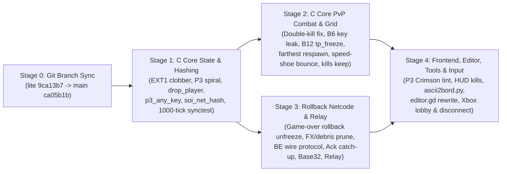

# Step On It! Remastered — Complete Remediation Plan (`10_09_improvements.md` Gap & Bug Closure)

> [!IMPORTANT]
> **Target Baseline**: `origin/main` (`ca05b1b2cf0ac03ead7ce15fe593c672cfa98504`, `"10/9 improvements"`).
> **Read-Only Audit Guarantee**: The working tree at `/usr/local/google/home/seanstappas/tmp/repos/steps` has not been modified. This document provides the complete, drop-in implementation plan organized into 4 dependency-ordered stages, with exact target line numbers, code replacements, and verification gates.

---

## Architecture & Stage Dependency Flow



### Defect & Missing Deliverable Matrix

| ID | Category | File & Lines (`ca05b1b`) | Defect / Gap Summary | Remediation Stage |
| :--- | :--- | :--- | :--- | :--- |
| **D1** | **Workspace** | `~/tmp/repos/steps` (`HEAD`) | Working directory is checked out on branch `lite` (`9ca13b7`), 1 commit behind `origin/main` (`ca05b1b`). | **Stage 0** |
| **D2** | **Bug (Critical)** | `game.gd:1221, 1388, 1943, 1990`<br/>`soi_state.c:266-280, 350-353` | `_start()` clobbers `EXT1` `victory_rule`; `_core.new_game()` after `_start()` wipes `EXT1` `starting_lives`; `soi_load_level()` overwrites Co-op `players[2..3].lives = -1` sentinel. | **Stage 1.1** |
| **D3** | **Gap** | `soi_state.c:113-130` | `soi_spawn_player3` only checks `(col + 1, row)` instead of top-center `(9, 1)` + outward Manhattan spiral with 2-tile vertical clearance and solid floor support. | **Stage 1.2** |
| **D4** | **Gap** | `soi_core.h`, `soi_state.c`, `soi_bridge.*` | Missing `soi_drop_player(slot)` C ABI, `soi_set_p3_any_key(enable)` toggle for 3P Compete on boards `1001–1050`, and `SOI_IN_META_CONFIRM` (`1u << 7`). | **Stage 1.3** |
| **D5** | **Bug (Desync)** | `soi_state.c:1423-1533` | `soi_net_hash` omits `vs_spawns[4][2]`, `p3_col`, `p3_row`, `p3_block`, `p3_any_key`, and `ext_starting_lives`. | **Stage 1.4** |
| **D6** | **Gap** | `tests/test_synctest.c`<br/>`tools/verify.ps1` | `test_synctest.c` runs 64 ticks with identical inputs (no divergent remote prediction); Phase 0 golden hashes across 152 boards are not pinned in `verify.ps1`. | **Stage 1.5** |
| **D7** | **Bug (Critical)** | `soi_enemies.c:1546-1550, 1629-1633`<br/>`soi_state.c:758-762`<br/>`soi_physics.c:356-361` | Direct projectile hits and Speed-Shoe body checks increment `kills++` and `score += 1000` **and** set `attacker_ttl = 120`, causing `commit_death` to award a **2nd kill and +1000 score** 48 ticks later. | **Stage 2.1** |
| **D8** | **Bug (Critical)** | `soi_grid.c:241, 300, 339, 345, 374` | Bug B6 regression: checks `w->play_mode != SOI_MODE_COMPETE` without excluding `SOI_MODE_VERSUS`, leaking collected keys to all opponents in Versus. | **Stage 2.2** |
| **D9** | **Bug** | `soi_grid.c:418` | Bug B12 regression: sets `w->tp_freeze = 211` in `SOI_MODE_VERSUS`, freezing the entire arena for 3 seconds on teleporter entry. | **Stage 2.3** |
| **D10** | **Bug** | `soi_state.c:638-673` | `respawn_player_in_place` ignores active enemies (`w->enemies[]`) in Manhattan distance calculation and skips `p3_spawn` in 2P matches (`!w->players[3].active`). | **Stage 2.4** |
| **D11** | **Bug** | `soi_state.c:750-755` | Dual Speed-Shoe collision flips `facing` without separating `x` positions past the 20 px overlap window, re-triggering collision every tick. | **Stage 2.5** |
| **D12** | **Bug** | `soi_state.c:152-187, 560-607, 843` | `keep[]` in `soi_next_level` and `reload_board_on_death` omits `kills`; early respawn invulnerability cancel ignores `w->friendly_fire`. | **Stage 2.6** |
| **D13** | **Bug (Critical)** | `game.gd:1465, 1476-1478, 1556` | `_physics_process` guards rollback behind `not _core.game_over() and not _core.level_complete()`, permanently freezing the client on a mispredicted win/death; `rb_tick` clamp (`current_tick - 63`) loads predicted state. | **Stage 3.1** |
| **D14** | **Bug** | `game.gd:87-91, 1438-1453, 1490, 1533` | `_net.is_resimulating` is cleared at line 1490 before `audio_gated` is checked at line 1533; `_debris` and `_death_pops` are never timestamped or pruned on rollback. | **Stage 3.2** |
| **D15** | **Bug / Gap** | `rollback_net.gd:187-246`<br/>`game.gd` | `MATCH_INIT` uses little-endian encoding and drops `input_assist`, `base_delay`, and `start_lives`; `SOI_IN_META_CONFIRM` (`0x80`) tally sync is unimplemented. | **Stage 3.3** |
| **D16** | **Bug / Gap** | `rollback_net.gd:253-272, 345-412`<br/>`game.gd:1194-1204` | Missing Half-RTT Clock-Rift Equalization, Adaptive Base Delay (`D = 2..4`), Ack-Anchored sliding window catch-up on Rift Stall, and C core `_core.drop_player(slot + 1)` on `PKT_DROP_PEER`. | **Stage 3.4** |
| **D17** | **Gap** | `rollback_net.gd:72-98`<br/>`headless_relay.gd` | Join code uses 8-char Base16 Hex without port instead of 10-char Crockford Base32 (`ip:port`); Tier 3 Headless Relay (`--headless --relay=7777`) is missing. | **Stage 3.5** |
| **D18** | **Gap** | `net_soak_test.gd` | Soak test only runs 1,200 ticks with 2 peers and 0% loss instead of 10,000 ticks, 3 peers, 120 ms RTT, $\pm 30$ ms jitter, 5% loss, and 400 ms Rift Stall spikes. | **Stage 3.6** |
| **D19** | **Bug / Gap** | `game.gd:356-364, 2488, 2666-2670`<br/>`live3d.gd:60-63` | `_redden()` uses dull channel swap instead of Crimson Red (`#E53935` / `#8E0000`); P3 Red Lock/Door procedural fallback draws brown; HUD omits `player_kills` in Versus. | **Stage 4.1** |
| **D20** | **Bug (Critical)** | `tools/ascii2bord.py:195-218, 270-285` | `compile_bord_from_ascii` drops `vs_spawns`; `verify-roundtrip` fails 152/152 boards due to the 2-byte legacy resource-fork padding footer (`\xff\x60`). | **Stage 4.2** |
| **D21** | **Bug / Gap** | `godot_project/scenes/editor.gd` | Map editor lacks major brush categories, toolbar controls, validation, sprite rendering, and wipes unsaved work on `Tab` playtest. | **Stage 4.3** |
| **D22** | **Gap** | `session.gd:18`, `main_menu.gd`, `game.gd:1431-1436, 2006-2008` | `Session.speed` defaults to `1` (91 Hz) instead of `2` (71 Hz); lobby lacks Xbox *"Press A to Join"* slot claiming and rule/map controls; controller disconnect lacks banner + `Space` fallback; online joypad lacks hysteresis. | **Stage 4.4** |

---

## Stage 0: Synchronize Local Repository (`~/tmp/repos/steps`) to `origin/main`

### Problem
`/usr/local/google/home/seanstappas/tmp/repos/steps` is currently checked out on branch `lite` (`9ca13b7`, Oct 9), whereas the `"10/9 improvements"` commit (`ca05b1b`) was pushed to `origin/main`.

### Commands
```bash
cd /usr/local/google/home/seanstappas/tmp/repos/steps
git status -s
git fetch origin main:main
git checkout main
git branch -f lite main
git rev-parse HEAD
# Expected: ca05b1b2cf0ac03ead7ce15fe593c672cfa98504
```

---

## Stage 1: C Core State, `EXT1` Clobber Fix, `soi_spawn_player3` Spiral, `soi_drop_player`, `p3_any_key` & `soi_net_hash`

### Step 1.1: Fix `EXT1` Map Attribute Clobber & Co-op Sentinel

#### 1. `core/src/soi_internal.h` (lines 180–185)
Add `p3_any_key` and `ext_starting_lives` to `struct SoiWorld`:
```c
struct SoiWorld {
    uint32_t rng_seed;    /* Toolbox Random() state (low-mem randSeed analogue) */
    uint32_t tick;        /* virtual frame counter (pacing-only in the original) */

    uint32_t cell[SOI_MAX_GRID_ROWS][SOI_MAX_GRID_COLS];  /* live playfield (up to 38x26) */
    uint8_t  grid_cols;          /* active columns: 19..38, default 19 */
    uint8_t  grid_rows;          /* active rows: 13..26, default 13 */
    uint8_t  p3_col;             /* EXT1 P3 spawn column (0 = auto fallback) */
    uint8_t  p3_row;             /* EXT1 P3 spawn row (0 = auto fallback) */
    uint16_t p3_block;           /* EXT1 P3 block word (default 0x020D) */
    uint8_t  vs_spawns[4][2];    /* EXT1 4 extra Versus arena spawns [col, row] */
    uint8_t  p3_any_key;         /* 1 = 3P Compete: P3 can collect any key / exit any door */
    uint8_t  ext_starting_lives; /* EXT1 starting lives (1..9), 0 if unset */
```

#### 2. `core/src/soi_state.c` (`soi_world_init`, `soi_new_game`, `soi_load_level`)
In `soi_world_init` (lines 35–45):
```c
void soi_world_init(SoiWorld *w, uint32_t seed)
{
    int i;
    memset(w, 0, sizeof(*w));
    w->rng_seed = seed ? seed : 1u;
    w->bonus_div = 3;
    w->grid_cols = SOI_GRID_COLS;
    w->grid_rows = SOI_GRID_ROWS;
    w->p3_block = 0x020D;
    w->p3_any_key = 0;
    w->ext_starting_lives = 0;
```

In `soi_new_game` (lines 266–280), preserve `w->ext_starting_lives` if already loaded:
```c
void soi_new_game(SoiWorld *w, int mode)
{
    int i;
    soi_set_play_mode(w, mode);
    int start_lives = (w->ext_starting_lives >= 1 && w->ext_starting_lives <= 9)
        ? (int)w->ext_starting_lives
        : 2;
    for (i = 1; i < SOI_MAX_PLAYERS; i++) {
        SoiPlayer *p = &w->players[i];
        p->score = 0; p->lives = start_lives; p->balls = 1; p->arrows = 1;
    }
    if (w->play_mode == SOI_MODE_COOPERATE) {
        int coop_pool = (w->ext_starting_lives >= 1 && w->ext_starting_lives <= 9)
            ? (int)w->ext_starting_lives
            : 4;
        w->players[1].lives = coop_pool; w->players[1].balls = 2; w->players[1].arrows = 2;
        for (i = 2; i < SOI_MAX_PLAYERS; i++) {
            w->players[i].lives = -1; w->players[i].balls = 0; w->players[i].arrows = 0;
        }
    }
}
```

In `soi_load_level` (lines 350–355), preserve the Co-op `lives = -1` sentinel on `players[2..3]`:
```c
                    if (rule <= 2) w->victory_rule = rule;
                    if (lives >= 1 && lives <= 9) {
                        w->ext_starting_lives = lives;
                        if (w->play_mode == SOI_MODE_COOPERATE) {
                            w->players[1].lives = lives;
                            for (i = 2; i < SOI_MAX_PLAYERS; i++)
                                w->players[i].lives = -1;
                        } else {
                            for (i = 1; i < SOI_MAX_PLAYERS; i++)
                                w->players[i].lives = lives;
                        }
                    }
```

#### 3. `godot_project/scenes/session.gd` (lines 11–12) & `godot_project/scenes/game.gd` (lines 1221, 1376–1396, 1942–1944, 1989–1991)
In `session.gd`, default `victory_rule` and `friendly_fire` to `-1` (meaning *"use map's `EXT1` setting unless overridden in lobby"*):
```gdscript
var victory_rule: int = -1  # -1 = Map Default, 0 = Lives (Elimination), 1 = Score, 2 = Door
var friendly_fire: int = -1 # -1 = Map Default, 0 = off, 1 = on
```

In `game.gd:_start()`, call `_core.new_game(_core_mode())` **before** `_core.load_level(_level_bytes)`, only override `victory_rule` / `friendly_fire` when `Session` has an explicit selection (`>= 0`), and wire `_core.set_p3_any_key(Session.p3_any_key)`:
```gdscript
func _start() -> void:
	_game_over_active = false
	_game_over_aborting = false
	_game_over_ticks = 0
	_game_over_letters.clear()
	var seed_val: int = Session.online_seed if (Session.is_online and Session.online_seed != 0) else 1
	_core.init(seed_val)
	_core.new_game(_core_mode())
	_core.set_input_assist(true)
	_core.set_p3_any_key(Session.p3_any_key)
	if Session.is_online and not Session.online_bord_bytes.is_empty():
		_level_bytes = Session.online_bord_bytes
	_core.load_level(_level_bytes)
	if Session.victory_rule >= 0:
		_core.set_victory_rule(Session.victory_rule)
	if _mode_versus:
		_core.set_friendly_fire(1)
	elif Session.friendly_fire >= 0:
		_core.set_friendly_fire(Session.friendly_fire)
	if _num_players >= 3:
		_core.spawn_player3()
	_core.limit_players(_num_players)
	_reset_round_ui()
	_update_board_music()
```
Remove the redundant post-`_start()` `_core.new_game(_core_mode())` calls at `game.gd:1221`, `game.gd:1943`, and `game.gd:1990`.

---

### Step 1.2: Implement Full `soi_spawn_player3` Manhattan Spiral Fallback

Replace `soi_spawn_player3` in `core/src/soi_state.c:110-130` with the 3-step algorithm (explicit `EXT1` -> top-center `(9, 1)` -> outward Manhattan spiral from `(p1_spawn + p2_spawn) / 2` checking 2-tile vertical clearance and supportive floor below):
```c
static int is_valid_p3_spawn(const SoiWorld *w, int c, int r)
{
    if (c < 0 || c >= w->grid_cols || r < 1 || r + 1 >= w->grid_rows)
        return 0;
    uint32_t at = w->cell[r][c];
    uint32_t above = w->cell[r - 1][c];
    if (SOI_CELL_TYPE(at) != 0 || (at & SOI_CELL_SUPPORTIVE) != 0 || (at & SOI_CELL_DOOR) != 0)
        return 0;
    if (SOI_CELL_TYPE(above) != 0 || (above & SOI_CELL_SUPPORTIVE) != 0 || (above & SOI_CELL_DOOR) != 0)
        return 0;
    uint32_t below = w->cell[r + 1][c];
    if ((below & SOI_CELL_SUPPORTIVE) == 0)
        return 0;
    return 1;
}

void soi_spawn_player3(SoiWorld *w)
{
    if (!w) return;

    if (w->p3_col > 0 && w->p3_row > 0 &&
        w->p3_col < w->grid_cols && w->p3_row < w->grid_rows) {
        place_player(w, 3, w->p3_col, w->p3_row);
        w->players[3].block_type = (uint8_t)(w->p3_block & 0xFFu);
        w->players[3].bonus_time = w->players[1].bonus_time;
        if (w->play_mode == SOI_MODE_COOPERATE) {
            w->players[3].lives = -1;
            w->players[3].balls = 0;
            w->players[3].arrows = 0;
        } else {
            w->players[3].lives = w->players[1].lives;
            w->players[3].balls = w->players[1].balls;
            w->players[3].arrows = w->players[1].arrows;
        }
        return;
    }

    int spawn_c = -1, spawn_r = -1;
    if (is_valid_p3_spawn(w, 9, 1)) {
        spawn_c = 9;
        spawn_r = 1;
    } else {
        int p1_c = (w->players[1].spawn_x - SOI_ORIGIN_X) / SOI_CELL_PX;
        int p1_r = (w->players[1].spawn_y - SOI_ORIGIN_Y) / SOI_CELL_PX;
        int p2_c = (w->players[2].spawn_x - SOI_ORIGIN_X) / SOI_CELL_PX;
        int p2_r = (w->players[2].spawn_y - SOI_ORIGIN_Y) / SOI_CELL_PX;
        int mid_c = (p1_c + p2_c) / 2;
        int mid_r = (p1_r + p2_r) / 2;
        int max_dist = (int)w->grid_cols + (int)w->grid_rows;
        int dist, dc;

        for (dist = 1; dist <= max_dist && spawn_c < 0; dist++) {
            for (dc = -dist; dc <= dist; dc++) {
                int dr = dist - (dc < 0 ? -dc : dc);
                int cand_c = mid_c + dc;
                int cand_r1 = mid_r + dr;
                int cand_r2 = mid_r - dr;

                if (is_valid_p3_spawn(w, cand_c, cand_r1)) {
                    spawn_c = cand_c;
                    spawn_r = cand_r1;
                    break;
                }
                if (dr != 0 && is_valid_p3_spawn(w, cand_c, cand_r2)) {
                    spawn_c = cand_c;
                    spawn_r = cand_r2;
                    break;
                }
            }
        }
    }

    if (spawn_c < 0) {
        int col = (w->players[1].spawn_x - SOI_ORIGIN_X) / SOI_CELL_PX;
        int row = (w->players[1].spawn_y - SOI_ORIGIN_Y) / SOI_CELL_PX;
        if (col + 1 < w->grid_cols && SOI_CELL_TYPE(w->cell[row][col + 1]) == 0)
            col += 1;
        spawn_c = col;
        spawn_r = row;
    }

    place_player(w, 3, spawn_c, spawn_r);
    w->players[3].block_type = (uint8_t)(w->p3_block & 0xFFu);
    w->players[3].bonus_time = w->players[1].bonus_time;
    if (w->play_mode == SOI_MODE_COOPERATE) {
        w->players[3].lives = -1;
        w->players[3].balls = 0;
        w->players[3].arrows = 0;
    } else {
        w->players[3].lives = w->players[1].lives;
        w->players[3].balls = w->players[1].balls;
        w->players[3].arrows = w->players[1].arrows;
    }
}
```

---

### Step 1.3: Add `SOI_IN_META_CONFIRM`, `soi_drop_player(slot)`, and `soi_set_p3_any_key`

1. **`core/include/soi_core.h`**:
   - Add `SOI_IN_META_CONFIRM = 1u << 7` to the input enum (line 49).
   - Declare `void soi_drop_player(SoiWorld *w, int player_slot);`, `void soi_set_p3_any_key(SoiWorld *w, int enable);`, and `int soi_p3_any_key(const SoiWorld *w);` (line 218).
2. **`core/src/soi_state.c`** (after `soi_limit_players`, line 142):
   ```c
   void soi_drop_player(SoiWorld *w, int player_slot)
   {
       if (!w || player_slot < 1 || player_slot >= SOI_MAX_PLAYERS) return;
       w->players[player_slot].active = 0;
       w->players[player_slot].alive = 0;
       w->players[player_slot].eliminated = 1;
   }

   void soi_set_p3_any_key(SoiWorld *w, int enable)
   {
       if (w) w->p3_any_key = enable ? 1 : 0;
   }

   int soi_p3_any_key(const SoiWorld *w)
   {
       return w ? (int)w->p3_any_key : 0;
   }
   ```
3. **`bridge/src/soi_bridge.h` & `bridge/src/soi_bridge.cpp`**:
   Expose `drop_player(slot)`, `set_p3_any_key(on)`, and `p3_any_key()` on `SoiCore`.

---

### Step 1.4: Complete `soi_net_hash` Coverage (`core/src/soi_state.c:1440-1455`)

Append all `EXT1` and P3 fields to `soi_net_hash` (while leaving `soi_serialize` and `soi_state_hash` untouched so `.soisnap` v1 fixtures remain byte-compatible):
```c
    fnv1a_u8(&h, w->input_assist);
    fnv1a_u8(&h, w->p3_col);
    fnv1a_u8(&h, w->p3_row);
    fnv1a_u16(&h, w->p3_block);
    fnv1a_u8(&h, w->p3_any_key);
    fnv1a_u8(&h, w->ext_starting_lives);
    for (i = 0; i < 4; i++) {
        fnv1a_u8(&h, w->vs_spawns[i][0]);
        fnv1a_u8(&h, w->vs_spawns[i][1]);
    }
```

---

### Step 1.5: Upgrade `tests/test_synctest.c` to 1,000 Ticks with Divergent Remote Prediction

Update `tests/test_synctest.c` so that:
1. `TOTAL_TICKS` is `1000` (`ROLLBACK_DEPTH` = `7`).
2. `w_sim` advances using **divergent remote inputs** (`in2[t] ^ 0x03`, `in3[t] ^ 0x05`), then every 5th tick (`if (t >= ROLLBACK_DEPTH && (t % 5) == 0)`) loads `ring[(t - ROLLBACK_DEPTH) % RING_CAP]`, resimulates `rollback_tick..t` with true `in1[k], in2[k], in3[k]` (updating `ring[k % RING_CAP]`), and asserts `soi_net_hash(w_sim) == soi_net_hash(w_ref)`.
3. Retains the zero-argument default directory scan of `extracted/levels/board_*.bord` (`if (argc == 1)`) so `tools/verify.ps1` continues to run `.\soi_synctest.exe` without arguments.

```c
    /* Inside test_board() loop for (t = 0; t < TOTAL_TICKS; t++): */
    soi_snapshot_save(w_sim, ring[t % RING_CAP]);

    /* w_ref steps with authoritative inputs; w_sim steps with mispredicted remote inputs */
    soi_tick3(w_ref, in1[t], in2[t], in3[t]);
    soi_tick3(w_sim, in1[t], (uint8_t)(in2[t] ^ 0x03u), (uint8_t)(in3[t] ^ 0x05u));

    if (t >= ROLLBACK_DEPTH && (t % 5) == 0) {
        int rollback_tick = t - ROLLBACK_DEPTH;
        soi_snapshot_load(w_sim, ring[rollback_tick % RING_CAP]);
        for (k = rollback_tick; k <= t; k++) {
            soi_snapshot_save(w_sim, ring[k % RING_CAP]);
            soi_tick3(w_sim, in1[k], in2[k], in3[k]);
        }
        if (soi_net_hash(w_ref) != soi_net_hash(w_sim)) {
            fprintf(stderr, "Rollback hash mismatch at tick %d on %s\n", t, path);
            ok = 0;
            goto cleanup;
        }
    }
```

---

## Stage 2: C Core PvP Combat, Versus Mode (`SOI_MODE_VERSUS`), Respawns & Grid Fixes

### Step 2.1: Fix Double-Kill (`+2` Kills, `+2000` Score) on Direct Hits

When a direct projectile hit (`soi_enemies.c:1546-1550, 1629-1633`) or a Speed-Shoe body check (`soi_state.c:758-762`) kills a player, it immediately increments `kills++` and `score += 1000`. Clear `attacker_ttl = 0` on direct hits so `commit_death` (`soi_physics.c:356-361`) does not award a second kill 48 ticks later when the death parabola crosses `soi_pit_death_y(w)` (`attacker_ttl = 120` remains solely for non-lethal indirect head-bonk block drops):

1. **`core/src/soi_enemies.c:1546-1553`** (Rolling Ball PvP Hit):
   ```c
   if (p->x + 0x06 <= X + 0x18 && X <= p->x + 0x1a && p->y <= Y + 0x18 && Y <= pb) {
       p->last_attacker = pr->owner;
       p->attacker_ttl = 0; /* Direct hit credits kill immediately; prevent double-award in commit_death */
       w->players[pr->owner].kills++;
       w->players[pr->owner].score += 1000;
       soi_player_hit(w, pj);
       pr->active = 0;
       break;
   }
   ```
2. **`core/src/soi_enemies.c:1629-1637`** (Straight Arrow PvP Hit):
   ```c
   if (p->x + 0x06 <= pr->x + 0x18 && pr->x <= p->x + 0x1a && p->y <= pr->y + 0x18 && pr->y <= pb) {
       p->last_attacker = pr->owner;
       p->attacker_ttl = 0; /* Direct hit credits kill immediately; prevent double-award in commit_death */
       w->players[pr->owner].kills++;
       w->players[pr->owner].score += 1000;
       soi_player_hit(w, pj);
       spent = 1;
       break;
   }
   ```
3. **`core/src/soi_state.c:756-773`** (Speed-Shoe Body Checks):
   ```c
   } else if (p1->fast > 0 && p2->fast == 0) {
       if (p2->invuln == 0) {
           p2->last_attacker = (uint8_t)i;
           p2->attacker_ttl = 0;
           p1->kills++;
           p1->score += 1000;
           soi_player_hit(w, j);
       }
   } else if (p2->fast > 0 && p1->fast == 0) {
       if (p1->invuln == 0) {
           p1->last_attacker = (uint8_t)j;
           p1->attacker_ttl = 0;
           p2->kills++;
           p2->score += 1000;
           soi_player_hit(w, i);
       }
   }
   ```

---

### Step 2.2: Fix Bug B6 Versus Key Leak & Wire `p3_any_key` (`core/src/soi_grid.c`)

1. In `give_key` (`core/src/soi_grid.c:235-243`):
   ```c
   static void give_key(SoiWorld *w, int player)
   {
       int j;
       const int shared = (w->play_mode != SOI_MODE_COMPETE && w->play_mode != SOI_MODE_VERSUS);
       for (j = 1; j < SOI_MAX_PLAYERS; j++) {
           SoiPlayer *pj = &w->players[j];
           if (pj->has_key == 2) continue;
           if (j == player || (shared && pj->active)) pj->has_key = 1;
       }
   }
   ```
2. Declare `competitive` and `p3_any` **once** at the top of `soi_pickup_check` (`core/src/soi_grid.c:248-254`):
   ```c
   void soi_pickup_check(SoiWorld *w, int player)
   {
       SoiPlayer *p = &w->players[player];
       SoiPlayer *cp = soi_pool(w, player);
       const int competitive = (w->play_mode == SOI_MODE_COMPETE || w->play_mode == SOI_MODE_VERSUS);
       const int p3_any = (player == 3 && w->p3_any_key);
       uint32_t c;
       unsigned t;
   ```
3. Replace `w->play_mode != SOI_MODE_COMPETE` with `!competitive` and allow `p3_any` at lines `298-305` (door exit), `337-353` (key pickup), and `373-376` (Red Lock unlock):
   ```c
   /* Door exit (line 298): */
   if ((c & SOI_CELL_DOOR) &&
       ((t <= 3u && (t == 1u || t == (unsigned)player + 1u || p3_any)) ||
        ((player == 3 || !competitive || p3_any) && c == 0x0935u))) {

   /* Key pickup (line 337): */
   if ((c & SOI_CELL_DOOR) &&
       ((t >= 7u && t <= 9u && (t == 7u || t == (unsigned)player + 7u || p3_any)) ||
        (c == 0x0933u && (player == 3 || !competitive || p3_any)))) {
       int cc, rr;
       give_key(w, player);
       if (c == 0x0933u) {
           if (!competitive) {
               int pj;
               for (pj = 1; pj < SOI_MAX_PLAYERS; pj++) {
                   if (w->players[pj].active) w->players[pj].keys |= (1u << 10);
               }
           } else {
               p->keys |= (1u << 10);
           }
       }

   /* Red lock unlock (line 373): */
   if (c == 0x0934u && (player == 3 || !competitive || p3_any) && (p->keys & (1u << 10))) {
       set_cell1(w, col1, row1, 0x0935u | SOI_CELL_SUPPORTIVE | SOI_CELL_DOOR);
   ```

---

### Step 2.3: Fix Bug B12 `tp_freeze` in Versus Mode (`core/src/soi_grid.c:417-421`)

```c
        /* Remaster: freeze gameplay during teleporter transition unless in Compete or Versus mode */
        if (w->play_mode != SOI_MODE_COMPETE && w->play_mode != SOI_MODE_VERSUS) {
            w->tp_freeze = 211;
        }
```

---

### Step 2.4: Fix Farthest-Point In-Place Respawn (`core/src/soi_state.c:634-683`)

Include active enemies (`w->enemies[]`) in the Manhattan distance calculation and include P3's spawn point (`w->players[3].spawn_x/y` or `soi_cell_x(w->p3_col), soi_cell_y(w->p3_row) + 1`) even in 2-player matches:
```c
    if (w->play_mode == SOI_MODE_VERSUS) {
        int best_x = rp->spawn_x, best_y = rp->spawn_y;
        int max_min_dist = -1;
        int cand;

        for (cand = 1; cand < SOI_MAX_PLAYERS; cand++) {
            int cx = w->players[cand].spawn_x;
            int cy = w->players[cand].spawn_y;
            if (cand == 3 && !w->players[3].active) {
                if (w->p3_col > 0 && w->p3_row > 0) {
                    cx = soi_cell_x(w->p3_col);
                    cy = soi_cell_y(w->p3_row) + 1;
                }
            }
            if (cx == 0 && cy == 0) continue;

            int min_d = 999999;
            int op, ei;
            for (op = 1; op < SOI_MAX_PLAYERS; op++) {
                const SoiPlayer *other = &w->players[op];
                if (other == rp || !other->active || !other->alive || other->eliminated) continue;
                int dx = cx - other->x; if (dx < 0) dx = -dx;
                int dy = cy - other->y; if (dy < 0) dy = -dy;
                if (dx + dy < min_d) min_d = dx + dy;
            }
            for (ei = 0; ei < SOI_MAX_ENEMIES; ei++) {
                const SoiEnemy *e = &w->enemies[ei];
                if (!e->active) continue;
                int dx = cx - e->x; if (dx < 0) dx = -dx;
                int dy = cy - e->y; if (dy < 0) dy = -dy;
                if (dx + dy < min_d) min_d = dx + dy;
            }
            if (min_d > max_min_dist) {
                max_min_dist = min_d;
                best_x = cx;
                best_y = cy;
            }
        }

        for (cand = 0; cand < 4; cand++) {
            int sc = w->vs_spawns[cand][0];
            int sr = w->vs_spawns[cand][1];
            if (sc == 0 && sr == 0) continue;
            int cx = soi_cell_x(sc);
            int cy = soi_cell_y(sr) + 1;
            int min_d = 999999;
            int op, ei;
            for (op = 1; op < SOI_MAX_PLAYERS; op++) {
                const SoiPlayer *other = &w->players[op];
                if (other == rp || !other->active || !other->alive || other->eliminated) continue;
                int dx = cx - other->x; if (dx < 0) dx = -dx;
                int dy = cy - other->y; if (dy < 0) dy = -dy;
                if (dx + dy < min_d) min_d = dx + dy;
            }
            for (ei = 0; ei < SOI_MAX_ENEMIES; ei++) {
                const SoiEnemy *e = &w->enemies[ei];
                if (!e->active) continue;
                int dx = cx - e->x; if (dx < 0) dx = -dx;
                int dy = cy - e->y; if (dy < 0) dy = -dy;
                if (dx + dy < min_d) min_d = dx + dy;
            }
            if (min_d > max_min_dist) {
                max_min_dist = min_d;
                best_x = cx;
                best_y = cy;
            }
        }
        rp->x = best_x;
        rp->y = best_y;
        rp->invuln = 120;
    }
```

---

### Step 2.5: Fix Dual Speed-Shoe Collision Separation (`core/src/soi_state.c:750-756`)

Displace both players horizontally past the 20 px overlap window, clamp to grid bounds, and emit `SOI_SFX_BLOCK_BREAK`:
```c
                if (p1->fast > 0 && p2->fast > 0) {
                    int push = (20 - dx + 1) / 2;
                    if (push < 2) push = 2;
                    if (p1->x <= p2->x) {
                        p1->x -= push;
                        p2->x += push;
                        p1->facing = -1;
                        p2->facing = 1;
                    } else {
                        p1->x += push;
                        p2->x -= push;
                        p1->facing = 1;
                        p2->facing = -1;
                    }
                    int min_x = SOI_ORIGIN_X;
                    int max_x = soi_cell_x(w->grid_cols - 1);
                    if (p1->x < min_x) p1->x = min_x;
                    if (p1->x > max_x) p1->x = max_x;
                    if (p2->x < min_x) p2->x = min_x;
                    if (p2->x > max_x) p2->x = max_x;
                    p1->run_x0 = p1->x;
                    p2->run_x0 = p2->x;
                    p1->move_ctr = 0;
                    p2->move_ctr = 0;
                    soi_sfx_emit(w, SOI_SFX_BLOCK_BREAK);
                }
```

---

### Step 2.6: Preserve `kills` & `p3_any_key` Across Level Transitions & Death Reloads (`core/src/soi_state.c:152-183, 560-601, 843`)

1. Add `uint16_t kills;` to `keep[SOI_MAX_PLAYERS]` and `uint8_t p3any = w->p3_any_key;` in both `soi_next_level` (`lines 152-183`) and `reload_board_on_death` (`lines 560-601`), restoring `w->players[i].kills = keep[i].kills;` and `w->p3_any_key = p3any;` after `soi_world_init`.
2. In `soi_tick3` (`line 843`), allow early respawn invulnerability cancellation whenever `w->play_mode == SOI_MODE_VERSUS || w->friendly_fire`:
   ```c
   if ((w->play_mode == SOI_MODE_VERSUS || w->friendly_fire) && ip->invuln > 0 &&
       (ins[i] & (SOI_IN_BLOCK_HIGH | SOI_IN_BLOCK_LOW | SOI_IN_ARROW | SOI_IN_BALL))) {
       ip->invuln = 0;
   }
   ```
3. Extend `tests/test_mechanics.c` (Section 67) to step the full 60 frames past `SOI_ST_DEAD` into `commit_death` and assert `w->players[1].kills == 1` and `w->players[1].score == 1000`.

---

## Stage 3: Rollback Netcode, Wire Protocol, Latency Escalation & Bundled Relay

### Step 3.1: Unfreeze Rollback on Mispredicted `game_over()` / `level_complete()` & Remove Snapshot Clamp (`godot_project/scenes/game.gd:1455-1510`)

Move the rollback check (`if _net != null and _net.earliest_mispredicted_tick >= 0:`) **above** the `_core.game_over() or _core.level_complete()` early return, and remove the `rb_tick = _net.current_tick - RollbackNet.RING_BUFFER_SIZE + 1` clamp that loaded predicted snapshots:

```gdscript
func _physics_process(_delta: float) -> void:
	_core_ticked = false
	if _core != null and _core.tp_freeze() > 0:
		_tp_frames = int(_core.tp_freeze())
	else:
		_tp_frames = 0

	if _net != null:
		_net.poll_network(Time.get_ticks_msec() / 1000.0)
		if _net.consecutive_rift_frames > 30:
			Engine.physics_ticks_per_second = int(SPEED_HZ[clampi(Session.speed, 0, 3)] * 0.98)
		elif _net.consecutive_rift_frames < -30:
			Engine.physics_ticks_per_second = int(SPEED_HZ[clampi(Session.speed, 0, 3)] * 1.02)
		else:
			Engine.physics_ticks_per_second = SPEED_HZ[clampi(Session.speed, 0, 3)]

	if _script_hold or _paused or (_alt and _alt_state != "play") or _challenge_intro > 0:
		return

	# Always process pending rollbacks BEFORE evaluating game_over / level_complete
	if _net != null and _net.earliest_mispredicted_tick >= 0:
		var rb_tick: int = _net.earliest_mispredicted_tick
		_net.earliest_mispredicted_tick = -1

		if rb_tick < _net.current_tick:
			var lag_frames: int = _net.current_tick - rb_tick
			if lag_frames >= RollbackNet.RING_BUFFER_SIZE:
				_net.desync_detected.emit(rb_tick, 0, 0)
			else:
				var snap: PackedByteArray = _net.snapshot_ring[rb_tick % RollbackNet.RING_BUFFER_SIZE]
				if not snap.is_empty():
					_core.snapshot_load(snap)
					_net.is_resimulating = true

					if _tally_captured and not _core.level_complete():
						_tally_captured = false
						_tally_anim = 0.0
						_warp_anim = 0.0
						_update_board_music()
					if _game_over_active and not _core.game_over():
						_game_over_active = false
						_game_over_ticks = 0
						_game_over_letters.clear()

					for sim_t in range(rb_tick, _net.current_tick):
						var s_p1: int = _net.get_or_predict_input(0, sim_t)
						var s_p2: int = _net.get_or_predict_input(1, sim_t) if _num_players >= 2 else 0
						var s_p3: int = _net.get_or_predict_input(2, sim_t) if _num_players >= 3 else 0
						_net.snapshot_ring[sim_t % RollbackNet.RING_BUFFER_SIZE] = _core.snapshot_save()
						_core.tick3(s_p1, s_p2, s_p3)
						_net.record_state_hash(sim_t, int(_core.net_hash() & 0xFFFFFFFF))
						for _i in range(_core.sfx_count()):
							_core.sfx_get(_i)

					_prune_render_history(rb_tick)
					_net.is_resimulating = false

	if _core.game_over() or _core.level_complete() or (not _alt and _core.challenge_failed()):
		if _net != null:
			_poll_online_meta_confirm()
		queue_redraw()
		return

	if _net != null and _net.check_rift_stall():
		queue_redraw()
		return
```

---

### Step 3.2: Timestamp & Prune `_death_pops` and `_debris` on Rollback (`godot_project/scenes/game.gd`)

1. In `_spawn_death_pop` (`line 2945`) and `_spawn_debris` (`line 2984`), preserve all existing dictionary keys (`"folder"`, `"frame"`, `"flip"`, `"id"`, `"x0"`, `"y0"`, `"t"`, `"px"`, `"py"`, `"vx"`, `"vy"`, `"grav"`) and add `"tick": _net.current_tick if _net != null else _core.tick_count()`.
2. In `_prune_render_history(from_tick: int)` (`lines 1438-1453`), keep the `_hist` and `_grid_snaps` pruning and append:
   ```gdscript
   	var keep_pops: Array = []
   	for p in _death_pops:
   		if int(p.get("tick", 0)) < from_tick:
   			keep_pops.append(p)
   	_death_pops = keep_pops

   	var keep_deb: Array = []
   	for d in _debris:
   		if int(d.get("tick", 0)) < from_tick:
   			keep_deb.append(d)
   	_debris = keep_deb

   	_enemy_lastpos.clear()
   	_proj_lastpos.clear()
   	if _core != null and _core.tp_freeze() == 0:
   		_tp_frames = 0
   ```

---

### Step 3.3: Big-Endian Wire Protocol, `MATCH_INIT` Field Application & `SOI_IN_META_CONFIRM`

1. In `godot_project/scenes/rollback_net.gd`, replace `encode_u16`/`encode_u32` and `decode_u16`/`decode_u32` with explicit big-endian helpers (`encode_be16`, `decode_be16`, `encode_be32`, `decode_be32`).
2. In `_handle_match_init` (`lines 213-246`), apply all received header fields (`input_assist`, `p3_any_key`, `base_delay`, `start_lives`) to `Session` and `BASE_DELAY` before emitting `match_started`.
3. Implement `_poll_online_meta_confirm()` in `game.gd` using `IN_META_CONFIRM = 1 << 7` so post-round tally screens advance when all active peers confirm.

---

### Step 3.4: Ack-Anchored Sliding Window Catch-Up, Adaptive Base Delay & `drop_player(slot + 1)`

1. **Ack-Anchored Sliding Window (`rollback_net.gd:328-363`)**:
   Track `peer_ack_tick[slot]` from offset 8 of `PKT_INPUT_TICK`. When `(target_tick - min_peer_ack) > 16`, set `anchor_start = min_peer_ack + 16` **before** writing offset 4 (`encode_be32(pkt, 4, anchor_start)`) so the packet header's `head_tick` and the 16-byte input payload (`anchor_start - k`) match 1:1.
2. **Adaptive Base Delay (`rollback_net.gd`)**:
   Adjust `BASE_DELAY = clampi(ceili((rolling_rtt_ms / 2.0) / 14.0), 2, 4)` at board boundaries.
3. **Deterministic Peer Drop (`game.gd:1194-1204`)**:
   When `peer_disconnected(slot, target_tick)` fires, call `_core.drop_player(slot + 1)` (mapping 0-indexed `RollbackNet` slot `0..2` to 1-indexed C core player `1..3`).

---

### Step 3.5: 10-Char Crockford Base32 Join Code (`ip:port`) & Tier 3 Headless Relay

1. **`rollback_net.gd:72-98`**:
   Encode 48 bits (`32-bit IPv4 << 16 | 16-bit port`) into 10 Crockford Base32 characters (`0123456789ABCDEFGHJKMNPQRSTVWXYZ`, formatted `SOI-XXXXX-XXXXX`), normalizing `O->0` and `I/L->1` on decode.
2. **`godot_project/scenes/headless_relay.gd` & `main_menu.gd`**:
   Add `headless_relay.gd` forwarding ENet channels 0 (reliable) and 1 (unsequenced) across connected peers when launched with `--headless --relay=7777`.

---

### Step 3.6: Upgrade `net_soak_test.gd` to 10,000 Ticks, 3 Peers & 400 ms Rift Stall Spikes

Update `godot_project/scenes/net_soak_test.gd` to run `TARGET_TICKS = 10000` across 3 peers (`P2 <-> P1 <-> P3`) with 120 ms RTT, $\pm 30$ ms jitter, 5% packet loss, and 60-tick 400 ms latency spikes injected at ticks `3000` and `7000`, asserting `0` desyncs.

---

## Stage 4: Godot Frontend, P3 Shader & HUD, Map Maker (`ascii2bord.py` & `editor.gd`), Lobby UI & Xbox Controllers

### Step 4.1: P3 Crimson Red Tint (`#E53935` / `#8E0000`), Red Doors & HUD Versus Kills

1. **`godot_project/scenes/game.gd:356-364` (`_redden`) & `live3d.gd:60-63`**:
   Use the exact luminance-preserving Crimson Red formula from `p3_tint.gdshader` (`shadow = Color(0.557, 0.0, 0.0, 1.0)`, `highlight = Color(0.898, 0.224, 0.208, 1.0)`).
2. **`godot_project/scenes/game.gd:2666-2673`**:
   Pass `Color(0.85, 0.15, 0.15)` to `_draw_door(pos, frame_color)` when rendering P3 Red Lock (`0x0934`) and P3 Red Door (`0x0935`).
3. **`godot_project/scenes/game.gd:2488` (`_draw_hud_3p`)**:
   When `_mode_versus` is active, render `"K%d" % int(_core.player_kills(src_p))` alongside lives in each player's HUD column.

---

### Step 4.2: Fix `tools/ascii2bord.py` (`vs_spawns` Parser & Legacy 2-Byte Footer)

1. **`vs_spawns` Regex Parser (`tools/ascii2bord.py:195-218`)**:
   In `compile_bord_from_ascii`, add `import re` and parse both tuple `[(c, r), ...]` and list `[[c, r], ...]` formats:
   ```python
   elif k == "vs_spawns":
       ext1["vs_spawns"] = [
           (int(m[0]), int(m[1]))
           for m in re.findall(r"[\[\(]\s*(\d+)\s*,\s*(\d+)\s*[\]\)]", v)
       ]
   ```
2. **Legacy 2-Byte Footer Tolerance (`tools/ascii2bord.py:270-285`)**:
   In `verify-roundtrip`, strip the 2-byte Mac resource-fork padding footer (`\xff\x60`) following the 4-byte `0x00000000` record terminator:
   ```python
   orig_clean = orig
   if len(orig) == len(recompiled) + 2 and orig[-6:-2] == b"\x00\x00\x00\x00":
       orig_clean = orig[:-2]
   ```

---

### Step 4.3: Visual Map Maker Rewrite (`godot_project/scenes/editor.gd`)

Upgrade `godot_project/scenes/editor.gd` with:
- Complete categorized palette: **Terrain** (`0x0000`, `0x0307`, `0x0207`, `0x0197`, `0x0387`, `0x0317`, `0x0318`), **Mechanics** (Teleporters `0x081A`/`0x081B`, Stop/Go Switches & Blocks), **Goodies** (Coins, Gems, Ammo, Speed Shoes `0x0932`, Shield `0x0930`), **Keys & Doors** (Universal, P1 Blue, P2 Green, P3 Red `0x0933`–`0x0935`), **Enemies** (`0..8` with Left/Right facing), and **Spawns** (`P1`, `P2`, `P3`, `VS1..VS4`).
- Real sprite sheet rendering via `_tex_cache` from `res://../extracted/sprites/`.
- Live validation banner (overlapping spawns, unmatched doors/keys).
- Full state persistence across `Tab` in-memory playtesting (`Session.set_meta("editor_state", _save_editor_state())`, preserving `cells`, `grid_cols`, `grid_rows`, `p1_spawn`, `p2_spawn`, `p3_spawn`, `vs_spawns`, `has_p3`, `default_mode`, `victory_rule`, `friendly_fire`, `starting_lives`, `bonus_time`, `map_name`, `brush_idx`, and `cursor_cell`).

---

### Step 4.4: Default 71 Hz Speed, Lobby Controls, Xbox Slot Claiming & Disconnect Banner

1. **`godot_project/scenes/session.gd:18`**:
   Set default `var speed: int = 2` (71 Hz Medium, per Bug B12) and add `var p3_any_key: bool = false` and `var custom_map_path: String = ""`.
2. **`godot_project/scenes/main_menu.gd`**:
   Add Xbox *"Press A to Join"* / Keyboard `Space` slot claiming (`_claim_controller_slot`, `_update_lobby_device_labels`) and lobby controls for Victory Rule, Friendly Fire, 3P Compete Any-Key toggle, and Custom Map selection (`_open_custom_map_selector`).
3. **`godot_project/scenes/game.gd:1431-1436, 2005-2008`**:
   Render a visible `"Controller Disconnected (Player X) — Reconnect or press SPACE for Keyboard"` overlay banner on `joy_connection_changed`, and apply the `0.50` / `0.35` stick hysteresis deadzone to online joypad polling.

---

## Verification & Acceptance Suite

Run the following verification gates in order after applying Stages 0–4:

```bash
# 1. C Core Mechanics Suite (67 sections, including double-kill & B6/B12 regression checks) under ASan+UBSan
gcc -std=c17 -O1 -fsanitize=address,undefined -Wall -Wextra -Icore/include -Icore/src \
    core/src/*.c tests/test_mechanics.c -lm -o /tmp/soi_mech
/tmp/soi_mech

# 2. C Core 1,000-Tick Divergent Rollback SyncTest across all 152 boards
gcc -std=c17 -O2 -Wall -Wextra -Icore/include core/src/*.c tests/test_synctest.c -o /tmp/soi_synctest
/tmp/soi_synctest

# 3. CLI Map Compiler & Decompiler Roundtrip (152/152 boards + EXT1 vs_spawns roundtrip)
python3 tools/ascii2bord.py verify-roundtrip extracted/levels

# 4. Godot Netcode Edge Cases, Adversarial 3P Rollback, & 10,000-Tick 3-Peer Soak Test
godot --headless --path godot_project -s scenes/test_net_edge_cases.gd
godot --headless --path godot_project -s scenes/test_net_adversarial.gd
godot --headless --path godot_project -s scenes/net_soak_test.gd

# 5. Map Editor Headless Self-Test
godot --headless --path godot_project -- --test-editor
```


