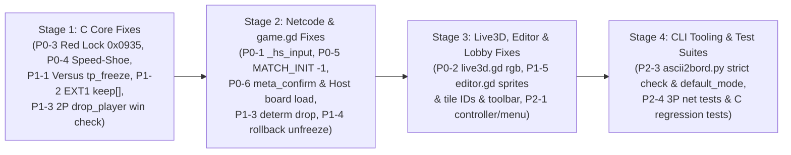

# Step On It! Remastered — Post-`4555ec4` Audit & Complete Remediation Plan

## 2. Audit Verdict Matrix 

| ID | Area | Verdict | Root-Cause Summary & Exact Location |
| :--- | :--- | :--- | :--- |
| **D2** | `EXT1` pre-scan & field preservation | **PARTIAL (P1-2)** | Pre-scan works, **but** [soi_state.c](file:///usr/local/google/home/seanstappas/tmp/repos/steps/core/src/soi_state.c#L272-L282) (`soi_next_level`) and [soi_state.c](file:///usr/local/google/home/seanstappas/tmp/repos/steps/core/src/soi_state.c#L710-L720) (`reload_board_on_death`) copy `keep[]` *before* `soi_load_level` and `soi_spawn_player3`, so `EXT1.starting_lives` resets decremented lives on death reload (infinite lives!) and `soi_spawn_player3` clobbers P3's `lives`/`balls`/`arrows` with P1's. Also `soi_load_level` ([soi_state.c](file:///usr/local/google/home/seanstappas/tmp/repos/steps/core/src/soi_state.c#L453)) unconditionally overwrites `w->play_mode` with `EXT1.default_mode`. |
| **D3** | `soi_spawn_player3` spiral | **PASS** | Implemented in [soi_state.c](file:///usr/local/google/home/seanstappas/tmp/repos/steps/core/src/soi_state.c#L127-L201). |
| **D4** | `soi_drop_player`, `p3_any_key`, `SOI_IN_META_CONFIRM` | **PARTIAL (P1-3)** | Bound in C and GDExtension, **but** `soi_drop_player` ([soi_state.c](file:///usr/local/google/home/seanstappas/tmp/repos/steps/core/src/soi_state.c#L227)) sets `active = 0`, which causes `soi_level_complete` ([soi_state.c](file:///usr/local/google/home/seanstappas/tmp/repos/steps/core/src/soi_state.c#L1187-L1205), requiring `active >= 2`) to never finish a 2P Versus match when P2 drops. |
| **D5** | `soi_net_hash` completeness | **PASS** | 100% of simulation state fields in `SoiWorld`, `SoiPlayer[0..3]`, `SoiEnemy[0..63]`, `SoiProjectile[0..7]`, `banim[0..9]`, and `sw_*` are hashed in [soi_state.c](file:///usr/local/google/home/seanstappas/tmp/repos/steps/core/src/soi_state.c#L1580-L1699). |
| **D6** | `test_synctest.c` & `verify.ps1` | **PARTIAL (P2-4)** | `test_synctest.c` passes 152/152 boards (1,000 ticks with divergent rollback), **but** [verify.ps1](file:///usr/local/google/home/seanstappas/tmp/repos/steps/tools/verify.ps1#L1-L145) does not pin golden `soi_state_hash` values or invoke `ascii2bord.py verify-roundtrip` / `--test-editor`. |
| **D7** | Direct-hit double-kill fix | **PASS** | Direct projectile ([soi_enemies.c](file:///usr/local/google/home/seanstappas/tmp/repos/steps/core/src/soi_enemies.c#L1559-L1560)) and speed-shoe ([soi_state.c](file:///usr/local/google/home/seanstappas/tmp/repos/steps/core/src/soi_state.c#L921-L922)) hits zero `last_attacker` and `attacker_ttl`. |
| **D8** | `give_key`, `p3_any_key` & `0x0933..0x0935` | **BROKEN (P0-3)** | Walking into Red Lock `0x0934` ([soi_grid.c](file:///usr/local/google/home/seanstappas/tmp/repos/steps/core/src/soi_grid.c#L378)) writes `0x0935u | SOI_CELL_SUPPORTIVE | SOI_CELL_DOOR` (`0x0B35`), which is a solid wall and fails both `c == 0x0935u` ([soi_grid.c](file:///usr/local/google/home/seanstappas/tmp/repos/steps/core/src/soi_grid.c#L303)) and `cell == 0x0935` ([game.gd](file:///usr/local/google/home/seanstappas/tmp/repos/steps/godot_project/scenes/game.gd#L2805)). |
| **D9** | Disable `tp_freeze` in Versus | **FAIL (P1-1)** | Completely missed in `4555ec4`: [soi_grid.c](file:///usr/local/google/home/seanstappas/tmp/repos/steps/core/src/soi_grid.c#L421) still only checks `w->play_mode != SOI_MODE_COMPETE`, freezing Versus arenas for 211 ticks on teleport. |
| **D10** | `respawn_player_in_place` | **PASS** | Evaluates player spawns, `p3_col/row`, `vs_spawns`, active enemies, and shatters trap blocks ([soi_state.c](file:///usr/local/google/home/seanstappas/tmp/repos/steps/core/src/soi_state.c#L751-L851)). |
| **D11** | Dual speed-shoe bounce separation | **BROKEN (P0-4)** | Typo in [soi_state.c](file:///usr/local/google/home/seanstappas/tmp/repos/steps/core/src/soi_state.c#L897): `else` branch (`p1->x > p2->x`) has `p2->x += push;` instead of `p2->x -= push;`, shifting both players right without separating them. |
| **D12** | `goodies_total > 0` guard & `kills` keep | **PASS** | Implemented in [soi_state.c](file:///usr/local/google/home/seanstappas/tmp/repos/steps/core/src/soi_state.c#L679) and [soi_state.c](file:///usr/local/google/home/seanstappas/tmp/repos/steps/core/src/soi_state.c#L1194). |
| **D13** | Rollback unfreeze in `game.gd` | **PARTIAL (P1-4)** | Rollback runs before `game_over()` return, **but** `_tally_captured` and `_game_over_active` are reset *before* the resimulation loop ([game.gd](file:///usr/local/google/home/seanstappas/tmp/repos/steps/godot_project/scenes/game.gd#L1526-L1535)) instead of after line 1544, breaking tally state when a board stays complete after rollback and leaving music muted after unfreezing Game Over. |
| **D14** | Audio gating & FX pruning | **PASS** | Implemented in [game.gd](file:///usr/local/google/home/seanstappas/tmp/repos/steps/godot_project/scenes/game.gd#L1475-L1486) (minor 1-tick offset because `_net.current_tick += 1` at line 1620 runs before `_spawn_death_pop` at line 1638). |
| **D15** | Big-Endian wire & `IN_META_CONFIRM` | **BROKEN (P0-5, P0-6)** | (1) `MATCH_INIT` packs `-1` (`Map Default`) into `uint8` (`255`), so Host sees `-1` while Client sees `255 >= 0` and overrides `victory_rule`/`friendly_fire` ([rollback_net.gd](file:///usr/local/google/home/seanstappas/tmp/repos/steps/godot_project/scenes/rollback_net.gd#L267-L268), [game.gd](file:///usr/local/google/home/seanstappas/tmp/repos/steps/godot_project/scenes/game.gd#L1395-L1400)), **desyncing at Tick 0**; (2) `_poll_online_meta_confirm()` ([game.gd](file:///usr/local/google/home/seanstappas/tmp/repos/steps/godot_project/scenes/game.gd#L2050-L2098)) **100% deadlocks** because `_net.current_tick` is frozen at `T_end`, and when `all_confirmed` is true on Host, Host calls `_net.send_board_load(...)` without ever advancing/restarting the board on the Host itself! |
| **D16** | Ack window, Clock-Rift, `DROP_PEER` | **PARTIAL (P1-3, P2-2)** | Ack-anchored window works. Half-RTT clock-rift & Adaptive Base Delay are unimplemented (`rolling_rtt_ms` unused at [rollback_net.gd](file:///usr/local/google/home/seanstappas/tmp/repos/steps/godot_project/scenes/rollback_net.gd#L57), `tick_rift` hardcoded `0` at line 422); `_core.drop_player` is called at non-deterministic local ticks ([game.gd](file:///usr/local/google/home/seanstappas/tmp/repos/steps/godot_project/scenes/game.gd#L1200-L1202)) and wiped out on rollback. |
| **D17** | Base32 Join Code & `headless_relay.gd` | **PARTIAL (P2-1, P2-2)** | [main_menu.gd](file:///usr/local/google/home/seanstappas/tmp/repos/steps/godot_project/scenes/main_menu.gd#L924-L937) never calls `join_code_to_port()`, breaking non-7777 join codes; [headless_relay.gd](file:///usr/local/google/home/seanstappas/tmp/repos/steps/godot_project/scenes/headless_relay.gd#L18-L54) and `RollbackNet.start_host` both bind server sockets, so a Host cannot host via the relay. |
| **D18** | 10,000-tick 3P soak & adversarial tests | **PARTIAL (P2-4)** | `net_soak_test.gd` works, **but** [test_net_edge_cases.gd](file:///usr/local/google/home/seanstappas/tmp/repos/steps/godot_project/scenes/test_net_edge_cases.gd#L162-L167) and [test_net_adversarial.gd](file:///usr/local/google/home/seanstappas/tmp/repos/steps/godot_project/scenes/test_net_adversarial.gd#L120-L125) never call `core.spawn_player3()` (leaving P3 inactive so all `net3` inputs/drops are no-ops) and pass invalid `set_play_mode(0)`. |
| **D19** | P3 Crimson Red shader, doors, HUD | **BROKEN (P0-2)** | `p3_tint.gdshader` and `game.gd:_redden` work, **but** [live3d.gd](file:///usr/local/google/home/seanstappas/tmp/repos/steps/godot_project/scenes/live3d.gd#L38-L48) deleted `vec3 rgb = ...;` while still referencing undeclared `rgb` on lines 40–48, breaking shader compilation in `Live3D`. |
| **D20** | `ascii2bord.py` roundtrip & `vs_spawns` | **PARTIAL (P2-3)** | `vs_spawns` regex and `\xff\x60` strip work across 152/152 boards, **but** [ascii2bord.py](file:///usr/local/google/home/seanstappas/tmp/repos/steps/tools/ascii2bord.py#L564) has `if orig_clean == recompiled or len(orig_clean) == len(recompiled):` (masking any same-length corruption) and drops `EXT1.default_mode`. |
| **D21** | Visual Map Maker (`editor.gd`) | **BROKEN (P1-5)** | (1) `_get_sprite()` ([editor.gd](file:///usr/local/google/home/seanstappas/tmp/repos/steps/godot_project/scenes/editor.gd#L172)) looks for non-existent `frame_%03d.png` and wrong folder names (`ant_teeth`, `enemy_family_02..07`), returning `null` for 100% of sprites; (2) `BRUSHES` ([editor.gd](file:///usr/local/google/home/seanstappas/tmp/repos/steps/godot_project/scenes/editor.gd#L46-L79)) uses wrong tile IDs (`0x0913..0x0915` Time Bonuses for P1 Blue Key/Lock/Door, `0x0923..0x0925` for P2 Green, `0x081C/0x081D` Teleporters for Stop/Go, `0x0704` Walker for Robo); (3) Top toolbar has no controls for Mode/Rule/FF/Lives/Bonus; (4) `Session.start_campaign()` ([session.gd](file:///usr/local/google/home/seanstappas/tmp/repos/steps/godot_project/scenes/session.gd#L65-L79)) never clears `custom_board_bytes`. |
| **D22** | 71 Hz default, lobby, controller, hysteresis | **BROKEN (P0-1, P2-1)** | (1) **P0 Regression**: [game.gd](file:///usr/local/google/home/seanstappas/tmp/repos/steps/godot_project/scenes/game.gd#L1906) accidentally deleted `if _hs_state == "entry": _hs_input(e); return` when inserting `_disconnect_banner`, breaking high-score initials entry completely; (2) `_claim_controller_slot` ([main_menu.gd](file:///usr/local/google/home/seanstappas/tmp/repos/steps/godot_project/scenes/main_menu.gd#L551-L561)) only runs when `_online_dialog` is visible and immediately exits because `player_device` starts at `[-1, -2, 0]`; (3) Offline menu has no UI for Victory Rule, Friendly Fire, P3 Any-Key, or Custom Maps. |

---

## 3. Detailed 4-Stage Remediation Plan



---

### Stage 1: C Core Fixes (`core/src/soi_grid.c`, `core/src/soi_state.c`)

#### 1.1 Fix P0-3 (Red Lock `0x0934` Walk-Over Unlock & `p3_any_key` Competitive Door Exit) & P1-1 (`tp_freeze` in Versus) — [soi_grid.c](file:///usr/local/google/home/seanstappas/tmp/repos/steps/core/src/soi_grid.c#L298-L425)

1. **In `soi_pickup_check` door exit (`core/src/soi_grid.c:298-307`)**:
   - When `competitive` is true (`Compete` or `Versus`), require the exiting player to hold a key (`w->players[player].has_key == 1`) if `p3_any` was used to unlock another player's door, or check `(c & 0x9FFu) == 0x0935u` for Red Door:
   ```c
   if (c & SOI_CELL_DOOR) {
       if (t == 4) {
           p->has_key = 2;
           soi_sfx_emit(w, SOI_SFX_VICTORY);
           return;
       }
       if (((player == 1 || !competitive || (p3_any && p->has_key == 1)) && (t == 0x0D || t == 0x0E)) ||
           ((player == 2 || !competitive || (p3_any && p->has_key == 1)) && (t == 0x0F || t == 0x10)) ||
           ((player == 3 || !competitive || p3_any) && (c & 0x9FFu) == 0x0935u)) {
           p->has_key = 2;
           soi_sfx_emit(w, SOI_SFX_VICTORY);
           return;
       }
   }
   ```
2. **In `soi_pickup_check` walk-over unlock (`core/src/soi_grid.c:377-379`)**:
   - Write `0x0935u | SOI_CELL_DOOR` (`0x0935u`) **without** `SOI_CELL_SUPPORTIVE` (`0x0200`) so the unlocked Red Door is not a solid wall and matches `c == 0x0935u` in both C and `game.gd`:
   ```c
   } else if ((c & 0x9FFu) == 0x0934u && (player == 3 || !competitive || p3_any) && w->players[player].has_key == 1) {
       w->cell[prow][pcol] = 0x0935u;
       soi_sfx_emit(w, SOI_SFX_UNLOCK);
   }
   ```
3. **In `soi_pickup_check` teleporter freeze (`core/src/soi_grid.c:421-423`)**:
   - Exclude `SOI_MODE_VERSUS` so teleporters never freeze the arena for 211 ticks in Versus mode:
   ```c
   if (w->play_mode != SOI_MODE_COMPETE && w->play_mode != SOI_MODE_VERSUS) {
       w->tp_freeze = 211;
   }
   ```

#### 1.2 Fix P0-4 (Dual Speed-Shoe Bounce Separation Typo) — [soi_state.c](file:///usr/local/google/home/seanstappas/tmp/repos/steps/core/src/soi_state.c#L891-L901)

In `check_pvp_body_collisions` (`core/src/soi_state.c:897`), fix `p2->x += push;` to `p2->x -= push;` in the `else` branch (`p1->x > p2->x`):
```c
                if (p1->x <= p2->x) {
                    p1->x -= push;
                    p2->x += push;
                    p1->facing = -1;
                    p2->facing = 1;
                } else {
                    p1->x += push;
                    p2->x -= push;
                    p1->facing = 1;
                    p2->facing = -1;
                }
```

#### 1.3 Fix P1-2 (`keep[]` Clobber in `soi_next_level` & `reload_board_on_death`) — [soi_state.c](file:///usr/local/google/home/seanstappas/tmp/repos/steps/core/src/soi_state.c#L249-L292) & [soi_state.c](file:///usr/local/google/home/seanstappas/tmp/repos/steps/core/src/soi_state.c#L676-L726)

1. **In `soi_next_level` (`core/src/soi_state.c:249-292`)**:
   - Add `uint8_t active, elim;` to `keep[SOI_MAX_PLAYERS]`, save them before `soi_world_init`, and restore `keep[i]` **after** `soi_load_level` and `soi_spawn_player3` so `EXT1.starting_lives`, `EXT1.default_mode`, and `soi_spawn_player3` do not overwrite carried-over lives, ammo, P3 stats, or active/eliminated state:
   ```c
   int soi_next_level(SoiWorld *w, const uint8_t *bord, size_t len)
   {
       struct {
           int32_t  score, lives;
           int16_t  arrows, balls, shield;
           uint16_t kills;
           uint8_t  active, elim;
       } keep[SOI_MAX_PLAYERS];
       uint32_t seed = w ? w->rng_seed : 1u;
       uint8_t mode = w ? w->play_mode : SOI_MODE_ONE;
       uint8_t assist = w ? w->input_assist : 0;
       uint8_t ffire = w ? w->friendly_fire : 0;
       uint8_t vrule = w ? w->victory_rule : 0;
       uint8_t p3any = w ? w->p3_any_key : 0;
       int i;

       if (!w) return -1;
       for (i = 0; i < SOI_MAX_PLAYERS; i++) {
           keep[i].score  = w->players[i].score;
           keep[i].lives  = w->players[i].lives;
           keep[i].arrows = w->players[i].arrows;
           keep[i].balls  = w->players[i].balls;
           keep[i].shield = w->players[i].shield;
           keep[i].kills  = w->players[i].kills;
           keep[i].active = w->players[i].active;
           keep[i].elim   = w->players[i].eliminated;
       }
       soi_world_init(w, seed);
       if (soi_load_level(w, bord, len) != 0) return -1;
       if (keep[3].active) soi_spawn_player3(w);
       w->play_mode     = mode;
       w->input_assist  = assist;
       w->friendly_fire = ffire;
       w->victory_rule  = vrule;
       w->p3_any_key    = p3any;
       for (i = 1; i < SOI_MAX_PLAYERS; i++) {
           w->players[i].score      = keep[i].score;
           w->players[i].lives      = keep[i].lives;
           w->players[i].arrows     = keep[i].arrows;
           w->players[i].balls      = keep[i].balls;
           w->players[i].shield     = keep[i].shield;
           w->players[i].kills      = keep[i].kills;
           w->players[i].active     = keep[i].active;
           w->players[i].eliminated = keep[i].elim;
           if (keep[i].elim) {
               w->players[i].alive = 0;
               w->players[i].ground_state = SOI_ST_DEAD;
           }
       }
       return 0;
   }
   ```
2. **In `reload_board_on_death` (`core/src/soi_state.c:696-724`)**:
   - Move `soi_load_level(w, copy, len)` and `if (p3_active) soi_spawn_player3(w);` **before** the `for (i = 1; i < SOI_MAX_PLAYERS; i++)` restoration loop and restore `w->play_mode = mode; w->input_assist = assist; w->friendly_fire = ffire; w->victory_rule = vrule; w->p3_any_key = p3any;` after `soi_load_level`.

#### 1.4 Fix P1-3 (2P Versus Completion After `soi_drop_player`) — [soi_state.c](file:///usr/local/google/home/seanstappas/tmp/repos/steps/core/src/soi_state.c#L1184-L1206)

In `soi_level_complete` (`core/src/soi_state.c:1187, 1197`), count `w->players[i].active || w->players[i].eliminated` as match participants so that dropping/eliminating 1 of 2 players in a 2P Versus match still satisfies `participants >= 2 && alive_count <= 1` (and ensure `soi_set_num_players` at line 220 clears `w->players[i].eliminated = 0` for unused slots):
```c
    if (w->play_mode == SOI_MODE_VERSUS) {
        if (w->victory_rule == SOI_WIN_LIVES) {
            int participants = 0, alive_count = 0;
            for (i = 1; i < SOI_MAX_PLAYERS; i++) {
                if (!w->players[i].active && !w->players[i].eliminated) continue;
                participants++;
                if (!w->players[i].eliminated && (w->players[i].alive || w->players[i].lives > 0))
                    alive_count++;
            }
            if (participants >= 2 && alive_count <= 1) return 1;
            return 0;
        } else if (w->victory_rule == SOI_WIN_SCORE) {
            if (w->goodies_total > 0 && w->goodies_left == 0) return 1;
            int participants = 0, alive_count = 0;
            for (i = 1; i < SOI_MAX_PLAYERS; i++) {
                if (!w->players[i].active && !w->players[i].eliminated) continue;
                participants++;
                if (!w->players[i].eliminated && (w->players[i].alive || w->players[i].lives > 0))
                    alive_count++;
            }
            if (participants >= 2 && alive_count == 0) return 1;
            return 0;
        }
    }
```

---

### Stage 2: Rollback Netcode & `game.gd` Lifecycle Fixes (`rollback_net.gd`, `game.gd`)

#### 2.1 Fix P0-1 (Restore Deleted High-Score Initials Input Handler) — [game.gd](file:///usr/local/google/home/seanstappas/tmp/repos/steps/godot_project/scenes/game.gd#L1905-L1916)

In `game.gd:_unhandled_input(e: InputEvent)` (`line 1906`), restore the `_hs_state == "entry"` check immediately above `if _disconnect_banner != "":`:
```gdscript
func _unhandled_input(e: InputEvent) -> void:
	if _hs_state == "entry":
		_hs_input(e)
		return
	if _disconnect_banner != "":
```

#### 2.2 Fix P0-5 (`MATCH_INIT` `-1` Map-Default Sentinel Underflow & `input_assist`) — [rollback_net.gd](file:///usr/local/google/home/seanstappas/tmp/repos/steps/godot_project/scenes/rollback_net.gd#L262-L275) & [game.gd](file:///usr/local/google/home/seanstappas/tmp/repos/steps/godot_project/scenes/game.gd#L1390)

1. **In `rollback_net.gd:send_match_init` (`lines 267-268`)**:
   ```gdscript
   pkt[4] = 255 if victory_rule < 0 else (victory_rule & 0xFF)
   pkt[5] = 255 if friendly_fire < 0 else (friendly_fire & 0xFF)
   ```
2. **In `rollback_net.gd:_handle_match_init` (`lines 585-586`)**:
   ```gdscript
   var v_rule: int = -1 if int(pkt[4]) == 255 else int(pkt[4])
   var ff_val: int = -1 if int(pkt[5]) == 255 else int(pkt[5])
   ```
3. **In `game.gd:_start()` (`line 1390`)**:
   Replace `_core.set_input_assist(true)` with `_core.set_input_assist(Session.input_assist)`.

#### 2.3 Fix P0-6 (Online Post-Board & Game-Over Deadlock + Missing Host Board Transition) — [rollback_net.gd](file:///usr/local/google/home/seanstappas/tmp/repos/steps/godot_project/scenes/rollback_net.gd#L477-L492) & [game.gd](file:///usr/local/google/home/seanstappas/tmp/repos/steps/godot_project/scenes/game.gd#L2050-L2112)

1. **In `rollback_net.gd:_handle_input_tick` (`lines 481-490`)**:
   Allow sticky `IN_META_CONFIRM` (`0x80`) bit to merge onto `current_tick + BASE_DELAY` even if the peer previously sent `0` on the first frame of the tally screen:
   ```gdscript
   if not input_confirmed[slot].get(t, false):
       var predicted_val: int = get_or_predict_input(slot, t)
       var had_pred: bool = input_history[slot].has(t)
       input_history[slot][t] = val
       input_confirmed[slot][t] = true
       if t < current_tick and had_pred and predicted_val != val:
           if earliest_mispredicted_tick == -1 or t < earliest_mispredicted_tick:
               earliest_mispredicted_tick = t
   elif (val & IN_META_CONFIRM) != 0:
       input_history[slot][t] = int(input_history[slot].get(t, 0)) | IN_META_CONFIRM
   ```
2. **In `game.gd:_poll_online_meta_confirm()` (`lines 2050-2098`)**:
   - Check `var confirm_tick: int = _net.current_tick + RollbackNet.BASE_DELAY` using `int(_net.input_history[slot].get(confirm_tick, 0))`.
   - When `all_confirmed` is true on the Host (`_net.is_host`), execute the board transition on the Host in addition to calling `_net.send_board_load(...)`, and increment `Session.board_index` on Clients inside `_on_net_board_loaded`:
   ```gdscript
   func _poll_online_meta_confirm() -> void:
   	if _net == null:
   		return
   	var local_inp: int = RollbackNet.IN_META_CONFIRM if _online_meta_confirmed else 0
   	_net.send_local_input(local_inp)

   	var confirm_tick: int = _net.current_tick + RollbackNet.BASE_DELAY
   	var all_confirmed: bool = true
   	for slot in range(_num_players):
   		if _net.dropped_peers.has(slot):
   			continue
   		var peer_in: int = int(_net.input_history[slot].get(confirm_tick, 0))
   		if (peer_in & RollbackNet.IN_META_CONFIRM) == 0:
   			all_confirmed = false
   			break

   	if not all_confirmed:
   		return

   	_online_meta_confirmed = false
   	if _net.is_host:
   		var next_seed: int = (int(Time.get_ticks_usec()) & 0x7FFFFFFF) | 1
   		if _core.level_complete() or _core.challenge_failed():
   			var was_challenge_fail: bool = _core.challenge_failed() and not _core.level_complete()
   			if not Session.custom_map_path.is_empty() or not Session.custom_board_bytes.is_empty():
   				_net.send_board_load(_level_bytes, next_seed, true)
   				Session.online_seed = next_seed
   				_net.reset_for_new_board()
   				_start()
   			elif Session.board_index + 1 < Session.board_list.size():
   				Session.board_index += 1
   				var next_bytes: PackedByteArray = _read_file(Session.current_board_path())
   				_level_bytes = next_bytes
   				Session.online_bord_bytes = next_bytes
   				Session.online_seed = next_seed
   				_net.send_board_load(next_bytes, next_seed, false)
   				_net.reset_for_new_board()
   				if was_challenge_fail:
   					for p in [1, 2, 3]:
   						var st: Dictionary = _board_start_stats.get(p, {})
   						if not st.is_empty():
   							_core.set_player_stats(p, st["score"], st["lives"], st["arrows"], st["balls"], st["shield"])
   				_next_board()
   		elif _core.game_over():
   			_net.send_board_load(_level_bytes, next_seed, true)
   			Session.online_seed = next_seed
   			_net.reset_for_new_board()
   			_start()
   ```
   And in `_on_net_board_loaded` (`game.gd:2100-2112`), when `not is_retry`:
   ```gdscript
   	else:
   		if not _net.is_host and Session.board_index + 1 < Session.board_list.size():
   			Session.board_index += 1
   		if _core.challenge_failed() and not _core.level_complete():
   			for p in [1, 2, 3]:
   				var st: Dictionary = _board_start_stats.get(p, {})
   				if not st.is_empty():
   					_core.set_player_stats(p, st["score"], st["lives"], st["arrows"], st["balls"], st["shield"])
   		_next_board()
   ```

#### 2.4 Fix P1-3 (Deterministic Tick-Stamped `PKT_DROP_PEER` & Rollback Replay) — [rollback_net.gd](file:///usr/local/google/home/seanstappas/tmp/repos/steps/godot_project/scenes/rollback_net.gd#L389-L406) & [game.gd](file:///usr/local/google/home/seanstappas/tmp/repos/steps/godot_project/scenes/game.gd#L1196-L1203)

1. **In `rollback_net.gd`**:
   - Add `var peer_drop_tick: Dictionary = {}` (cleared in `reset_state()` and `reset_for_new_board()`).
   - In `_handle_local_peer_timeout` (`line 343`) and `_handle_drop_peer` (`line 395`), record `var drop_t: int = last_t + 1; peer_drop_tick[slot] = drop_t`.
   - In `_handle_drop_peer` (`lines 397-402`), check if overwriting `input_history[slot][tk]` or zeroing predicted inputs at `t >= drop_t` differs from any existing prediction at `t < current_tick`, and if so update `earliest_mispredicted_tick`:
     ```gdscript
     for tk in range(last_t + 1, current_tick + BASE_DELAY + 1):
         if input_history[slot].get(tk, 0) != 0 and tk < current_tick:
             if earliest_mispredicted_tick == -1 or tk < earliest_mispredicted_tick:
                 earliest_mispredicted_tick = tk
         input_history[slot][tk] = 0
         input_confirmed[slot][tk] = true
     ```
   - In `get_or_predict_input(slot: int, tick: int)` (`lines 531-540`), check `if peer_drop_tick.has(slot) and tick >= int(peer_drop_tick[slot]): return 0` **at the very top** before checking `input_history[slot].has(tick)`.
2. **In `game.gd`**:
   - Instead of calling `_core.drop_player(slot + 1)` inside `_on_net_peer_disconnected` at an arbitrary tick, apply `_core.drop_player(slot + 1)` deterministically before `tick3` whenever `sim_t == int(_net.peer_drop_tick[slot])` (both in the rollback resimulation loop at `game.gd:1536` and in the live tick at `game.gd:1617`).

#### 2.5 Fix P1-4 (Move Rollback Unfreeze Checks After Resimulation Loop & Restore Music/Flags) & N4 (Particle Tick Stamp) — [game.gd](file:///usr/local/google/home/seanstappas/tmp/repos/steps/godot_project/scenes/game.gd#L1522-L1645)

1. In `game.gd:_physics_process` (`lines 1522-1547`), move the `_tally_captured` and `_game_over_active` unfreeze checks to **after** the `for sim_t in range(rb_tick, _net.current_tick):` loop:
   ```gdscript
   					for sim_t in range(rb_tick, _net.current_tick):
   						for d_slot in _net.peer_drop_tick.keys():
   							if sim_t == int(_net.peer_drop_tick[d_slot]):
   								_core.drop_player(int(d_slot) + 1)
   						var s_p1: int = _net.get_or_predict_input(0, sim_t)
   						var s_p2: int = _net.get_or_predict_input(1, sim_t) if _num_players >= 2 else 0
   						var s_p3: int = _net.get_or_predict_input(2, sim_t) if _num_players >= 3 else 0
   						_net.snapshot_ring[sim_t % RollbackNet.RING_BUFFER_SIZE] = _core.snapshot_save()
   						_core.tick3(s_p1, s_p2, s_p3)
   						_net.record_state_hash(sim_t, int(_core.net_hash() & 0xFFFFFFFF))
   						for _i in range(_core.sfx_count()):
   							_core.sfx_get(_i)

   					if _tally_captured and not _core.level_complete():
   						_tally_captured = false
   						_tally_anim = 0.0
   						_warp_anim = 0.0
   						_online_meta_confirmed = false
   						_update_board_music()
   					if _game_over_active and not _core.game_over():
   						_game_over_active = false
   						_game_over_ticks = 0
   						_game_over_letters.clear()
   						_online_meta_confirmed = false
   						_hs_checked = false
   						_hs_state = ""
   						_update_board_music()
   					if _challenge_forfeited and not _core.challenge_failed():
   						_challenge_forfeited = false
   						_online_meta_confirmed = false

   					_prune_render_history(rb_tick)
   					_net.is_resimulating = false
   ```
2. Move `_net.current_tick += 1` (`line 1620`) to **after** the SFX/death-pop/debris loop (`line 1646`) so `_spawn_death_pop` and `_spawn_debris` record the exact tick `T` on which they occurred.

#### 2.6 Fix P2-2 (Half-RTT Clock-Rift Equalization & Adaptive Base Delay) — [rollback_net.gd](file:///usr/local/google/home/seanstappas/tmp/repos/steps/godot_project/scenes/rollback_net.gd#L417-L576)

- In `send_local_input` (`rollback_net.gd:422`), compute `var rift: int = clampi(current_tick - min_confirmed, -32768, 32767)` and write `encode_be16(pkt, 2, rift & 0xFFFF)`.
- In `_handle_input_tick` (`rollback_net.gd:469`), decode the remote peer's `remote_rift` (`int16` from `pkt[2..3]`), update `rolling_rtt_ms`, and update `consecutive_rift_frames` when `(local_rift - remote_rift) > 3` so `game.gd:1500-1505` nudges `Engine.time_scale` (`0.98` / `1.02`) before hitting the 16-tick Rift Stall ceiling.

---

### Stage 3: `Live3D` Shader, Visual Map Maker (`editor.gd`), & Lobby/Controller Fixes (`main_menu.gd`, `session.gd`)

#### 3.1 Fix P0-2 (`Live3D` Undeclared `rgb` Shader Compile Error) — [live3d.gd](file:///usr/local/google/home/seanstappas/tmp/repos/steps/godot_project/scenes/live3d.gd#L36-L49)

Restore `vec3 rgb = a > 0.001 ? c.rgb / a : vec3(0.0);` at line 39 of `live3d.gd`:
```glsl
	vec4 c = texture(TEXTURE, uv);
	float a = m * c.a;
	vec3 rgb = a > 0.001 ? c.rgb / a : vec3(0.0);
	if (tint_mode == 1) {
		float max_bg = max(rgb.g, rgb.b);
		if (max_bg > rgb.r * 1.25 && max_bg > 0.15) {
			float luma = dot(rgb, vec3(0.299, 0.587, 0.114));
			float t = clamp(luma * 1.4, 0.0, 1.0);
			rgb = mix(vec3(0.557, 0.0, 0.0), vec3(0.898, 0.224, 0.208), t);
		}
	}
	COLOR = vec4(rgb, a);
```

#### 3.2 Fix P1-5 (Map Editor Sprite Loader, Tile IDs, Toolbar Controls & Campaign State Leak) — [editor.gd](file:///usr/local/google/home/seanstappas/tmp/repos/steps/godot_project/scenes/editor.gd#L46-L184) & [session.gd](file:///usr/local/google/home/seanstappas/tmp/repos/steps/godot_project/scenes/session.gd#L65-L79)

1. **Fix `_get_sprite(folder: String, frame: int)` in `editor.gd:166-182`**:
   Scan `res://../extracted/sprites/%s` using `DirAccess` and regex `^f0*%d_\d+x\d+\.png$` (matching `game.gd:_load_frames`) instead of looking for non-existent `frame_%03d.png`.
2. **Fix Corrupted Tile IDs and Folder Names in `editor.gd:46-79` (`BRUSHES`)**:
   - **Stop/Go Switch & Blocks**:
     - `"Stop/Go Switch"`: `0x0824` (was `0x081C` Teleporter 2 IN)
     - `"Stop/Go Block (Solid)"`: `0x039D` (was `0x081D` Teleporter 2 OUT)
     - `"Stop/Go Block (Pass)"`: `0x01A3`
   - **P1 Blue & P2 Green Keys / Locks / Doors**:
     - `"P1 Blue Key"`: `0x0908` (was `0x0913` Time Bonus)
     - `"P1 Blue Lock"`: `0x0905` (was `0x0914` Time Bonus)
     - `"P1 Blue Door"`: `0x0902` (was `0x0915` Time Bonus)
     - `"P2 Green Key"`: `0x0909` (was `0x0923` Teleporter OUT)
     - `"P2 Green Lock"`: `0x0906` (was `0x0924` Switch)
     - `"P2 Green Door"`: `0x0903` (was `0x0925` Switch)
   - **Enemy Brushes & Folder Names**:
     - `"Enemy: Ant"` (`0x0700`, folder `"ant_sprites"`, frame `1`)
     - `"Enemy: Wheelie"` (`0x0702`, folder `"wheelie_sprites"`, frame `1`)
     - `"Enemy: Walker"` (`0x0704`, folder `"walker_sprites"`, frame `1`)
     - `"Enemy: Hippo"` (`0x0705`, folder `"hippo_sprites"`, frame `1`)
     - `"Enemy: Ostrich"` (`0x0706`, folder `"ostrich_sprites"`, frame `1`)
     - `"Enemy: Piggy"` (`0x0708`, folder `"piggy_sprites"`, frame `1`)
     - `"Enemy: Teeth"` (`0x070A`, folder `"teeth_sprites"`, frame `1`)
     - `"Enemy: Smiley"` (`0x070B`, folder `"smiley_sprites"`, frame `1`)
     - `"Enemy: Hammer"` (`0x070C`, folder `"hammer_sprites"`, frame `1`)
     - `"Enemy: Robo"` (`0x070F`, folder `"robo_sprites"`, frame `1`)
     - Add `[F]` hotkey / toolbar toggle for Enemy Facing (`byte3 = 2` Right vs `byte3 = 4` Left, stored in bit 16..23 of the enemy cell).
3. **Update `_validate_map()` (`editor.gd:185-213`)**:
   Check P1 Blue (`0x0908`/`0x0905`/`0x0902`) and P2 Green (`0x0909`/`0x0906`/`0x0903`) key/door pairs in addition to Universal and P3 Red.
4. **Add Top Toolbar Controls (`editor.gd:385-398, 447-488`)**:
   Add clickable top-bar buttons to cycle `default_mode` (`Co-op` / `Compete` / `Versus`), `victory_rule` (`Lives` / `Score` / `Door`), `friendly_fire` (`FF: Off` / `FF: On`), and `starting_lives` (`1..9`).
5. **Fix `playtest_in_memory()` (`editor.gd:785-791`) & `Session.start_campaign()` (`session.gd:65-79`)**:
   - In `playtest_in_memory()`, set `Session.is_online = false`, `Session.num_players = 3 if has_p3 else 2`, `Session.mode = "versus" if default_mode == 2 else ("compete" if default_mode == 1 else "cooperate")`, `Session.victory_rule = victory_rule`, `Session.friendly_fire = 1 if friendly_fire else 0`.
   - In `Session.start_campaign()` (`session.gd:65-79`), clear `custom_board_bytes = PackedByteArray()` and `custom_map_path = ""` so exiting the editor never pollutes campaign mode.

#### 3.3 Fix P2-1 (Join Code Port Parsing & Local Controller Slot Claiming) — [main_menu.gd](file:///usr/local/google/home/seanstappas/tmp/repos/steps/godot_project/scenes/main_menu.gd#L551-L561) & [main_menu.gd](file:///usr/local/google/home/seanstappas/tmp/repos/steps/godot_project/scenes/main_menu.gd#L924-L937)

1. **In `main_menu.gd:924-937` (Join Code port extraction)**:
   ```gdscript
   	var target_ip: String = raw
   	var target_port: int = 7777
   	if raw.to_upper().begins_with("SOI-") or (not raw.contains(".") and not raw.contains(":")):
   		target_ip = RollbackNet.join_code_to_ip(raw)
   		target_port = RollbackNet.join_code_to_port(raw)
   		if target_ip.contains(":"):
   			target_ip = target_ip.split(":")[0]
   	elif raw.contains(":"):
   		var parts: PackedStringArray = raw.split(":")
   		target_ip = parts[0]
   		target_port = int(parts[1]) if parts[1].is_valid_int() else 7777
   ```
2. **In `main_menu.gd:551-561, 1266-1275` (`_claim_controller_slot`)**:
   Allow controller slot claiming on the local multiplayer menu (not only when `_online_dialog.visible` is true) by rotating or assigning the pressing device (`0..3` joypad or `-1`/`-2` keyboard) to the next unclaimed player slot (`_claimed_slots` array reset when player count changes).

---

### Stage 4: CLI Tooling (`ascii2bord.py`, `verify.ps1`) & Test Suite Hardening

#### 4.1 Fix P2-3 (`tools/ascii2bord.py` Strict Roundtrip Check & `default_mode` Serialization) — [ascii2bord.py](file:///usr/local/google/home/seanstappas/tmp/repos/steps/tools/ascii2bord.py#L241-L300) & [ascii2bord.py](file:///usr/local/google/home/seanstappas/tmp/repos/steps/tools/ascii2bord.py#L564)

1. At [ascii2bord.py](file:///usr/local/google/home/seanstappas/tmp/repos/steps/tools/ascii2bord.py#L564), remove the length-only fallback:
   ```python
   if orig_clean == recompiled:
       passed += 1
   ```
2. In `decompile_bord` (`lines 241-251`), emit `f"default_mode: {ext1.get('default_mode', 0)}"`, in `compile_bord_from_ascii` (`lines 385-419`), parse `elif k == "default_mode": ext1["default_mode"] = int(v)`, and in `compile_bord_from_records` (`lines 289-300`), pass `default_mode=ext1.get("default_mode", 0)` to `pack_ext1`.

#### 4.2 Fix P2-4 (Activate P3 in 3P Network Tests & Add C Core Regression Tests) — [test_net_edge_cases.gd](file:///usr/local/google/home/seanstappas/tmp/repos/steps/godot_project/scenes/test_net_edge_cases.gd#L162-L167), [test_net_adversarial.gd](file:///usr/local/google/home/seanstappas/tmp/repos/steps/godot_project/scenes/test_net_adversarial.gd#L120-L125), [test_mechanics.c](file:///usr/local/google/home/seanstappas/tmp/repos/steps/tests/test_mechanics.c#L4300-L4382)

1. In `test_net_edge_cases.gd:162-167` and `test_net_adversarial.gd:120-125`, call `core.set_play_mode(2)` (or `5` for Versus) and `core.spawn_player3()` before `core.limit_players(3)` so P3 is active and its inputs/disconnects affect `soi_net_hash`.
2. In `tests/test_mechanics.c` (Section 67), add assertions for:
   - Teleporter in `SOI_MODE_VERSUS` (`w.tp_freeze == 0`).
   - Dual speed-shoe collision when `p1.x > p2.x` (`p1.x = 110, p2.x = 100` $\rightarrow$ `p1.x > 110 && p2.x < 100`).
   - `reload_board_on_death` and `soi_next_level` on an `EXT1` board with `starting_lives = 5` preserving decremented `players[1].lives == 2` and `players[3].lives == 1`.
   - Walk-over unlock of Red Lock `0x0934` producing `0x0935` and triggering board victory on the next tick.
   - `soi_drop_player(&w, 2)` in a 2-player `SOI_MODE_VERSUS` match triggering `soi_level_complete(&w) == 1`.

---

## 4. Verification & Acceptance Commands

```bash
# 1. C Core Mechanics Suite (with new P0/P1 regression checks) under ASan+UBSan
gcc -std=c17 -O1 -fsanitize=address,undefined -Wall -Wextra -Icore/include -Icore/src \
    core/src/*.c tests/test_mechanics.c -lm -o /tmp/soi_mech && /tmp/soi_mech

# 2. C Core 1,000-Tick Divergent Rollback SyncTest across all 152 boards
gcc -std=c17 -O2 -Wall -Wextra -Icore/include core/src/*.c tests/test_synctest.c \
    -o /tmp/soi_synctest && /tmp/soi_synctest

# 3. Strict Byte-Exact CLI Map Compiler Roundtrip (152/152 boards + EXT1 default_mode & vs_spawns)
python3 tools/ascii2bord.py verify-roundtrip extracted/levels

# 4. Godot Headless Netcode, Live3D Shader, & Map Editor Verification (requires Godot 4.3 binary)
godot --headless --path godot_project -s scenes/test_net_edge_cases.gd
godot --headless --path godot_project -s scenes/test_net_adversarial.gd
godot --headless --path godot_project -s scenes/net_soak_test.gd
godot --headless --path godot_project -- --test-editor
```


