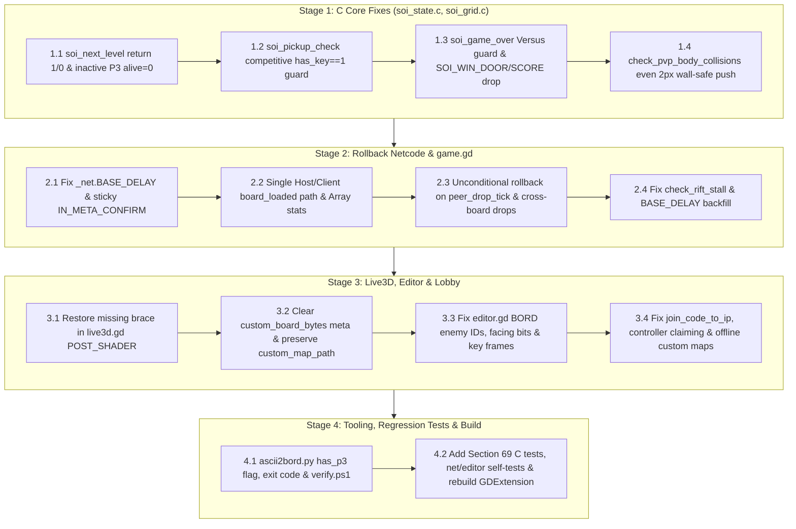

# Step On It! Remastered — Post-`a7c2bdd` Audit & Remediation Plan

---

## 1. Executive Summary: Were `plan/10_15.md` Improvements Done & Done Correctly?

Commit `a7c2bdd` (`"gap improvements"`, 14 files changed, `+1,028 / -165` lines) attempted all four stages of `plan/10_15.md` and currently passes:
- `tests/test_mechanics.c` (68 sections under `gcc -std=c17 -O1 -fsanitize=address,undefined`): **100% PASS**
- `tests/test_synctest.c` (152/152 boards $\times$ 1,000 ticks with divergent rollback): **100% PASS**
- `tools/ascii2bord.py verify-roundtrip extracted/levels`: **152/152 byte-exact PASS**

However, the multi-agent `/swarm` audit (`@core_auditor`, `@net_auditor`, `@ui_editor_auditor`, `@test_runner`, and independent `@verifier`) found that **several fixes in `a7c2bdd` were only partially applied or introduced new P0/P1 regressions**:

1. **8 P0 Blockers / Regressions**:
   - **P0-1 (`live3d.gd` Shader Syntax Error)**: Restoring `vec3 rgb = ...` at `godot_project/scenes/live3d.gd:38` deleted the closing `}` of `for (int y = -4; y <= 4; y++) {` (line 32), leaving `void fragment()` unclosed and breaking `POST_SHADER` compilation in 3D mode.
   - **P0-2 (`RollbackNet.BASE_DELAY` Static Access Crash)**: `godot_project/scenes/rollback_net.gd:14` changed `BASE_DELAY` from `const` to an instance `var`, while `godot_project/scenes/game.gd:2074` still accesses `RollbackNet.BASE_DELAY` on the class name, crashing in Godot 4 on the first frame of `_poll_online_meta_confirm()`.
   - **P0-3 (Online Tally `IN_META_CONFIRM` Deadlock)**: While `_net.current_tick` is frozen at `T_end` on the tally/game-over screen, `send_local_input()` (`godot_project/scenes/rollback_net.gd:468-469`) increments `target_tick = prev_scheduled + 1` at 71 Hz (`T_end + BASE_DELAY + K`), whereas `_poll_online_meta_confirm()` (`godot_project/scenes/game.gd:2074-2080`) only checks `confirm_tick = T_end + BASE_DELAY` (`K = 0`), deadlocking unless `Enter` was already held on frame 0 of the tally screen.
   - **P0-4 (Host Double Board Transition & `_board_start_stats.get()` Crash)**: `send_board_load()` (`godot_project/scenes/rollback_net.gd:304`) synchronously emits `board_loaded` on the Host (running `_on_net_board_loaded()`), and then `_poll_online_meta_confirm()` (`godot_project/scenes/game.gd:2093-2125`) immediately runs `reset_for_new_board()` and `_start()`/`_next_board()` a **second time** on the Host. In addition, `_board_start_stats.get(p, {})` (`godot_project/scenes/game.gd:2107, 2143`) calls `.get()` on an `Array`, crashing on Challenge failure.
   - **P0-5 (`soi_next_level` Return Value Inversion & `_next_board()` P3 Clobber)**: `soi_next_level` (`core/src/soi_state.c:258-298`) was changed to return `-1` on error and `0` on success, violating `core/include/soi_core.h:156-158` (`1` on success, `0` on error) and causing `SoiCore::next_level()` (`bridge/src/soi_bridge.cpp:36`) to return `false` on every valid level. Furthermore, `godot_project/scenes/game.gd:1409-1410` (`_next_board()`) calls `_core.spawn_player3()` *after* `_core.next_level()`, wiping P3's carried-over `lives`/`arrows`/`balls`/`kills` and resurrecting an eliminated/dropped P3.
   - **P0-6 (Peer Drop Desync When Predicted Input Was `0` & Cross-Board Drop Wipe)**: In `godot_project/scenes/rollback_net.gd:356-361` and `421-426`, when `drop_t = last_t + 1 < current_tick`, `earliest_mispredicted_tick` is only set if `input_history[slot].get(tk, 0) != 0`. If the dropped peer was predicted idle (`0`), no rollback runs and `_core.drop_player()` (`godot_project/scenes/game.gd:1627`) never executes. Furthermore, `reset_for_new_board()` (`godot_project/scenes/rollback_net.gd:197-199`) clears `dropped_peers`, causing the next board to stall at tick 16 waiting for the disconnected peer.
   - **P0-7 (Editor Playtest `custom_board_bytes` Metadata Leak & Host Custom Map Wipe)**: `godot_project/scenes/editor.gd:896` sets `Session.set_meta("custom_board_bytes", raw)` which `godot_project/scenes/game.gd:3214` checks first, and `Session.start_campaign()` (`godot_project/scenes/session.gd:162-165`) never calls `remove_meta("custom_board_bytes")`, permanently hijacking Campaign mode after one editor playtest. Conversely, `godot_project/scenes/main_menu.gd:905-908` calls `Session.start_campaign()` (which wipes `Session.custom_map_path = ""`) right before checking `if Session.custom_map_path != "":`!
   - **P0-8 (GDExtension Shared Library Rebuild Required)**: `godot_project/bin/` must be rebuilt after C Core changes so `soi_bridge` exports `drop_player` and the updated `soi_state.c`/`soi_grid.c` logic.
2. **4 P1 Gameplay & Editor Bugs**:
   - **P1-1 (`soi_pickup_check` Competitive Door Theft & `player == 3` Short-Circuit)** in `core/src/soi_grid.c:309-311`.
   - **P1-2 (Versus `soi_game_over` Hijack & `SOI_WIN_DOOR`/`SOI_WIN_SCORE` Drop Stall)** in `core/src/soi_state.c:1186-1230`.
   - **P1-3 (`check_pvp_body_collisions` Border-Wall Embedding & Odd-Pixel Misalignment)** in `core/src/soi_state.c:906-925`.
   - **P1-4 (`editor.gd` Enemy Brush Tile IDs Mismatching `soi_bord_badguy_type`, `[F]` Facing Corrupting `SpawnDelay`, & Wrong P1/P2 Key Sprite Frames)** in `godot_project/scenes/editor.gd:64-86, 495-503`.
3. **3 P2 Polish, Netcode & Tooling Gaps**:
   - **P2-1 (`check_rift_stall` Resetting `consecutive_rift_frames` Every Frame & Adaptive `BASE_DELAY` Input Holes)** in `godot_project/scenes/rollback_net.gd:516-522, 624-627`.
   - **P2-2 (Lobby Controller Slot Claiming Overwriting Slot 0, `join_code_to_ip` Appending `:port`, Client `board_list` Uninitialized, & Offline Custom Map Loading)** in `godot_project/scenes/main_menu.gd:551-565, 954-965`, `godot_project/scenes/rollback_net.gd:153-155`, and `godot_project/scenes/game.gd:1886-1930, 3213-3234`.
   - **P2-3 (`ascii2bord.py` Auto-Spiral P3 Flag & Exit Code + `verify.ps1` Hooks + Regression Tests)** in `tools/ascii2bord.py:124-125, 574` and `tools/verify.ps1:100-144`.

---

## 2. Complete Audit Verdict Matrix (`plan/10_15.md` Items at `a7c2bdd`)

| Plan Item | `D`-ID | Target Files | Verdict at `a7c2bdd` | Verification Summary |
| :--- | :--- | :--- | :--- | :--- |
| **Stage 1.1** | **D8, D9** | `core/src/soi_grid.c:302-435` | **PARTIAL (P1-1)** | Red Lock `0x0934` unlocks to `0x0935u` without `SOI_CELL_SUPPORTIVE` (`PASS`), and `tp_freeze` excludes `SOI_MODE_VERSUS` (`PASS`). **Bug**: `soi_pickup_check` lines 310–311 let keyless P1/P2 exit a door unlocked by P3 under `p3_any_key` and let keyless P3 exit an unlocked `0x0935`. |
| **Stage 1.2** | **D11** | `core/src/soi_state.c:906-925` | **PARTIAL (P1-3)** | `p2->x -= push;` sign typo fixed (`PASS`). **Bugs**: Clamps into solid border walls (`col 0`, `col grid_cols-1`), ignores interior `SOI_CELL_SUPPORTIVE` walls, and pushes by odd pixel counts when `dx % 4 == 2`, breaking 2-px cell alignment in `run_step`. |
| **Stage 1.3** | **D2** | `core/src/soi_state.c:257-299`, `godot_project/scenes/game.gd:1407-1410` | **BROKEN (P0-5)** | `keep[]` is restored after `soi_load_level`, **but** `soi_next_level` inverted its return value (`0` on success, `-1` on error), breaking `SoiCore::next_level()`. Also `game.gd:_next_board()` calls `_core.spawn_player3()` *after* `_core.next_level()`, clobbering P3's restored stats and resurrecting eliminated/dropped P3. |
| **Stage 1.4** | **D4** | `core/src/soi_state.c:1186-1230` | **PARTIAL (P1-2)** | 2P/3P `SOI_WIN_LIVES` counts `participants` (`PASS`). **Bugs**: `soi_game_over` returns `1` in `SOI_MODE_VERSUS` when `alive_count == 0` (hijacking Versus winner screen with Campaign Game Over), and `SOI_WIN_DOOR` / `SOI_WIN_SCORE` never finish when all opponents drop (`soi_drop_player`). |
| **Stage 2.1** | **D22 (P0-1)** | `godot_project/scenes/game.gd:1921-1928` | **PASS (Minor P2-2)** | `_hs_state == "entry"` restored (`PASS`). Minor P2 bugs: `JOY_BUTTON_A` at line 1886 bypasses `_hs_input`, and `KEY_SPACE` disconnect banner at line 1924 reassigns slot `0` instead of the disconnected controller's slot. |
| **Stage 2.2** | **D15 (P0-5)** | `godot_project/scenes/rollback_net.gd:275-276`, `godot_project/scenes/game.gd:1388` | **PASS** | `MATCH_INIT` encodes `-1` as `255` and decodes `255` back to `-1`; `_start()` uses `Session.input_assist`. |
| **Stage 2.3** | **D15 (P0-6)** | `godot_project/scenes/rollback_net.gd:304`, `godot_project/scenes/game.gd:2068-2147` | **BROKEN (P0-2, P0-3, P0-4)** | (1) `RollbackNet.BASE_DELAY` static access crashes; (2) `send_local_input` increments `target_tick` past `confirm_tick` while frozen at tally, deadlocking; (3) `send_board_load` emits `board_loaded` on Host while Host also transitions inline (double transition); (4) `_board_start_stats.get()` crashes on `Array`. |
| **Stage 2.4** | **D16 (P1-3)** | `godot_project/scenes/rollback_net.gd:355-426`, `godot_project/scenes/game.gd:1606-1628` | **BROKEN (P0-6)** | (1) If dropped peer's predicted input at `drop_t < current_tick` was `0`, no rollback triggers and `_core.drop_player` is skipped forever; (2) `reset_for_new_board()` wipes `dropped_peers`, stalling the next board at tick 16; (3) live tick saves `snapshot_ring` before `drop_player`. |
| **Stage 2.5** | **D13, D14** | `godot_project/scenes/game.gd:1537-1554, 1651-1659` | **PASS** | Unfreeze checks and music restoration run after the resimulation loop; `_net.current_tick += 1` runs after SFX/death-pop/debris spawning. |
| **Stage 2.6** | **D16 (P2-2)** | `godot_project/scenes/rollback_net.gd:516-627` | **BROKEN (P2-1)** | `check_rift_stall()` zeroes `consecutive_rift_frames` every frame whenever `last_confirmed_tick <= current_tick`, making `Engine.time_scale` drift recovery dead code; mid-board `BASE_DELAY` increase leaves unconfirmed holes in `input_history[local_slot]`. |
| **Stage 3.1** | **D19 (P0-2)** | `godot_project/scenes/live3d.gd:32-49` | **BROKEN (P0-1)** | `vec3 rgb = ...` restored at line 38, **but** closing `}` of `for (int y = -4; y <= 4; y++)` was deleted, breaking shader compilation. `p3_tint.gdshader` and Versus HUD `"K%d"` kills are `PASS`. |
| **Stage 3.2** | **D21 (P1-5)** | `godot_project/scenes/editor.gd:64-905`, `godot_project/scenes/session.gd:162-165` | **BROKEN (P0-7, P1-4)** | `_get_sprite()` regex loader and top toolbar work (`PASS`), **but**: (1) `Session.set_meta("custom_board_bytes", raw)` is never cleared by `Session.start_campaign()`; (2) Enemy `BRUSHES` use `SoiEnemyType` (`0x0700..0x070F`) instead of BORD placement IDs (`1..19`); (3) `[F]` writes into `SpawnDelay` (`bits 16..23`) instead of direction bits (`0x0500`/`0x0600`); (4) P1/P2 Keys use wrong sprite frames (`20`/`36` instead of `9`/`10`). |
| **Stage 3.3** | **D17, D22** | `godot_project/scenes/main_menu.gd:551-965`, `godot_project/scenes/rollback_net.gd:153-155` | **BROKEN (P0-7, P2-2)** | (1) `main_menu.gd:905` calls `Session.start_campaign()` right before checking `Session.custom_map_path != ""`, wiping the selected custom map; (2) `join_code_to_ip()` appends `":%d"` when `port != 7777`, breaking `join_match(ip, port)`; (3) `_claim_controller_slot` always overwrites slot `0` for unassigned joypads. |
| **Stage 4.1** | **D20 (P2-3)** | `tools/ascii2bord.py:124-575` | **PASS (Minor P2-3)** | Strict byte equality (`orig_clean == recompiled`) and `default_mode` + `vs_spawns` roundtrip pass **152/152** boards. Minor gaps: `pack_ext1` omits `flags |= 1` when `has_p3` is true with `[0, 0]` auto-spiral spawn, and `verify-roundtrip` exits `0` on failure. |
| **Stage 4.2** | **D6, D18** | `tests/test_mechanics.c:4398-4505`, `godot_project/scenes/test_net_edge_cases.gd:162-168` | **PASS (Minor P2-3)** | Section 68 C tests and 3P `spawn_player3()` in net tests added and passing. `tools/verify.ps1` still needs `ascii2bord.py verify-roundtrip` and `--test-editor` hooks. |
| **D3, D5, D7, D10, D12** | Previously closed | `core/src/soi_state.c`, `core/src/soi_enemies.c` | **PASS** | Verified intact in source and passing all C mechanics and 1,000-tick divergent rollback synctests. |

---

## 3. Detailed 4-Stage Remediation Plan



---

### Stage 1: C Core Fixes (`core/src/soi_state.c`, `core/src/soi_grid.c`)

#### 1.1 Fix P0-5 (`soi_next_level` Return Contract & Eliminated/Inactive Player State) — `core/src/soi_state.c:257-299` & `720-741`

1. **In `soi_next_level` (`core/src/soi_state.c:257-299`)**:
   - Restore the `core/include/soi_core.h:158` return contract (`1` on success, `0` on error) so `SoiCore::next_level()` (`bridge/src/soi_bridge.cpp:36`) returns `true` on success.
   - When `!keep[i].active || keep[i].elim`, set `w->players[i].alive = 0` and `w->players[i].ground_state = SOI_ST_IDLE` (`0`) instead of `SOI_ST_DEAD` (`0x80`), ensuring an inactive P3 on an `EXT1` (`has_p3`) board is not left with `alive = 1`.
   ```c
   int soi_next_level(SoiWorld *w, const uint8_t *bord, size_t len)
   {
       if (!w) return 0;
       ...
       soi_world_init(w, seed);
       if (!soi_load_level(w, bord, len)) return 0;
       if (keep[3].active) soi_spawn_player3(w);
       w->play_mode     = mode;
       w->input_assist  = assist;
       w->friendly_fire = ffire;
       w->victory_rule  = vrule;
       w->p3_any_key    = p3any;
       for (i = 1; i < SOI_MAX_PLAYERS; i++) {
           w->players[i].score      = keep[i].score;
           w->players[i].lives      = keep[i].lives;
           w->players[i].arrows     = keep[i].arrows;
           w->players[i].balls      = keep[i].balls;
           w->players[i].shield     = keep[i].shield;
           w->players[i].kills      = keep[i].kills;
           w->players[i].active     = keep[i].active;
           w->players[i].eliminated = keep[i].elim;
           if (!keep[i].active || keep[i].elim) {
               w->players[i].alive = 0;
               w->players[i].ground_state = SOI_ST_IDLE;
           }
       }
       return 1;
   }
   ```
2. **In `reload_board_on_death` (`core/src/soi_state.c:735-740`)**:
   Apply the same `if (!keep[i].active || keep[i].elim)` cleanup with `ground_state = SOI_ST_IDLE`.

#### 1.2 Fix P1-1 (`soi_pickup_check` Competitive Door Exit Requires Holding a Key) — `core/src/soi_grid.c:302-319`

In `soi_pickup_check` (`core/src/soi_grid.c:302-319`), require `(!competitive || p->has_key == 1)` for all door exits so that:
- When P3 unlocks P1's Blue Door (`0x0902`) or P2's Green Door (`0x0903`) under `p3_any_key = 1`, keyless P1/P2 (`has_key == 0`) cannot walk through the open door and steal the win.
- Keyless P3 (`has_key == 0`) cannot exit an already-unlocked Red Door (`0x0935`) in competitive modes.
```c
        case 0x02: /* Exit door: P1 in Compete, or any player in Cooperate */
        case 0x03: /* Green exit door (P2) */
        case 0x35: /* Red exit door (P3) */ {
            int own_door = (t == (unsigned)player + 1u) || (player == 3 && (c & 0x9FFu) == 0x0935u);
            int any_door = (t == 1u || t == 2u || t == 3u || (c & 0x9FFu) == 0x0935u);
            if ((c & SOI_CELL_DOOR) &&
                ((!competitive && any_door) ||
                 (competitive && p->has_key == 1 && (own_door || (p3_any && any_door))))) {
                p->has_key = 2; /* signals board clear */
                w->cell[r][col] = 0;
                soi_sfx_emit(w, SOI_SFX_VICTORY);
                if (w->play_mode == SOI_MODE_COMPETE || w->play_mode == SOI_MODE_VERSUS)
                    w->winner = (uint8_t)player;
            }
            break;
        }
```

#### 1.3 Fix P1-2 (Versus `soi_game_over` Hijack & `SOI_WIN_DOOR`/`SOI_WIN_SCORE` Drop Completion) — `core/src/soi_state.c:1185-1230`

1. **In `soi_game_over` (`core/src/soi_state.c:1186-1195`)**:
   Return `0` when `w->play_mode == SOI_MODE_VERSUS` so that when the last player dies in Versus (`alive_count == 0`), `game.gd` transitions to the Versus winner tally (`soi_level_complete(w) == 1`) instead of the Campaign `"GAME OVER"` screen.
2. **In `soi_level_complete` (`core/src/soi_state.c:1197-1230`)**:
   Track `active_count` in addition to `participants` and `alive_count`. In `SOI_WIN_SCORE`, complete the match if `participants >= 2 && (alive_count == 0 || active_count <= 1)`. In `SOI_WIN_DOOR`, also complete the match if `participants >= 2 && alive_count <= 1` (matching `soi_versus_winner`'s last-survivor fallback at lines 1266–1274).
```c
int soi_game_over(const SoiWorld *w)
{
    int i, any_active = 0;
    if (!w) return 0;
    if (w->play_mode == SOI_MODE_VERSUS) return 0;
    for (i = 1; i < SOI_MAX_PLAYERS; i++) {
        if (!w->players[i].active) continue;
        any_active = 1;
        if (!w->players[i].eliminated) return 0;
    }
    return any_active;
}

int soi_level_complete(const SoiWorld *w)
{
    int i;
    if (!w) return 0;
    if (w->play_mode == SOI_MODE_VERSUS) {
        int participants = 0, active_count = 0, alive_count = 0;
        for (i = 1; i < SOI_MAX_PLAYERS; i++) {
            if (!w->players[i].active && !w->players[i].eliminated) continue;
            participants++;
            if (w->players[i].active) active_count++;
            if (w->players[i].active && !w->players[i].eliminated &&
                (w->players[i].alive || w->players[i].lives > 0))
                alive_count++;
        }
        if (w->victory_rule == SOI_WIN_LIVES) {
            return (participants >= 2 && alive_count <= 1) ? 1 : 0;
        } else if (w->victory_rule == SOI_WIN_SCORE) {
            if (w->goodies_total > 0 && w->goodies_left == 0) return 1;
            return (participants >= 2 && (alive_count == 0 || active_count <= 1)) ? 1 : 0;
        } else {
            /* SOI_WIN_DOOR */
            for (i = 1; i < SOI_MAX_PLAYERS; i++) {
                if (w->players[i].active && w->players[i].has_key == 2) return 1;
            }
            return (participants >= 2 && alive_count <= 1) ? 1 : 0;
        }
    }
    for (i = 1; i < SOI_MAX_PLAYERS; i++) {
        if (w->players[i].active && w->players[i].has_key == 2) return 1;
    }
    return 0;
}
```

#### 1.4 Fix P1-3 (`check_pvp_body_collisions` Wall-Safe 2-Pixel Aligned Separation) — `core/src/soi_state.c:906-925`

Round `push` up to an even multiple of 2 px (`int push = (((20 - dx + 1) / 2) + 1) & ~1;`) and step 2 px at a time while checking that the target column is inside `[1 .. w->grid_cols - 2]` and not `SOI_CELL_SUPPORTIVE`:
```c
            if (p1_fast && p2_fast) {
                int push = (((20 - dx + 1) / 2) + 1) & ~1;
                int dir1 = (p1->x < p2->x) ? -1 : (p1->x > p2->x ? 1 : ((i < j) ? -1 : 1));
                int dir2 = -dir1;
                int step;
                for (step = 0; step < push; step += 2) {
                    int nx1 = p1->x + dir1 * 2;
                    int c1 = soi_px_col(dir1 < 0 ? nx1 : nx1 + 31);
                    int r1_top = soi_px_row(p1->y + 4), r1_bot = soi_px_row(p1->y + 30);
                    if (c1 > 0 && c1 < w->grid_cols - 1 &&
                        !(w->cell[r1_top][c1] & SOI_CELL_SUPPORTIVE) &&
                        !(w->cell[r1_bot][c1] & SOI_CELL_SUPPORTIVE)) {
                        p1->x = nx1;
                    }
                    int nx2 = p2->x + dir2 * 2;
                    int c2 = soi_px_col(dir2 < 0 ? nx2 : nx2 + 31);
                    int r2_top = soi_px_row(p2->y + 4), r2_bot = soi_px_row(p2->y + 30);
                    if (c2 > 0 && c2 < w->grid_cols - 1 &&
                        !(w->cell[r2_top][c2] & SOI_CELL_SUPPORTIVE) &&
                        !(w->cell[r2_bot][c2] & SOI_CELL_SUPPORTIVE)) {
                        p2->x = nx2;
                    }
                }
                p1->facing = (dir1 < 0) ? -1 : 1;
                p2->facing = (dir2 < 0) ? -1 : 1;
                soi_sfx_emit(w, SOI_SFX_LAND);
            }
```

---

### Stage 2: Rollback Netcode & `game.gd` Lifecycle Fixes (`rollback_net.gd`, `game.gd`)

#### 2.1 Fix P0-2 (`_net.BASE_DELAY`), P0-3 (Sticky `IN_META_CONFIRM` at Frozen Tick), & P2-1 (`BASE_DELAY` Backfill) — `godot_project/scenes/rollback_net.gd:455-476` & `godot_project/scenes/game.gd:2068-2086`

1. **In `godot_project/scenes/rollback_net.gd:send_local_input(input_mask: int)` (`lines 455-476`)**:
   - Do **not** increment `target_tick = prev_scheduled + 1` when `current_tick` is frozen at tally/game-over; instead keep `target_tick = maxi(current_tick + BASE_DELAY, prev_scheduled)`, preserve any already-latched `IN_META_CONFIRM` bit at `target_tick`, and backfill any gap ticks `[prev_scheduled + 1 .. target_tick]` when `BASE_DELAY` increases mid-board:
   ```gdscript
   	var prev_scheduled: int = int(last_confirmed_per_peer[local_slot])
   	var target_tick: int = current_tick + BASE_DELAY
   	if current_tick > 0 and target_tick < prev_scheduled:
   		target_tick = prev_scheduled

   	var prev_val: int = int(input_history[local_slot].get(target_tick, 0))
   	if (prev_val & IN_META_CONFIRM) != 0:
   		input_mask |= IN_META_CONFIRM

   	var start_fill: int = maxi(current_tick, prev_scheduled + 1) if prev_scheduled >= 0 else target_tick
   	for tk in range(start_fill, target_tick + 1):
   		input_history[local_slot][tk] = input_mask
   	input_history[local_slot][target_tick] = input_mask
   	last_confirmed_per_peer[local_slot] = target_tick
   ```
2. **In `godot_project/scenes/game.gd:_poll_online_meta_confirm()` (`lines 2068-2086`)**:
   - Replace `RollbackNet.BASE_DELAY` with `_net.BASE_DELAY`, and check whether `IN_META_CONFIRM` is set on any tick `tk` in `[_net.current_tick .. maxi(_net.current_tick + _net.BASE_DELAY, int(_net.last_confirmed_per_peer[slot]))]`:
   ```gdscript
   	var all_confirmed: bool = true
   	for slot in range(_num_players):
   		if _net.dropped_peers.has(slot):
   			continue
   		var slot_ok: bool = false
   		var max_tk: int = maxi(_net.current_tick + _net.BASE_DELAY, int(_net.last_confirmed_per_peer[slot]))
   		for tk in range(_net.current_tick, max_tk + 1):
   			if (int(_net.input_history[slot].get(tk, 0)) & RollbackNet.IN_META_CONFIRM) != 0:
   				slot_ok = true
   				break
   		if not slot_ok:
   			all_confirmed = false
   			break
   ```

#### 2.2 Fix P0-4 (Single Host/Client `board_loaded` Transition Path & `_board_start_stats` Array Indexing) & P0-5 (Remove Redundant `_core.spawn_player3()` in `_next_board()`) — `godot_project/scenes/rollback_net.gd:304` & `godot_project/scenes/game.gd:1407-1413, 2088-2147`

1. **In `godot_project/scenes/game.gd:_next_board()` (`lines 1407-1413`)**:
   - Remove `if _num_players >= 3: _core.spawn_player3()` (since `soi_next_level` already spawns P3 when `keep[3].active` is set and restores `keep[3]`).
   - Re-apply `_core.drop_player(int(d_slot) + 1)` for any `d_slot` in `_net.dropped_peers.keys()` when `Session.is_online and _net != null`:
   ```gdscript
   func _next_board() -> void:
   	_core.next_level(_level_bytes)
   	_core.limit_players(_num_players)
   	if Session.is_online and _net != null:
   		for d_slot in _net.dropped_peers.keys():
   			_core.drop_player(int(d_slot) + 1)
   	_reset_round_ui()
   	_update_board_music()
   ```
2. **In `godot_project/scenes/rollback_net.gd:send_board_load()` (`line 304`)**:
   - Remove `board_loaded.emit(bord_bytes, rng_seed, is_retry)` from `send_board_load()` so the Host does not execute the board transition twice!
3. **In `godot_project/scenes/game.gd:_poll_online_meta_confirm()` & `_on_net_board_loaded()` (`lines 2088-2147`)**:
   - Set `Session.online_seed = next_seed` *before* calling `_net.send_board_load(...)`.
   - Save `var saved_stats: Array = _board_start_stats.duplicate(true)` *before* calling `_next_board()`.
   - Index `saved_stats[p - 1]` (since `_board_start_stats` is a `0`-indexed `Array` of `Dictionary`), and restore stats *after* `_next_board()` so `_next_board()` does not overwrite the restored pre-challenge stats:
   ```gdscript
   				var saved_stats: Array = _board_start_stats.duplicate(true)
   				_next_board()
   				if was_challenge_fail:
   					for p in range(1, _num_players + 1):
   						if p - 1 < saved_stats.size():
   							var st: Dictionary = saved_stats[p - 1]
   							_core.set_player_stats(p, int(st["score"]), int(st["lives"]), int(st["arrows"]), int(st["balls"]), int(st["shield"]))
   ```
   And apply the exact same `saved_stats` order in `_on_net_board_loaded()` (`lines 2138-2146`).

#### 2.3 Fix P0-6 (Unconditional Rollback on `drop_t < current_tick`, Cross-Board `dropped_peers` Preservation, & Live-Tick Snapshot Order) — `godot_project/scenes/rollback_net.gd:197-199, 355-426` & `godot_project/scenes/game.gd:1606-1628`

1. **In `godot_project/scenes/rollback_net.gd` (`EVENT_DISCONNECT` at lines 355–361 and `_handle_drop_peer` at lines 415–426)**:
   - Whenever `drop_t < current_tick`, unconditionally set `if earliest_mispredicted_tick == -1 or drop_t < earliest_mispredicted_tick: earliest_mispredicted_tick = drop_t` even if the predicted input at `drop_t` was `0`, so the resimulation loop always runs and executes `_core.drop_player(slot + 1)` at `sim_t == drop_t`:
   ```gdscript
   	var drop_t: int = last_t + 1
   	peer_drop_tick[slot] = drop_t
   	if drop_t < current_tick:
   		if earliest_mispredicted_tick == -1 or drop_t < earliest_mispredicted_tick:
   			earliest_mispredicted_tick = drop_t
   	for tk in range(drop_t, current_tick + BASE_DELAY + 1):
   		input_history[slot][tk] = 0
   ```
   - In `_handle_drop_peer` (`lines 415-420`), compare each unpacked input `val` against `get_or_predict_input(slot, tk)` before overwriting `input_history[slot][tk] = val`, updating `earliest_mispredicted_tick` if `tk < current_tick and prev_pred != val`.
2. **In `godot_project/scenes/rollback_net.gd:reset_for_new_board()` (`lines 197-199`)**:
   - Preserve `dropped_peers` across boards and set `peer_drop_tick[int(d_slot)] = 0` so Board 2+ never stalls at tick 16 waiting for a peer who disconnected on an earlier board:
   ```gdscript
   func reset_for_new_board() -> void:
   	var saved_drops: Dictionary = dropped_peers.duplicate()
   	reset()
   	dropped_peers = saved_drops
   	for d_slot in dropped_peers.keys():
   		peer_drop_tick[int(d_slot)] = 0
   ```
3. **In `godot_project/scenes/game.gd:_physics_process` (`lines 1606-1628`)**:
   - Move the `for d_slot in _net.peer_drop_tick.keys():` loop (`lines 1625-1628`) directly **above** `_net.snapshot_ring[_net.current_tick % RollbackNet.RING_BUFFER_SIZE] = _core.snapshot_save()` (`line 1606`), matching the order in the resimulation loop (`lines 1525-1531`).

#### 2.4 Fix P2-1 (`check_rift_stall()` Preserving `consecutive_rift_frames`) — `godot_project/scenes/rollback_net.gd:620-628`

Remove lines `624-627` from `check_rift_stall()` so `consecutive_rift_frames` (computed from Half-RTT clock rift in `_handle_input_tick` at lines `506-511`) is not wiped to `0` every frame:
```gdscript
func check_rift_stall() -> bool:
	_update_last_confirmed_tick()
	var unconfirmed_span := current_tick - last_confirmed_tick
	if unconfirmed_span >= MAX_PREDICTION_FRAMES:
		is_rift_stalled = true
		consecutive_rift_frames += 1
		return true
	is_rift_stalled = false
	return false
```

---

### Stage 3: `Live3D` Shader, Visual Map Maker (`editor.gd`), & Lobby/Controller Fixes (`main_menu.gd`, `session.gd`)

#### 3.1 Fix P0-1 (Restore Missing Closing Brace in `live3d.gd` `POST_SHADER`) — `godot_project/scenes/live3d.gd:32-49`

Add the missing `\t}` to close `for (int y = -4; y <= 4; y++) {` before `vec3 rgb = ...`:
```glsl
	for (int y = -4; y <= 4; y++) {
		for (int x = -4; x <= 4; x++) {
			if (float(max(abs(x), abs(y))) <= rad) {
				a = max(a, cov(texture(src, uv + vec2(float(x), float(y)) * px)));
			}
		}
	}
	vec3 rgb = a > 0.001 ? c.rgb / a : vec3(0.0);
```

#### 3.2 Fix P0-7 (Clear `custom_board_bytes` Metadata & Preserve `custom_map_path` in Host Lobby) — `godot_project/scenes/session.gd:162-165`, `godot_project/scenes/game.gd:1895-2036, 3213-3234`, & `godot_project/scenes/main_menu.gd:905-912`

1. **In `godot_project/scenes/session.gd:start_campaign()` (`lines 162-165`)**:
   ```gdscript
   	custom_board_bytes = PackedByteArray()
   	custom_map_path = ""
   	if has_meta("custom_board_bytes"):
   		remove_meta("custom_board_bytes")
   	if has_meta("editor_return"):
   		remove_meta("editor_return")
   ```
2. **In `godot_project/scenes/game.gd` when returning to `editor.tscn` (`lines 1896, 1936, 1971, 2034`)**:
   Also call `if Session.has_meta("custom_board_bytes"): Session.remove_meta("custom_board_bytes")` and `Session.custom_board_bytes = PackedByteArray()`.
3. **In `godot_project/scenes/main_menu.gd` (`start_match_btn.pressed`, lines 905–912)**:
   Save `var chosen_map: String = Session.custom_map_path` before calling `Session.start_campaign()`, then restore `Session.custom_map_path = chosen_map` so host-selected custom maps are not wiped right before `if Session.custom_map_path != "":`.
4. **In `godot_project/scenes/game.gd:_load_level_bytes()` (`lines 3213-3234`)**:
   Check `if not Session.custom_map_path.is_empty() and FileAccess.file_exists(Session.custom_map_path): return FileAccess.get_file_as_bytes(Session.custom_map_path)` so custom maps also load in offline/local matches.

#### 3.3 Fix P1-4 (`editor.gd` Authentic BORD Enemy Tile IDs, `[F]` Facing Bits `0x0500`/`0x0600`/`0x0700`, Key Sprite Frames, & `Ctrl` Shortcut Guards) — `godot_project/scenes/editor.gd:64-86, 385-503`

1. **In `godot_project/scenes/editor.gd:64-86` (`BRUSHES`)**:
   - Fix `Key (P1 Blue)` (`0x0908`) `"frame"` from `20` to `9` and `Key (P2 Green)` (`0x0909`) `"frame"` from `36` to `10`.
   - Fix Enemy `BRUSHES` to use authentic BORD low-byte placement IDs matching `soi_bord_badguy_type` (`core/src/soi_enemies.c:82-107`) and non-zero spawner period/delay (`0x1E140000`) for spawner types:
     - `"Turret/Cannon"`: `0x1E140701` (`sprite: "cannon_sprites"`, `frame: 2`)
     - `"Enemy: Hippo"`: `0x1E140705` (`sprite: "hippo_sprites"`, `frame: 2`)
     - `"Enemy: Hammer"`: `0x1E140706` (`sprite: "hammer_sprites"`, `frame: 2`)
     - `"Enemy: Wheelie"`: `0x0609` (`sprite: "disk_sprites"`, `frame: 2`)
     - `"Enemy: Teeth"`: `0x060A` (`sprite: "teeth_sprites"`, `frame: 2`)
     - `"Enemy: Smiley"`: `0x1E14070B` (`sprite: "smiley_sprites"`, `frame: 2`)
     - `"Enemy: Ant"`: `0x1E14070C` (`sprite: "ant_sprites"`, `frame: 2`)
     - `"Enemy: Robo"`: `0x060F` (`sprite: "robo_sprites"`, `frame: 2`)
     - `"Enemy: Walker"`: `0x0610` (`sprite: "walker_sprites"`, `frame: 2`)
     - `"Enemy: Ostrich"`: `0x0612` (`sprite: "ostrich_sprites"`, `frame: 2`)
     - `"Enemy: Piggy"`: `0x0613` (`sprite: "piggy_sprites"`, `frame: 2`)
2. **In `godot_project/scenes/editor.gd:495-503` (Enemy Facing `[F]` Toggle)**:
   Encode facing in bits `8..15` (`0x0500` = left, `0x0600` = right, `0x0700` = alternate) as expected by `core/src/soi_state.c:566-570` (`(tile & 0x100u) && !(tile & 0x200u)`), and match enemy brushes in `_draw()` via `(cell_val & 0x0400) != 0 and (b["tile"] & 0xFF) == (cell_val & 0xFF)`.
3. **In `godot_project/scenes/editor.gd:385-406` (`_unhandled_input` / `_input`)**:
   Guard `KEY_C`, `KEY_G`, and `KEY_F` with `and not event.ctrl_pressed` (so `Ctrl+C` never resizes/clears the canvas), and handle `KEY_TAB` in `_input(event)` so toolbar button focus does not swallow `Tab` playtest.

#### 3.4 Fix P2-2 (`join_code_to_ip`, Multi-Controller Slot Claiming, Client `board_list`, & Disconnect Reassignment) — `godot_project/scenes/rollback_net.gd:153-155`, `godot_project/scenes/main_menu.gd:551-565, 954-965`, & `godot_project/scenes/game.gd:1886-1930`

1. **In `godot_project/scenes/rollback_net.gd:153-155` (`join_code_to_ip`)**:
   Return `"%d.%d.%d.%d" % [b0, b1, b2, b3]` without appending `":%d" % port` (since `join_code_to_port()` already returns `port` and `enet.connect_to_host(ip, port)` requires a bare IP string).
2. **In `godot_project/scenes/main_menu.gd:551-565` (`_claim_controller_slot`)**:
   When `current_slot == -1`, assign `device_id` to the first slot `s` in `0..Session.num_players - 1` that still has a negative (keyboard) device ID before cycling.
3. **In `godot_project/scenes/main_menu.gd:954-965` (Client `match_started` callback)**:
   Call `Session.start_campaign()` on the Client before setting `Session.is_online = true` so `Session.board_list` is populated for multi-board online progression.
4. **In `godot_project/scenes/game.gd:1886-1888` & `1924-1930`**:
   Gate `JOY_BUTTON_A` on `if _hs_state != "entry":`, and in the `KEY_SPACE` disconnect handler reassign only the player slot whose gamepad ID is no longer in `Input.get_connected_joypads()`.

---

### Stage 4: CLI Tooling (`ascii2bord.py`, `verify.ps1`), Regression Test Additions & GDExtension Build

#### 4.1 Fix P2-3 (`tools/ascii2bord.py` Auto-Spiral `has_p3` Flag, Non-Zero Failure Exit Code, & `tools/verify.ps1` Hooks) — `tools/ascii2bord.py:124-125, 574` & `tools/verify.ps1:91-140`

1. In `tools/ascii2bord.py:124-125` (`pack_ext1`), accept `has_p3: bool = False` and set `if has_p3 or p3_col > 0 or p3_row > 0: flags |= 1` (passing `has_p3=bool(ext1.get("has_p3", False))` from `compile_bord_from_records` and `compile_bord_from_ascii`).
2. In `tools/ascii2bord.py:574` (`verify-roundtrip`), add `if failed > 0: sys.exit(1)`.
3. In `tools/verify.ps1`, add two stages:
   - After `core: creeper chain simulation` (`line 90`):
     ```powershell
     Stage 'tools: ascii2bord 152-board byte-exact roundtrip' {
         $out = & py tools/ascii2bord.py verify-roundtrip extracted/levels
         [bool]($LASTEXITCODE -eq 0 -and ($out -match '152/152 boards round-tripped byte-exact'))
     }
     ```
   - Inside `if (-not $SkipGodot -and (Test-Path $Godot))` (`after line 137`):
     ```powershell
     Stage 'editor: headless map editor self-test (--test-editor)' {
         $edOut = & $Godot --headless --path godot_project res://scenes/editor.tscn -- --test-editor 2>&1
         [bool]($LASTEXITCODE -eq 0 -and ($edOut -match 'MapEditor CLI self-test: PASS'))
     }
     ```

#### 4.2 Add Section 69 C Core Regression Tests (`tests/test_mechanics.c:4505`)

Append Section 69 right before `free(w);` in `tests/test_mechanics.c`:
```c
    /* ---- 69. Post-a7c2bdd Regression Tests ---- */
    {
        /* 69.1: soi_next_level returns 1 on success, 0 on error, and keeps inactive P3 alive=0 */
        uint8_t ext_bord[52];
        memset(ext_bord, 0, sizeof(ext_bord));
        ext_bord[0x07] = 2; ext_bord[0x09] = 2;
        ext_bord[0x0B] = 4; ext_bord[0x0D] = 2;
        ext_bord[0x0E] = 0x13; ext_bord[0x0F] = 0x88;
        memcpy(ext_bord + 28, "EXT1", 4);
        ext_bord[32] = 1; ext_bord[33] = 1; /* has_p3 = 1 */
        ext_bord[34] = 19; ext_bord[35] = 13;
        ext_bord[36] = 5; ext_bord[37] = 2;
        ext_bord[38] = 0x02; ext_bord[39] = 0x0D;
        ext_bord[49] = 3;
        uint16_t ecrc = 0xFFFF;
        for (int i = 0; i < 22; i++) {
            ecrc ^= ((uint16_t)ext_bord[28 + i] << 8);
            for (int b = 0; b < 8; b++) ecrc = (ecrc & 0x8000) ? ((ecrc << 1) ^ 0x1021) : (ecrc << 1);
        }
        ext_bord[50] = (uint8_t)(ecrc >> 8);
        ext_bord[51] = (uint8_t)(ecrc & 0xFF);

        soi_world_init(w, 1);
        soi_set_play_mode(w, SOI_MODE_COMPETE);
        CHECK(soi_load_level(w, ext_bord, 52) == 1, "69.1: soi_load_level returns 1");
        soi_limit_players(w, 2); /* 2P match on a board with EXT1 has_p3 */
        CHECK(soi_next_level(w, NULL, 0) == 0, "69.1: soi_next_level returns 0 on invalid board");
        CHECK(soi_next_level(w, ext_bord, 52) == 1, "69.1: soi_next_level returns 1 on valid board");
        CHECK(w->players[3].active == 0 && w->players[3].alive == 0,
              "69.1: inactive P3 has alive == 0 after soi_next_level on EXT1 has_p3 board");

        /* 69.2: Competitive door exit under p3_any_key requires holding a key */
        soi_world_init(w, 1);
        w->level_loaded = 1;
        soi_set_play_mode(w, SOI_MODE_COMPETE);
        soi_set_p3_any_key(w, 1);
        reset_player(w, 1, 3, 9); ground_player(w, 3, 9);
        reset_player(w, 3, 5, 9); ground_player(w, 5, 9);
        w->players[1].active = 1; w->players[3].active = 1;
        w->players[1].has_key = 0; /* P1 is keyless */
        w->players[3].has_key = 1; /* P3 holds a key and unlocked P1's Blue Door */
        w->cell[9][3] = 0x0902u;   /* Unlocked P1 Blue Door at P1's cell */
        soi_tick3(w, 0, 0, 0);
        CHECK(w->players[1].has_key == 0 && soi_level_complete(w) == 0,
              "69.2: Keyless P1 cannot exit unlocked Blue Door in Compete when p3_any_key=1");
        w->cell[9][5] = 0x0902u;   /* Unlocked P1 Blue Door at P3's cell */
        soi_tick3(w, 0, 0, 0);
        CHECK(w->players[3].has_key == 2 && soi_level_complete(w) == 1 && w->winner == 3,
              "69.2: Key-holding P3 exits unlocked Blue Door and wins in Compete when p3_any_key=1");

        /* 69.3: Versus soi_game_over returns 0 and SOI_WIN_DOOR / SOI_WIN_SCORE complete on drop */
        soi_world_init(w, 1);
        w->level_loaded = 1;
        soi_set_play_mode(w, SOI_MODE_VERSUS);
        soi_set_victory_rule(w, SOI_WIN_DOOR);
        reset_player(w, 1, 3, 9); ground_player(w, 3, 9);
        reset_player(w, 2, 6, 9); ground_player(w, 6, 9);
        w->players[1].active = 1; w->players[2].active = 1;
        soi_drop_player(w, 2);
        CHECK(soi_level_complete(w) == 1, "69.3: Versus SOI_WIN_DOOR completes when opponent drops");
        w->players[1].alive = 0; w->players[1].lives = 0; w->players[1].eliminated = 1;
        CHECK(soi_game_over(w) == 0, "69.3: soi_game_over is always 0 in SOI_MODE_VERSUS");

        /* 69.4: Dual speed-shoe bounce keeps even 2-px alignment and respects border walls */
        soi_world_init(w, 1);
        w->level_loaded = 1;
        soi_set_play_mode(w, SOI_MODE_VERSUS);
        w->friendly_fire = 1;
        for (int r = 0; r < 13; r++) {
            w->cell[r][0] = 0x0307u;
            w->cell[r][18] = 0x0307u;
        }
        reset_player(w, 1, 1, 9); ground_player(w, 1, 9);
        reset_player(w, 2, 1, 9); ground_player(w, 1, 9);
        w->players[1].fast = 100;
        w->players[2].fast = 100;
        w->players[1].x = soi_cell_x(1);      /* Right against left border wall (col 0) */
        w->players[2].x = soi_cell_x(1) + 6;  /* dx = 6 (dx % 4 == 2) */
        soi_tick(w, 0, 0);
        CHECK(((w->players[1].x - SOI_ORIGIN_X) & 1) == 0 &&
              ((w->players[2].x - SOI_ORIGIN_X) & 1) == 0,
              "69.4: Dual speed-shoe bounce preserves 2-px even coordinate alignment");
        CHECK(w->players[1].x >= soi_cell_x(1),
              "69.4: Dual speed-shoe bounce does not push P1 into col 0 border wall");
    }
```

#### 4.3 Add Headless Self-Test Assertions (`editor.gd`, `test_net_edge_cases.gd`, `test_net_progression.gd`)

1. **In `godot_project/scenes/editor.gd:_run_self_test()` (`after line 380`)**:
   Add assertions verifying `Live3D.POST_SHADER` compilation, enemy brush BORD IDs (`1..19`), `[F]` facing toggle (`0x0500`/`0x0600`/`0x0700`), `Session.start_campaign()` clearing `custom_board_bytes` metadata, and `RollbackNet.join_code_to_ip()` with non-7777 port:
   ```gdscript
   	# Verify Live3D.POST_SHADER compiles cleanly
   	var sh := Shader.new()
   	sh.code = Live3D.POST_SHADER
   	assert(sh.code.count("{") == sh.code.count("}"), "Live3D.POST_SHADER unbalanced braces")

   	# Verify all Enemy brushes map to valid BORD badguy IDs (1..19)
   	for b in BRUSHES:
   		if b["cat"] == "Enemies":
   			var btype: int = int(b["tile"]) & 0xFF
   			assert(btype >= 1 and btype <= 19, "Invalid BORD enemy ID %d for %s" % [btype, b["name"]])

   	# Verify [F] enemy facing toggle updates bits 8..15 (0x0500 / 0x0600 / 0x0700)
   	cells[5][5] = 0x0609
   	hover_cell = Vector2i(5, 5)
   	_cycle_hovered_enemy_facing()
   	assert(((cells[5][5] >> 8) & 0xFF) in [0x05, 0x06, 0x07], "Enemy facing bits not in 0x05..0x07")

   	# Verify Session.start_campaign() clears custom_board_bytes meta
   	if Session:
   		Session.set_meta("custom_board_bytes", raw)
   		Session.start_campaign()
   		assert(not Session.has_meta("custom_board_bytes"), "start_campaign() leaked custom_board_bytes meta")

   	# Verify join_code_to_ip returns bare IP even when port != 7777
   	var jc := RollbackNet.ip_to_join_code("127.0.0.1", 8888)
   	assert(RollbackNet.join_code_to_ip(jc) == "127.0.0.1", "join_code_to_ip included port")
   	assert(RollbackNet.join_code_to_port(jc) == 8888, "join_code_to_port mismatch")
   ```
2. **In `godot_project/scenes/test_net_edge_cases.gd` (`around line 223`)**:
   - Before `net3.close()`, stop calling `net3.send_local_input(0)` for 8 ticks while `net1` and `net2` continue advancing `current_tick`, so when `net3.close()` triggers `PKT_DROP_PEER`, `drop_t = last_t + 1 < current_tick` while `net3`'s predicted input was `0` (idle). Verify `earliest_mispredicted_tick == drop_t`, rollback executes `c_inst.drop_player(3)` on both `core1` and `core2`, and `core1.net_hash() == core2.net_hash()`.
   - After tick 700, call `net1.reset_for_new_board()` and `net2.reset_for_new_board()` and step 20 ticks on Board 2 to verify `dropped_peers` still contains slot `2` and neither peer enters `check_rift_stall()` at tick 16.
3. **In `godot_project/scenes/test_net_progression.gd` (`after line 70`)**:
   - Freeze `net1.current_tick = 100` and `net2.current_tick = 100`, call `send_local_input(0)` for 10 frames on both peers (simulating 10 frames of idle viewing on the tally screen), then call `send_local_input(RollbackNet.IN_META_CONFIRM)` and poll network. Verify both peers see `IN_META_CONFIRM` at `maxi(current_tick + BASE_DELAY, last_confirmed_per_peer[slot])` without deadlocking, and verify `net1.send_board_load(...)` emits `board_loaded` on `net2` (Client) without double-firing on `net1` (Host).

---

## 4. Complete Build, Test & Verification Commands

Run these commands in order after applying Stages 1–4 to verify every fix end-to-end:

### 4.1 C Core Unit & Rollback SyncTests (Linux / GCC with ASan + UBSan)
```bash
# 1. Compile and run C Core Mechanics Suite (Sections 1..69) with AddressSanitizer + UndefinedBehaviorSanitizer
gcc -std=c17 -O1 -fsanitize=address,undefined -Wall -Wextra \
    -Icore/include -Icore/src core/src/*.c tests/test_mechanics.c \
    -lm -o /tmp/soi_mech && /tmp/soi_mech
# Expected output: "ALL MECHANIC TESTS PASSED" (exit code 0)

# 2. Compile and run 1,000-Tick Divergent Rollback SyncTest across all 152 boards
gcc -std=c17 -O2 -Wall -Wextra \
    -Icore/include core/src/*.c tests/test_synctest.c \
    -o /tmp/soi_synctest && /tmp/soi_synctest extracted/levels/*.bord
# Expected output: "ALL SYNCTEST ROLLBACK CHECKS PASSED (152/152 boards)" (exit code 0)

# 3. Compile and run Creeper Chain Simulation across all 152 boards
gcc -std=c17 -O2 -Wall -Wextra \
    -Icore/include -Icore/src core/src/*.c tools/verify_creepers.c \
    -o /tmp/soi_creepers && /tmp/soi_creepers extracted/levels/*.bord
# Expected output: "=== ... 0 FAILED ===" (exit code 0)
```

### 4.2 CLI Map Compiler Byte-Exact Roundtrip Verification
```bash
# 4. Verify all 152 original & extended boards round-trip byte-for-byte
python3 tools/ascii2bord.py verify-roundtrip extracted/levels
# Expected output: "152/152 boards round-tripped byte-exact (0 failed)" (exit code 0)
```

### 4.3 GDExtension Bridge Build (`godot_project/bin/`)
```bash
# Option A (Linux / macOS with SCons + bridge/godot-cpp):
scons -C bridge target=template_debug

# Option B (CMake + bridge/godot-cpp):
cmake -S bridge -B /tmp/soi_bridge_build -DCMAKE_BUILD_TYPE=Debug && \
    cmake --build /tmp/soi_bridge_build -j

# Option C (Windows with portable Zig toolchain):
pwsh -File bridge/build_zig.ps1
```

### 4.4 Godot Headless Verification Suites (Netcode, Progression, Soak, & Map Editor)
```bash
# 5. Map Editor, Live3D Shader, Brush ID, Session Meta & Join Code Self-Test
godot --headless --path godot_project res://scenes/editor.tscn -- --test-editor
# Expected output: "MapEditor CLI self-test: PASS" (exit code 0)

# 6. 3-Player Edge Cases, Idle-Prediction Peer Drop Rollback, & Cross-Board Drop Persistence
godot --headless --path godot_project res://scenes/test_net_edge_cases.tscn
# Expected output: "EDGE CASES & DISCONNECT SUITE: ALL TESTS PASSED" (exit code 0)

# 7. Online Board Progression, Frozen-Tick Tally IN_META_CONFIRM, & Retry Sync
godot --headless --path godot_project res://scenes/test_net_progression.tscn
# Expected output: "BOARD PROGRESSION TEST: PASS" (exit code 0)

# 8. 3-Player Adversarial Packet Loss, Out-of-Order & Burst Lag Test
godot --headless --path godot_project res://scenes/test_net_adversarial.tscn
# Expected output: "ADVERSARIAL SUITE: PASS" (exit code 0)

# 9. 10,000-Tick 3-Player Rollback Soak Test (120ms RTT, +/-30ms jitter, 5% loss)
godot --headless --path godot_project res://scenes/net_soak_test.tscn
# Expected output: "SOAK TEST: PASS" (exit code 0)

# 10. Full One-Command End-to-End Pipeline (Windows PowerShell)
powershell -File tools/verify.ps1
# Expected output: "ALL STAGES PASSED" (exit code 0)
```


