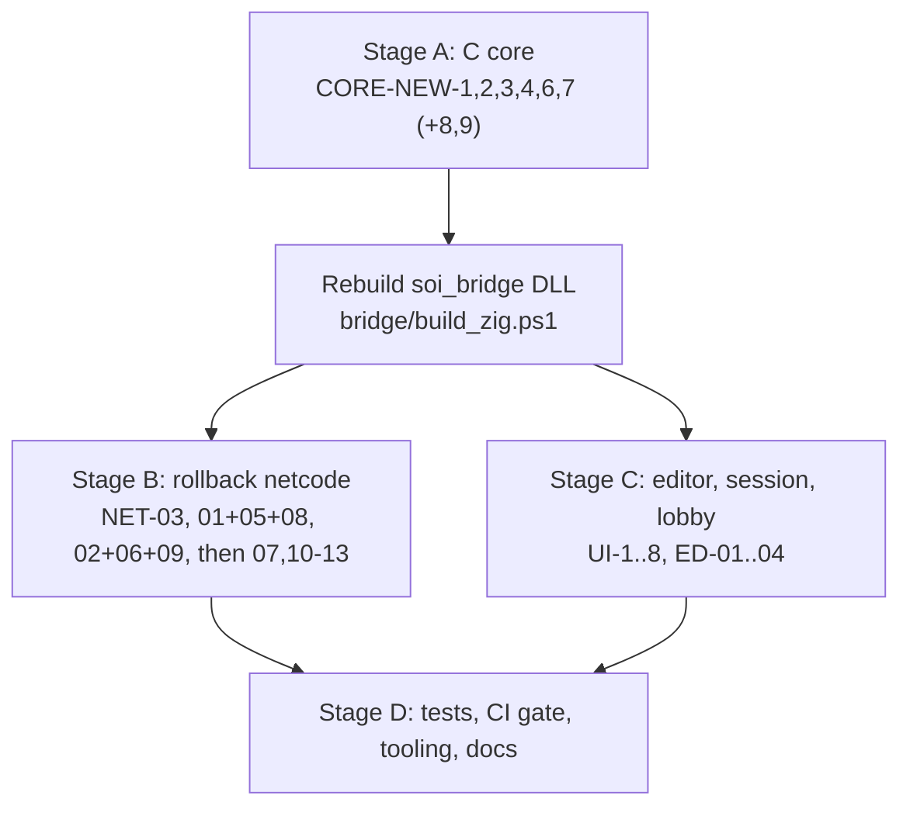

# Step On It! Remastered: audit of the 10/16 fixes, remediation plan, and answers to your 3 questions

> [!NOTE]
> This was a static, read-only audit of `~/tmp/repos/steps` at commit `3066c72` ("10/16 fixes"). Nothing was built, run, or changed: `git status --porcelain --ignored` was empty before and after. Every finding is therefore **unverified at runtime**. Before fixing each P0/P1, the implementer should first reproduce it with a test that fails.
>
> Confidence: each author report was cross-checked against the code by an independent verifier. Claims that did not hold up were removed (for example, a "survivor freezes after all peers drop" bug, NET-04, was refuted). I re-read the code for CORE-NEW-1, NET-01, NET-02, NET-03, NET-09, UI-2, UI-3 and UI-6 myself. The verifier's final pass over this document found 2 errors, both fixed: the NET-09 description and an editor brush row that was already correct.

---

## 1. Verdict

**Partly.** I checked 41 plan sub-items: **19 correct, 13 partial, 9 broken or plan-wrong**. Five of the broken items copied wrong code from `plan/10_16.md` itself (§1.2, §1.3, §1.4, §2.1, and the §4 expected outputs).

**Landed correctly:**
- `soi_next_level` returns 1/0.
- The host no longer fires `board_loaded` twice.
- `spawn_player3` was removed from `_next_board`.
- Dropped peers survive `reset_for_new_board`.
- On a live tick, `drop_player` runs before the snapshot is saved.
- `check_rift_stall` no longer resets its counter.
- The `live3d.gd` shader brace is restored.
- `start_campaign` clears the editor metadata.
- Key brush frames 9/10, the Ctrl guards, and Tab handled in `_input` are fixed.
- `join_code_to_ip` returns a bare IP.
- The client calls `start_campaign()` before going online.
- The `JOY_BUTTON_A` gate is in place.
- The `ascii2bord.py` `has_p3` flag and non-zero exit code are fixed.
- The two new `verify.ps1` stages exist.
- All 83 bridge methods are bound.

### P0 blockers (fix before any online play)

| ID | Where | What breaks |
|---|---|---|
| CORE-NEW-1 | [`check_pvp_body_collisions`](file:///usr/local/google/home/seanstappas/tmp/repos/steps/core/src/soi_state.c#L902-L945) (soi_state.c) | The row index from `soi_px_row` is never bounds-checked: it is -1 above the field and can reach `grid_rows` (26 on big maps) near the pit. `w->cell[r][c]` then reads outside `cell[26][38]`. That is undefined behavior: a possible crash, or a desync between machines. |
| NET-03 | resim loop in [`game.gd _physics_process`](file:///usr/local/google/home/seanstappas/tmp/repos/steps/godot_project/scenes/game.gd#L1511-L1540) | [`soi_tick3`](file:///usr/local/google/home/seanstappas/tmp/repos/steps/core/src/soi_state.c#L1008-L1020) has no stop condition. The live path stops ticking on `level_complete` / `game_over` / `challenge_failed`, but the rollback resimulation loop keeps ticking past that tick. A peer that rolls back into the end of a board ends up with a different score, lives and RNG than the other peers. |
| NET-01 | [`send_local_input`](file:///usr/local/google/home/seanstappas/tmp/repos/steps/godot_project/scenes/rollback_net.gd#L471-L484) | While frozen on the tally, `target_tick = maxi(..., prev_scheduled + 1)` grows by 1 every frame. The `IN_META_CONFIRM` latch reads a tick that was never written, so it is dead code. If a rollback un-freezes the tally, input delay jumps by the number of frozen frames. The plan's own formula would instead overwrite inputs already sent to peers. |
| NET-05 | `PKT_INPUT_TICK` / `reset_for_new_board` (rollback_net.gd) | Input packets carry no board epoch, so late board-1 packets get applied to board 2. The client can also run board 2's first tick one frame before the host. |
| NET-06 | [`_start`](file:///usr/local/google/home/seanstappas/tmp/repos/steps/godot_project/scenes/game.gd#L1381-L1405) (game.gd) | Dropped peers are re-dropped in `_next_board` but not in `_start`. Retry, custom-map restart, and the Compete/Versus wrap bring a dropped player back. |

NET-02 (the `BOARD_LOAD` seed is never applied) was graded P0 by its author. I moved it to P1 (§3): the host and the client run the same transition path, so it only matters once the peers' end-of-board states have already diverged, which is what NET-01/03/05 cause.

### System, algorithm and alignment problems

1. **Nothing gates a change.** Tests only run when someone runs `tools/verify.ps1` by hand on the Windows dev PC, so the 10/16 agent shipped code that was never compiled or run against these tests.
2. **Some tests pass on broken code.**
   - Test 69.2 ticks once from tick 0, and even ticks skip the player update, so it passes with the §1.2 fix reverted (CORE-NEW-5).
   - `test_net_progression.gd` gives both cores the same seed and never applies the `BOARD_LOAD` seed, which hides NET-02.
   - The editor self-test uses `assert()`, which release builds strip out.
3. **The plan's own code sketches were wrong** in §1.2, §1.3, §1.4 and §2.1, and its §4 expected-output strings were wrong. Implementers copied them.
4. **Remaster rules leak into the original game.** The P3, Versus and `p3_any_key` logic was added to shared original code paths. CORE-NEW-3 now blocks exits through the unlocked universal door (0x0901) in the original 2P Compete mode; the original routine `FUN_1002bc64` allows `t == player+1 || t == 1`.
5. **Gaps in desync detection.**
   - CORE-NEW-1 is undefined behavior.
   - `soi_serialize` and `soi_state_hash` skip 20+ fields that `soi_net_hash` covers (CORE-NEW-9).
   - End-of-board states are treated as final although they are speculative under rollback (NET-01, NET-03).

---

## 2. Verdict matrix (`plan/10_16.md`)

| Item | Verdict | Note |
|---|---|---|
| §1.1a `soi_next_level` returns 1/0 | Correct | Bridge and `_next_board` callers match. |
| §1.1b inactive/eliminated cleanup | Partial | CORE-NEW-6: P3 is spawned before the tiles are decoded. CORE-NEW-7: co-op elimination is never cleared. |
| §1.2 competitive door exit | Broken, plan-wrong | CORE-NEW-3 |
| §1.3 Versus game-over guard + `level_complete` | Broken, plan-wrong | CORE-NEW-2 |
| §1.4 PvP push | Broken, plan-wrong | CORE-NEW-1 (P0), CORE-NEW-4 |
| §2.1a frozen-tick `target_tick` | Broken, plan-wrong | NET-01 |
| §2.1b `IN_META_CONFIRM` latch | Broken | Dead code: `.get(target_tick)` always returns 0. |
| §2.1c `BASE_DELAY` backfill | Partial | At tick 0 it can overwrite ticks that were already sent. |
| §2.1d meta-confirm window, `_net.BASE_DELAY` | Partial | Works around the runaway, but the window keeps growing. |
| §2.2a single `board_loaded` path | Correct | |
| §2.2b `online_seed` for board 2+ | Partial (plan gap) | The host sets `online_seed` before sending, as the plan said, but nothing applies it: `_next_board()` keeps `w->rng_seed` (NET-02). |
| §2.2c `saved_stats` indexing | Partial | Indexing is right, but `_capture_board_start()` is not called after the restore (NET-09). |
| §2.2d no `spawn_player3` in `_next_board` | Correct | |
| §2.2e re-apply `drop_player` | Partial | Missing in `_start` (NET-06). |
| §2.3a unconditional rollback on drop | Partial | NET-07: confirms start at 0 instead of -1, and `DROP_PEER` carries only 16 ticks of input. |
| §2.3b misprediction compare in `_handle_drop_peer` | Correct | |
| §2.3c `reset_for_new_board` keeps drops | Correct | |
| §2.3d live-tick drop before snapshot | Correct | |
| §2.4 `check_rift_stall` | Correct | |
| §3.1 `POST_SHADER` brace | Correct (static) | |
| §3.2a `start_campaign` clears metadata | Correct | |
| §3.2b clear metadata on return to editor | Partial | UI-3: the challenge-fail path still leaks. |
| §3.2c host keeps `custom_map_path` | Correct | |
| §3.2d offline custom maps | Partial | UI-4: no offline UI can set the path, and the path sticks around afterwards. |
| §3.3a enemy brush BORD IDs | Broken, plan-wrong | UI-1 |
| §3.3b key frames 9/10 | Correct | Lock and door frames are still wrong (UI-5). |
| §3.3c `[F]` facing + `_draw` lookup | Broken | UI-2, UI-6 |
| §3.3d Ctrl guards / §3.3e Tab in `_input` | Correct | |
| §3.4a `join_code_to_ip` | Correct | Leaves an unused variable (UI-10). |
| §3.4b `_claim_controller_slot` | Partial | UI-7 |
| §3.4c client `start_campaign` / §3.4d `JOY_BUTTON_A` gate | Correct | |
| §3.4e disconnect reassignment | Partial | UI-8 |
| §4.1 `ascii2bord` + `verify.ps1` stages | Correct | New TOOL-01 and TOOL-02 issues. |
| §4.2 Section 69 tests | Broken / partial | 69.2 tests nothing (CORE-NEW-5); 69.4 never checks that the bodies end up separated. |
| §4.3(1) editor self-test | Partial | UI-9 |
| §4.3(2) `test_net_edge_cases.gd` | Correct | |
| §4.3(3) `test_net_progression.gd` | Partial | Hides NET-02. |
| P0-8 bridge bindings | Correct (static) | The DLL must be rebuilt locally because `godot_project/bin/` is gitignored. See also TOOL-04. |
| Plan §4 expected outputs | Plan-wrong | Commands 2, 4, 6 and 8 expect strings that the tools never print (PLAN-01). |

---

## 3. New issues found beyond the plan

**P1 (wrong rules or broken feature)**

- **CORE-NEW-2:** Versus ends one life early and reports a draw. The check `(alive || lives > 0)` should be `!eliminated`: `lives == 0` is the last life. Also, `SOI_WIN_SCORE` can pick an eliminated player as the winner.
- **CORE-NEW-3:** P3 can exit through the locked universal door 0x0904, while P1 and P2 cannot exit through the unlocked one (0x0901) in Compete or Versus.
- **CORE-NEW-4:** When one player is pinned against a wall, the push leaves the bodies overlapping (dx 14 < 20), so they bounce again on the next tick.
- **CORE-NEW-5:** Test 69.2 does not actually test the fix (see §1).
- **CORE-NEW-6:** `soi_load_level` places P3 before it decodes the tiles, so automatic P3 placement looks at an empty grid.
- **CORE-NEW-7:** In co-op, `eliminated` is never cleared, whether by a 1-UP or by the next board. Confirm what the original game does before fixing.
- **NET-07:** `last_confirmed_per_peer` starts at 0 instead of -1, and `PKT_DROP_PEER` carries only 16 ticks of the dropped player's input.
- **NET-08:** `IN_META_CONFIRM` is not masked out of `last_confirmed_input` or the input prediction.
- **NET-02:** the seed in `BOARD_LOAD` is never used, because `soi_next_level` reuses `w->rng_seed`. The host and the client take the same path (`is_retry=true` → `_start()` on both sides; otherwise `_next_board()` on both sides), so this only bites once the end-of-board states differ (NET-01/03/05). Applying the seed explicitly is still the right fix, and `test_net_progression.gd` currently hides the issue.
- **NET-09:**
  - After a challenge fail, `_next_board()` re-captures the board-start stats before the old stats are restored, and nothing captures them again. The next retry then restores the wrong stats.
  - The client works out `was_challenge_fail` from its own core state instead of reading it from the packet.
  - On the last board, Compete/Versus restarts the same board instead of ending the match.
  - On the last board in Co-op, the host returns to the main menu without telling the clients.
- **NET-11:** The lobby calls `start_host(7777, n_players)`, which allows one peer too many. A connection to a full lobby is defaulted to slot 1, and a disconnect in the lobby marks that slot as dropped before the match starts.
- **NET-12:** A rollback deeper than 64 ticks skips resimulation entirely and only prints "desync".
- **NET-14:** `headless_relay.gd` cannot be used with `RollbackNet`: there is no relay-client mode and no slot header.
- **UI-1:** Editor enemy brushes spawn the wrong enemies: "Wheelie" is a Spinner and "Walker" is a Creeper. Teeth, Ostrich and Piggy are missing the spawner timing header. Several types are missing entirely.
- **UI-2:** The editor's `_draw` matches enemy cells on the low byte only, so 6 enemies show up as door, lock, key, coin or ball sprites.
- **UI-3:** Failing a challenge board during an editor playtest leaks the metadata and drops you to the menu instead of back to the editor.
- **UI-4:** There is no offline launcher for custom maps, and `custom_map_path` sticks around after `load_game` or the old menu.
- **ED-01:** The editor HUD controls sit at x = 650 to 850, off-screen at 640×480.
- **DOCS-02:** The docs still say netcode and the editor are not built.

**P2 (edge cases, polish, tooling)**

- CORE-NEW-8: the EXT1 `vs_spawns` are parsed but never used.
- CORE-NEW-9: gaps in what `soi_serialize` and `soi_state_hash` cover.
- NET-10: `MATCH_INIT` has no protocol or build version.
- NET-13: each peer changes `BASE_DELAY` on its own.
- UI-5: lock/door brush frames are 21/22/37/38; they should be 6/3/7/4.
- UI-6: painting drops the spawner's 0x0700 "alternate" facing.
- UI-7: the `player_device` default `[-1,-2,0]` gives joypad 0 to two players.
- UI-8: the disconnect fallback sets -1 for every slot and stops after the first.
- UI-9: the editor self-test uses `assert()`.
- ED-02/03: the save file name is fixed, and playtest forces 2P/3P.
- ED-04: right-drag does not erase, and `has_p3` cannot be cleared.
- TOOL-01: `pack_ext1` ignores `has_p3=False` when P3 coordinates are set.
- TOOL-02: the `verify-roundtrip` padding check is wrong when an EXT1 trailer is present.
- TOOL-03: `ENEMY_NAMES` is keyed by enemy type instead of BORD ID.
- TOOL-04: CMake's `OUTPUT_NAME` is hardcoded to the Windows debug name on every platform and config.
- HYG-01/02: 11 empty files and 6 stray files at the repo root.
- DOCS-01/03: the stage counts and `REMAINING_WORK.md` are out of date.
- PLAN-01: wrong expected outputs in plan §4.

**P3 (cleanup)**

- HYG-03: `/.github/` is gitignored, yet files under it are tracked.
- UI-10: an unused variable.

---

## 4. Remediation plan



**Rules for whoever implements this** (so we don't need a "10/18" plan):
- Write the regression test first, and show it failing on today's code before the fix and passing after it. Paste both outputs.
- Treat code in plans as a sketch. Check it against the core's real rules: tile encodings, tick parity, and lives semantics.
- Guard every remaster-only rule by mode. Run the original-mode replays (`tools/fixture_replay.py`, `tests/beatability`) before and after each change.
- Rebuild the DLL and run all 15 `tools/verify.ps1` stages before calling anything done.

### Stage A: C core (`core/src/soi_state.c`, `soi_grid.c`, `soi_physics.c`)

**A1. CORE-NEW-1 + CORE-NEW-4 (`check_pvp_body_collisions`)**
- Replace the raw `w->cell[r][c]` reads with [`soi_get_cell(w, c, r)`](file:///usr/local/google/home/seanstappas/tmp/repos/steps/core/src/soi_grid.c#L22-L26). It returns `SOI_WALL` when the cell is out of bounds, so the move is simply blocked.
- Step 2 px at a time until the bodies are 20 px apart or neither can move, so the free player takes the whole separation when the other is pinned:
  ```c
  int r1t = soi_px_row(p1->y + 4), r1b = soi_px_row(p1->y + 30);
  int r2t = soi_px_row(p2->y + 4), r2b = soi_px_row(p2->y + 30);
  for (int it = 0; it < 10 && abs(p1->x - p2->x) < 20; it++) {
      int moved = 0;
      int nx1 = p1->x + dir1 * 2, c1 = soi_px_col(dir1 < 0 ? nx1 : nx1 + 31);
      if (c1 > 0 && c1 < w->grid_cols - 1 &&
          !(soi_get_cell(w, c1, r1t) & SOI_CELL_SUPPORTIVE) &&
          !(soi_get_cell(w, c1, r1b) & SOI_CELL_SUPPORTIVE)) { p1->x = nx1; moved = 1; }
      if (abs(p1->x - p2->x) >= 20) break;
      int nx2 = p2->x + dir2 * 2, c2 = soi_px_col(dir2 < 0 ? nx2 : nx2 + 31);
      if (c2 > 0 && c2 < w->grid_cols - 1 &&
          !(soi_get_cell(w, c2, r2t) & SOI_CELL_SUPPORTIVE) &&
          !(soi_get_cell(w, c2, r2b) & SOI_CELL_SUPPORTIVE)) { p2->x = nx2; moved = 1; }
      if (!moved) break;
  }
  ```
- Test: extend 69.4 with `CHECK(abs(p1.x - p2.x) >= 20)`. Add a 38×26 case with both players on the bottom row, and one above the field. Run under `-fsanitize=address,undefined`.

**A2. CORE-NEW-3 (`soi_pickup_check`)**
- Change the door test to:
  ```c
  int own_door = (t == 1u) ||
                 ((player == 1 || player == 2) && t == (unsigned)player + 1u) ||
                 (player == 3 && (c & 0x9FFu) == 0x0935u);
  ```
  Keep the existing `has_key == 1` requirement in competitive modes.
- Tests: P3 holding a key on a locked 0x0904 must not exit. P1 holding a key on 0x0901 in 2P Compete must exit. The original 2P Compete replay must not change.

**A3. CORE-NEW-2 (`soi_level_complete`, `soi_versus_winner`)**
- Count a participant as alive when `active && !eliminated`. `commit_death` sets `eliminated` only when lives drop below 0, so `lives == 0` is still a life.
- Keep the `participants >= 2` guard. Apply the change to the LIVES rule and to the drop-completion fallbacks for DOOR and SCORE.
- In `soi_versus_winner` under `SOI_WIN_SCORE`, skip eliminated players.
- Test: in 2P Versus, P2 has `lives=0, alive=0, eliminated=0, respawn_timer=90`, so `level_complete` must be 0. After P2's next death, `level_complete` must be 1 and the winner must be P1.

**A4. CORE-NEW-6:** In `soi_load_level`, move the `soi_spawn_player3` call to after the tile-decode loop. Test: on an EXT1 board with `has_p3` and P3 at (0,0) (automatic placement), P3 must not end up inside a wall.

**A5. CORE-NEW-7:** First confirm the original co-op shared-lives behavior in `analysis/decomp/`. Then clear `eliminated` on a 1-UP and/or on the next board only if the original game does. Add a test that matches the confirmed behavior.

**A6. CORE-NEW-8/9 (P2):** Place players at the EXT1 `vs_spawns` in Versus. Add the missing fields to `soi_serialize` and `soi_state_hash` (or switch `test_synctest.c` to `soi_net_hash` and say so in a comment). Then rebuild the DLL.

### Stage B: rollback netcode (`rollback_net.gd`, `game.gd`, `main_menu.gd`)

**B1. NET-03: stop resimulating at the end-of-board tick.**
- In the resim loop, save the pre-tick tally values as the live path does. After `_core.tick3()`:
  ```gdscript
  if _core.game_over() or _core.level_complete() or (not _alt and _core.challenge_failed()):
      _net.current_tick = sim_t + 1
      break
  ```
- Rule: a tally, game-over or challenge-fail state is provisional until every active peer has confirmed its inputs through that tick. The existing "un-freeze if the rollback undid it" code in `_physics_process` stays.
- Test: peer A walks into the door at tick T while peer B predicts idle and runs on to T+4. When A's tick-T packet arrives, both peers must stop at T+1 with equal `net_hash()` and equal scores.

**B2. NET-01 + NET-05 + NET-08: replace the input-bit handshake with a confirm message.**
- **Why:** using an input bit makes a menu handshake part of the deterministic input stream. Neither the shipped formula (delay runaway) nor the plan's formula (overwrites sent input) can be made right.
- **Changes:**
  1. While frozen on a tally, game-over or challenge-fail screen, stop calling `send_local_input`.
  2. When the local player presses Enter and the end-of-board tick is confirmed (`last_confirmed_tick >= current_tick - 1`), send a reliable `PKT_META_CONFIRM {board_epoch, terminal_tick, net_hash}` on channel 0.
  3. The host sends `BOARD_LOAD` only once every active peer has confirmed the same `(epoch, tick, hash)`. A hash mismatch raises `desync_detected`, which also gives a desync check at the end of every board. If a rollback undoes the end-of-board state, clear the confirmations.
  4. Add `board_epoch` to `RollbackNet`: increment it in `reset_for_new_board()`, pack it into the upper bits of `PKT_INPUT_TICK` byte 1 (today byte 1 is `local_slot`), and drop packets from other epochs.
  5. On `board_loaded`, return from that client frame, so the host and the client both run tick 0 on the next frame.
  6. Mask `IN_META_CONFIRM` out of `last_confirmed_input` and `get_or_predict_input`, or retire the bit.
  7. `send_local_input` must never rewrite a tick it has already sent; only fill new ticks.
- **Tests:**
  - After 120 frozen frames, the local schedule has not moved.
  - A packet with a stale epoch is rejected.
  - Three peers confirming the same tick and hash cause exactly one `BOARD_LOAD`.
  - A mismatched hash raises `desync_detected`.

**B3. NET-02 / NET-06 / NET-09: board transitions.**
- In `_next_board`, call `_core.set_seed(Session.online_seed)` before `next_level` on every peer.
- In `_start`, add the `for d_slot in _net.dropped_peers: _core.drop_player(d_slot + 1)` loop.
- Call `_capture_board_start()` after restoring `saved_stats`, on both the host path and the client path.
- Carry `was_challenge_fail` in `BOARD_LOAD` (the net report suggests a spare bit) so the client does not recompute it from its own state.
- Decide what the end of the last board does. In Compete/Versus, show results and end the match. In Co-op, send a "match over" message before the host closes the connection.
- Tests: change c1's seed, apply the `BOARD_LOAD` seed on both cores, and check that the hashes match. Retrying after a drop must keep P3 dropped.

**B4. Hardening**
- **NET-07:** start `last_confirmed_per_peer` at `[-1,-1,-1]` and check every place that reads it. Grow the `DROP_PEER` input history from 16 to 64 ticks (`RING_BUFFER_SIZE`).
- **NET-11:** call `start_host(7777, n_players - 1)`. Reject connections when the lobby is full or a match is running. Mark a slot as dropped only after the match starts, and never overwrite a slot by default.
- **NET-12:** do **not** clamp the rollback and resimulate from the oldest snapshot. That would apply the drop at a different tick than the other peers did, which is itself a desync. Instead:
  - keep the prediction limit well below the 64-tick buffer;
  - when the limit is exceeded, either request a full host snapshot over the reliable channel, or end the match with a visible desync message.
- **NET-10:** put a protocol version and a build ID in `MATCH_INIT`, and refuse a peer whose values differ (this ties into Q1).
- **NET-13:** only the host changes `BASE_DELAY`, and it broadcasts each change to take effect at a future tick.
- **NET-14:** defer. Use Tailscale instead of the relay (see §6).

### Stage C: editor, session, lobby

**C1. UI-1 / UI-2 / UI-5 / UI-6 (`editor.gd`)**
- Correct the brush table to match [`soi_bord_badguy_type`](file:///usr/local/google/home/seanstappas/tmp/repos/steps/core/src/soi_enemies.c#L82-L107):

  | Enemy | BORD ID | Tile | `sprite` folder |
  |---|---|---|---|
  | Wheelie | 2 | `0x0602` | `disk_sprites` |
  | Walker | 4 | `0x14000604` | `walker_sprites` |
  | Spinner (new brush) | 9 | `0x0609` | `spinner_sprites` |
  | Teeth (spawner) | 10 | `0x1E14070A` | `teeth_sprites` |
  | Ostrich (spawner) | 18 | `0x1E140712` | `ostrich_sprites` |
  | Piggy (spawner) | 19 | `0x1E140713` | `piggy_sprites` |

  Also add brushes for Beanie (7/8), Knight (13), Gargoyle (14) and Creeper H/V (16/17). Check whether the facing byte 0x07 is valid for the Cannon (BORD 1 is a shooter, not a spawner).
- Change the lock/door frames to 6/3/7/4 (`goody_sprites`, matching `game.gd`).
- In `_draw`, match on the low byte only when the brush is itself an enemy, i.e. `(int(b["tile"]) & 0x0400) != 0`.
- In `_paint_at`, keep 0x0700 on spawners.
- Rewrite `_run_self_test` with a check helper that is not stripped in release builds (`push_error` + `quit(1)`). For each enemy brush, load a one-enemy board in `SoiCore` and compare `enemy_type()` with the expected type. Also check that every enemy brush resolves through `_draw`.

**C2. UI-3 / UI-4**
- In the `editor_return` branch of `_press_enter`, add `or _core.challenge_failed()`.
- Clear the custom-map state in `Session.load_game()` and in `menu.gd`.
- Add an offline "Play custom map" entry (see Q2).

**C3. UI-7 / UI-8**
- Default `player_device` to `[-1,-2,-3]`, and remove duplicates when a controller claims a slot.
- The disconnect fallback should assign `-(p+1)` and not stop after the first slot.

**C4. ED-01..04**
- Fit the HUD inside 640 px (two rows).
- Add Save As and Open dialogs.
- Add a 1P/2P/3P choice for playtest.
- Make right-drag erase, and allow clearing `has_p3`.

### Stage D: tests, CI gate, tooling, docs

- **D1:** fix test 69.2 (tick until an odd tick has run, then check again) and extend 69.3 and 69.4 (see A2/A3/A1).
- **D2:** TOOL-01..04.
  - Respect `has_p3=False`.
  - Check the padding before the EXT1 trailer.
  - Key `ENEMY_NAMES` by BORD ID.
  - Make CMake's `OUTPUT_NAME` depend on platform and config.
- **D3: CI gate.** Add a GitHub Actions workflow on the same self-hosted Windows runner used for releases (§6). It runs `test_mechanics`, `test_synctest`, `verify_creepers`, the `ascii2bord` roundtrip, and the 5 Godot headless suites. The release job runs only after it passes.
- **D4:** hygiene (HYG-01..03) and docs (DOCS-01..03). Update plan §4's expected strings to match §5 below.

---

## 5. Verification commands and their real output (for after implementation)

Same commands as `plan/10_16.md` §4, with the expected output corrected to what the code actually prints (I checked each string in the source):

| # | Command (see plan §4) | Real success output |
|---|---|---|
| 1 | `test_mechanics` (ASan + UBSan) | `ALL MECHANIC TESTS PASSED` |
| 2 | `test_synctest extracted/levels/*.bord` | `ALL SYNCTEST ROLLBACK CHECKS PASSED` |
| 3 | `verify_creepers` | `=== N Creeper boards: 0 FAILED ===` |
| 4 | `ascii2bord.py verify-roundtrip extracted/levels` | `Roundtrip check: 152 passed, 0 failed out of 152 files.` |
| 5 | `editor.tscn -- --test-editor` | `MapEditor CLI self-test: PASS` |
| 6 | `test_net_edge_cases.tscn` | `EDGE CASES TEST: PASS (All join code, disconnect, and drop tests passed!)` |
| 7 | `test_net_progression.tscn` | `BOARD PROGRESSION TEST: PASS` |
| 8 | `test_net_adversarial.tscn` | `ADVERSARIAL 3P TEST: PASS (1500 ticks, 3 players, 0 desyncs, rollbacks healed successfully)` |
| 9 | `net_soak_test.tscn` | `SOAK TEST: PASS (10,000 ticks, 3 peers, 0 desyncs, rift stall healed)` |
| 10 | `tools/verify.ps1` | `ALL STAGES PASSED` |

---

## 6. Q1: sharing the game on Windows for 2P/3P, with auto-update from git

**Short answer:** yes, auto-update from the git remote is possible. An installer alone (Inno Setup/NSIS) does not solve updates, so use something that installs **and** updates.

**For this week, use Parsec (no code changes).** Online rollback has the five P0 bugs above. Run the game on your PC with local 2P/3P instead: the main menu supports 1 to 3 players, three keyboard layouts and gamepads. Friends connect through [Parsec](https://parsec.app/) and play with their own keyboard or controller. Nothing needs to be shipped or kept in sync.

**After Stages A and B, real online play:**

1. **Make the game exportable** (required).
   - Assets load from `res://../extracted/...` through `ProjectSettings.globalize_path()` and raw file APIs: about 30 references in 12 scripts, for example `session.gd:175`, `game.gd:305`, `audio.gd:152`, `live3d.gd:85`. An exported `.exe` won't find them there.
   - Add a `Session.ext_path()` helper that looks for `extracted/` next to the exe first, and route every lookup through it.
   - Load `apple_logo.png` and `Chicago.ttf` with `load()` so they come from the `.pck`.
   - Default to REMASTERED with music on when the game is launched without flags. Today `session.gd:35/47` and `audio.gd:82/114` default to ORIGINAL with music off.
2. **Export and package.**
   - Add `godot_project/export_presets.cfg` for Windows Desktop with a separate `.pck`; Godot copies the `soi_bridge` release DLL next to the exe.
   - Add `tools/package_win.ps1`. It stamps a build ID (the git SHA) into a generated `build_info.gd`, builds the DLL with `bridge/build_zig.ps1`, runs a headless export, and mirrors `extracted/` (including the gitignored HD and 3D folders) next to the exe.
3. **Same build for every player:** put the build ID in `MATCH_INIT` and refuse peers that don't match (NET-10).
4. **Delivery and auto-update.** A **self-hosted GitHub Actions runner on your PC** builds and publishes on each push. Your PC already has Godot, zig and the gitignored assets. Keep the repo private: GitHub warns against self-hosted runners on public repos. Publish from a `release` branch or tags after the CI gate (D3) passes, so a half-finished push to `main` doesn't reach your friends.
   - **Recommended for 2 to 3 friends: itch.io + `butler push`** to a draft or restricted (download-key) page. Friends install once through the itch app, which then patches each new build automatically. You write no updater code, and SmartScreen does not prompt on updates.
   - **Alternative: Velopack** (a `Setup.exe` plus delta updates, no third-party app). It needs an update trigger at game start (or a small launcher stub) and somewhere to host the feed. On a private GitHub repo that means a token; an unguessable R2 or S3 URL also works.
   - **Avoid:**
     - a plain zip: manual updates leave friends on different builds, which desyncs rollback;
     - Godot `.pck` patching: it cannot replace the loaded DLL or files outside `res://`.

   The distribution worker ranked Velopack first. I put itch.io first because it needs no updater code and no token handling.
5. **Connecting over the internet: Tailscale.**
   - The free Personal plan allows 6 users. You can also share only your PC with friends' own Tailscale accounts.
   - Only the host needs to be reachable, because P2 and P3 connect to P1.
   - Change the host lobby (`main_menu.gd` around lines 874 to 887) to prefer the 100.64.0.0/10 address, and stop the UPnP thread from overwriting it.
   - Forwarding UDP 7777 on your router is the fallback.
   - The headless relay does not work with `RollbackNet` as written (NET-14).
6. **Decide where the big assets live.** Measure the gitignored folders on your PC (`sprites_3d_frames`, `sprites_3d`, `pict_hd`, `pict_hd_v2`). The two workers' estimates disagree (about 18 MB vs. hundreds of MB), and the folders are not in this clone.
   - Under about 100 MB: commit them, so fresh clones and CI are complete.
   - Larger: use Git LFS (mind the free 10 GiB storage/bandwidth limits) or one pinned release-asset zip.

> [!CAUTION]
> The assets are extracted from a commercial 1996 game. Keep distribution private (friends only). Even a draft itch page or a private GitHub release is hosting on a third-party service under its terms.

Full report: [distrib_report.md](file:///usr/local/google/home/seanstappas/.gemini/jetski/brain/ed42ce63-f95a-461f-94f3-593295d4a4fd/scratch/distrib_report.md)

---

## 7. Q2: is there a visual map editor?

**Yes.** It is [`editor.gd`](file:///usr/local/google/home/seanstappas/tmp/repos/steps/godot_project/scenes/editor.gd) (962 lines) with `editor.tscn`, a mouse-driven editor that draws the real sprites. Three ways to open it:
- the **Map Editor** button on the main menu (`main_menu.gd:476`);
- **File → Map Editor...** (`main_menu.gd:222`);
- the `--editor` flag (`main_menu.gd:54`), e.g. `"<Godot>" --path godot_project -- --editor`. `play.ps1` has no switch for it.

**What works today:**
- 49 brushes in 6 categories: terrain, mechanics, goodies, keys/doors, 11 enemies, and spawns (P1/P2/P3 and four Versus spawns).
- Paint with left-drag; right-click erases.
- Three sizes, 19×13, 28×19 and 38×26 (G/C keys).
- `F` cycles enemy facing.
- `Ctrl+S` / `Ctrl+O` save and load `user://custom_maps/<name>.bord`.
- Saves write a BORD file with the EXT1 trailer and its CRC-16.
- `Tab` playtests the map from memory and returns to the editor.
- The host can send a custom map to online peers in `MATCH_INIT`.

**Missing:** undo/redo, zoom/pan, rectangle/fill tools, copy/paste, a file dialog and map naming, an offline launcher for custom maps, 1P playtest, a validation panel, and packaging boards into a campaign. The text (ASCII) format exists only on the command line (`tools/ascii2bord.py`).

**Bugs you would hit now:**
- wrong enemies (UI-1);
- enemies drawn as doors or coins (UI-2);
- wrong lock/door art (UI-5);
- lost spawner facing (UI-6);
- HUD controls off-screen at 640×480 (ED-01);
- challenge-fail playtest exits to the menu (UI-3).

**Roadmap:**
- **P0:**
  - Stage C fixes C1, C2 and C4.
  - A two-row HUD that fits 640 px.
  - Save As / Open dialogs.
  - 1P playtest.
  - A "Play custom map" entry in the main menu.
- **P1:**
  - A palette drawer with thumbnails.
  - Undo/redo.
  - Rectangle, fill and flood tools.
  - A `play.ps1 -Editor` switch.
- **P2:**
  - Select/copy/paste/flip.
  - An enemy inspector (facing, spawn period and delay).
  - A board metadata inspector.
  - A validation panel: spawns present, keys vs. doors, and reachability using `tests/beatability`.
  - ASCII import/export inside the editor.
- **P3:** zoom/pan and campaign packaging.

Full report: [editor_report.md](file:///usr/local/google/home/seanstappas/.gemini/jetski/brain/ed42ce63-f95a-461f-94f3-593295d4a4fd/scratch/editor_report.md)

---

## 8. Q3: making sure the 3D sprites match the sources

### Why gaps get past agents today

1. **Fallbacks are silent.**
   - `game.gd` quietly substitutes when 3D art is missing: a missing 3D frame falls back to the HD sheet, a missing frame index to a nearby lower frame, and a failing or missing live rig to the pre-rendered or 2D art.
   - Static tiles drawn by `_blit` / `_blit_clip` never use Live3D at all.
   - Nothing logs a fallback, and there is no strict mode.
2. **The 3D specs and renders are gitignored.**
   - `extracted/sprites_3d` and `sprites_3d_frames` are not in git, so this clone has neither.
   - [`framematch.py check_all()`](file:///usr/local/google/home/seanstappas/tmp/repos/steps/tools/soi3d/framematch.py#L1689-L1720) passes when no family specs are present at all.
3. **Live rigs: 8 of the 40 `sprites_live` families fail their own gate.** Their `gate.json` has `"pass": false`: `beenie_char`, `bigger_mblock`, `emblem_teeth`, `goody_1up`, `knight_sprites`, `master_egg`, `spin_ind_shoe` and `weapons`. Meanwhile `SPRITE_REMASTER_STATUS.md` claims every family passes.
4. **The per-frame metric is blind to details.**
   - `stage_verify` gates on a sharp alpha IoU plus a mean ΔE (CIE76) after a σ=1 blur, averaged over the union and composited over black.
   - That blur erases 1 to 3 px features such as eyes and mouths. Averaging dilutes small missing parts, dark fringes score as fine, and it cannot tell front from back.
   - The frame-identity check turns itself off whenever the render error is at least the difference between two SD frames ([`framematch.py:1600`](file:///usr/local/google/home/seanstappas/tmp/repos/steps/tools/soi3d/framematch.py#L1596-L1603)).
   - `detail_audit.py`, `ref_compare.py` and `verify_3d.py` are not gates: they always exit 0, and `verify_3d` crops to the bounding box, which hides scale and anchor errors.
5. **Alignment.**
   - `game.gd` uses four different anchoring conventions.
   - The fitter's camera shift can lift feet off the ground line.
   - `live3d.gd` mirrors the finished 2D image after the 3D lighting, so mirrored sprites have their key light on the wrong side.
   - `live_check.gd` tests only the unmirrored, untinted pose at `f=0`.
6. **Process.** Authors loosen gate thresholds per family in `frames.json` and mark their own families published.

### Recommended system (detail and phases in the sprites report)

1. **L1, coverage.**
   - Track the specs, and the 3D frames if their size allows (see §6.6).
   - Add a `sprite_coverage.json` that maps every SD frame to a 3D frame or to an explicit waiver.
   - Make `--check` fail when coverage is incomplete or no family is present.
   - Add a `--strict-sprites` mode in `game.gd` that logs or flags every fallback.
2. **L2, a real gate at SD resolution, with thresholds in one central `gate_policy.json`.** A family override needs verifier sign-off.
   - Silhouette IoU at two alpha cutoffs, plus a boundary distance.
   - An unblurred detail-miss check for small blobs.
   - ΔE2000 per palette cluster (mean and P95).
   - Anchor checks: floor row and centroid offset.
   - A facing check from an object-ID/normal render pass.
   - A fixed identity check and a check for frame-to-frame pops.

   The sprites report proposes starting thresholds. Calibrate them on families you know are good.
3. **L3, spec sheets per family.** List the required features (colors, props, facing per animation) and score side-by-side composites with a structured VLM rubric. This catches meaning-level misses that metrics can't.
4. **L4, artifacts a human reviews.**
   - Contact sheets per family: SD, 3D, onion-skin, contour and a ΔE heatmap.
   - An in-game capture harness that compares SD, pre-rendered and live output.
   - Fix the live mirror by mirroring in 3D.
   - Extend `live_check` to flipped, `f=0.5` and P3-tinted poses.
5. **L5, CI and roles.**
   - Store golden metrics and fail `verify.ps1` on any regression.
   - The author can only mark a family "candidate". An independent verifier promotes it to "published", with the artifacts attached.

**Do first:**
1. Turn on fallback logging, and make `--check` fail when it has nothing to check.
2. Build contact sheets for the 8 failing live families and decide for each one: fix or waiver.
3. Make `detail_audit` a blocking gate.

Full report: [sprites_report.md](file:///usr/local/google/home/seanstappas/.gemini/jetski/brain/ed42ce63-f95a-461f-94f3-593295d4a4fd/scratch/sprites_report.md)

---

## Detailed reports (evidence, line numbers, code sketches)

- [core_report.md](file:///usr/local/google/home/seanstappas/.gemini/jetski/brain/ed42ce63-f95a-461f-94f3-593295d4a4fd/scratch/core_report.md): C core, Stage 1, Section 69 tests.
- [net_report.md](file:///usr/local/google/home/seanstappas/.gemini/jetski/brain/ed42ce63-f95a-461f-94f3-593295d4a4fd/scratch/net_report.md): netcode, Stage 2. The verifier removed refuted claims.
- [ui_report.md](file:///usr/local/google/home/seanstappas/.gemini/jetski/brain/ed42ce63-f95a-461f-94f3-593295d4a4fd/scratch/ui_report.md): shader, editor fixes, session, lobby.
- [tooling_report.md](file:///usr/local/google/home/seanstappas/.gemini/jetski/brain/ed42ce63-f95a-461f-94f3-593295d4a4fd/scratch/tooling_report.md): Stage 4.1, bindings, hygiene, docs.
- [verifier_report.md](file:///usr/local/google/home/seanstappas/.gemini/jetski/brain/ed42ce63-f95a-461f-94f3-593295d4a4fd/scratch/verifier_report.md): the cross-checked verdict matrix, after its first draft's errors were corrected.


