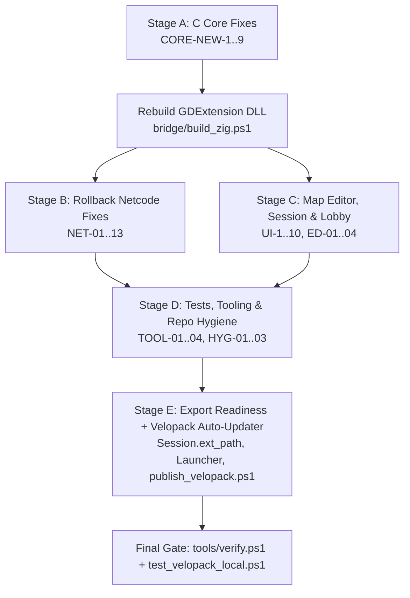

# Step On It! Remastered: Agent-Ready Implementation, Verification & Velopack Distribution Plan

> [!IMPORTANT]
> **Self-Contained Execution Guide for Windows (`D:\Code\step-on-it-remastered`)**
> This document is a self-contained, agent-executable copy of [`plan/10_17.md`](file:///D:/Code/step-on-it-remastered/plan/10_17.md) updated with:
> 1. **Local Windows repository paths and line numbers** (`D:/Code/step-on-it-remastered/...`) instead of external Linux paths.
> 2. **Inlined code specifications** so no external scratch reports are needed.
> 3. **Stage E: Simple Windows Distribution & Auto-Update on Every Run via Velopack + GitHub Releases** (binary delta updates, zero setup on friend's PC, no `.dll`/`.exe` committed to git).

---

## 0. Environment & Execution Invariants (Read First)

- **Workspace Root:** `D:\Code\step-on-it-remastered`
- **Tool Paths on this PC:**
  - **Zig C/C++ Compiler:** `D:\SOI-tools\zig\zig-windows-x86_64-0.13.0\zig.exe`
  - **Godot 4.3 Console (for headless tests/imports/exports):** `D:\SOI-tools\godot\Godot_v4.3-stable_win64_console.exe`
  - **Godot 4.3 GUI:** `D:\SOI-tools\godot\Godot_v4.3-stable_win64.exe`
  - **Python:** `.venv\Scripts\python.exe` (or `py`)
- **Godot Headless CLI Rule:** Never pass a script that `extends Node` or `extends Control` to Godot's `-s` (`--script`) CLI flag; `-s` requires `SceneTree` or `MainLoop` and will hang silently. Always invoke scene-based test harnesses via their `.tscn` resource URI (e.g., `& 'D:\SOI-tools\godot\Godot_v4.3-stable_win64_console.exe' --headless --path godot_project res://scenes/editor.tscn -- --test-editor`).
- **Implementation Discipline:**
  1. Before fixing each P0/P1 bug, write or update its regression test first and verify that it fails on the unpatched code and passes after the fix.
  2. Guard every remaster-only rule by mode (`SOI_MODE_VERSUS`, `p3_any_key`, `friendly_fire`) so original 1P / 2P Co-op / 2P Compete behavior and fixture replays (`tools/fixture_replay.py`) never regress.
  3. Whenever any file under `core/` or `bridge/` changes, rebuild the GDExtension DLL with `powershell -ExecutionPolicy Bypass -File bridge/build_zig.ps1` before running Godot tests.
  4. Run `powershell -ExecutionPolicy Bypass -File tools/verify.ps1` at the end and ensure `ALL STAGES PASSED` (exit code 0).

---

## 1. Executive Summary of Audit Findings

### Landed Correctly in `3066c72`
- `soi_next_level` returns `1`/`0` and callers check it.
- Host no longer fires `board_loaded` twice.
- `spawn_player3` was removed from `_next_board`.
- Dropped peers survive `reset_for_new_board`.
- On a live tick, `drop_player` runs before the snapshot is saved.
- `check_rift_stall` no longer resets its counter prematurely.
- `live3d.gd` `POST_SHADER` brace is restored.
- `start_campaign` clears editor metadata.
- Key brush frames 9/10, Ctrl guards, and Tab handled in `_input` are fixed.
- `join_code_to_ip` returns a bare IP.
- Client calls `start_campaign()` before going online; `JOY_BUTTON_A` gate is in place.
- `ascii2bord.py` `has_p3` flag and non-zero exit code are fixed; `verify.ps1` stages exist; all 83 bridge methods are bound.

### P0 Blockers (Fix in Stages A & B before any online play)

| ID | Location | What Breaks |
|---|---|---|
| **CORE-NEW-1** | [`check_pvp_body_collisions`](file:///D:/Code/step-on-it-remastered/core/src/soi_state.c#L902-L967) | Row index from `soi_px_row` is never bounds-checked (`-1` above playfield, or `>= grid_rows` near the pit). `w->cell[r][c]` reads out-of-bounds memory (UB / crash / desync). |
| **NET-03** | Resim loop in [`game.gd _physics_process`](file:///D:/Code/step-on-it-remastered/godot_project/scenes/game.gd#L1526-L1538) | [`soi_tick3`](file:///D:/Code/step-on-it-remastered/core/src/soi_state.c#L1008-L1020) has no stop condition. Live path stops ticking on `level_complete` / `game_over` / `challenge_failed`, but rollback resimulation keeps ticking past that frame, desyncing score, lives, and RNG. |
| **NET-01** | [`send_local_input`](file:///D:/Code/step-on-it-remastered/godot_project/scenes/rollback_net.gd#L470-L485) | While frozen on tally/game-over, `target_tick = maxi(..., prev_scheduled + 1)` increments every frame. `IN_META_CONFIRM` latch reads an unwritten tick (dead code). Un-freezing after rollback jumps input delay by frozen frames. |
| **NET-05** | [`rollback_net.gd`](file:///D:/Code/step-on-it-remastered/godot_project/scenes/rollback_net.gd#L446-L520) | `PKT_INPUT_TICK` carries no `board_epoch`, so late board-1 packets corrupt board 2's input history. Client also ticks board 2 one frame early on the load frame. |
| **NET-06** | [`_start` in `game.gd`](file:///D:/Code/step-on-it-remastered/godot_project/scenes/game.gd#L1381-L1405) | Dropped peers are re-dropped in `_next_board` but not in `_start`. Retry, custom-map restart, and Compete/Versus wrap resurrect dropped players. |

---

## 2. Execution Flow



---

## 3. Step-by-Step Implementation Plan

### Stage A: C Core (`core/src/soi_state.c`, `core/src/soi_grid.c`)

#### A1. Fix `CORE-NEW-1` (OOB cell read) & `CORE-NEW-4` (Incomplete wall-pinned separation)
- **File:** [`core/src/soi_state.c`](file:///D:/Code/step-on-it-remastered/core/src/soi_state.c#L916-L946)
- **Problem:** `check_pvp_body_collisions` indexes `w->cell[r1_top][c1]` directly without bounds-checking `r1_top`/`r1_bot`, and only steps each player by half the overlap (`push`), leaving them overlapping (`dx == 14 < 20`) when one player is pinned against a wall.
- **Fix:** Replace the inner push loop (lines 918–939) with `soi_get_cell(w, c, r)` (which safely returns `SOI_WALL` out of bounds) and iterate up to 10 steps of 2 px until `abs(p1->x - p2->x) >= 20` or neither player can move:
  ```c
  int dir1 = (p1->x < p2->x) ? -1 : (p1->x > p2->x ? 1 : ((i < j) ? -1 : 1));
  int dir2 = -dir1;
  int r1t = soi_px_row(p1->y + 4), r1b = soi_px_row(p1->y + 30);
  int r2t = soi_px_row(p2->y + 4), r2b = soi_px_row(p2->y + 30);
  for (int it = 0; it < 10 && abs(p1->x - p2->x) < 20; it++) {
      int moved = 0;
      int nx1 = p1->x + dir1 * 2, c1 = soi_px_col(dir1 < 0 ? nx1 : nx1 + 31);
      if (c1 > 0 && c1 < w->grid_cols - 1 &&
          !(soi_get_cell(w, c1, r1t) & SOI_CELL_SUPPORTIVE) &&
          !(soi_get_cell(w, c1, r1b) & SOI_CELL_SUPPORTIVE)) {
          p1->x = nx1;
          moved = 1;
      }
      if (abs(p1->x - p2->x) >= 20) break;
      int nx2 = p2->x + dir2 * 2, c2 = soi_px_col(dir2 < 0 ? nx2 : nx2 + 31);
      if (c2 > 0 && c2 < w->grid_cols - 1 &&
          !(soi_get_cell(w, c2, r2t) & SOI_CELL_SUPPORTIVE) &&
          !(soi_get_cell(w, c2, r2b) & SOI_CELL_SUPPORTIVE)) {
          p2->x = nx2;
          moved = 1;
      }
      if (!moved) break;
  }
  ```

#### A2. Fix `CORE-NEW-3` (Competitive door exit rules in `soi_pickup_check`)
- **File:** [`core/src/soi_grid.c`](file:///D:/Code/step-on-it-remastered/core/src/soi_grid.c#L309-L314)
- **Problem:**
  1. `own_door` omits `t == 1u` (unlocked universal door `0x0901`), breaking 2P Compete on maps with a universal door (original `FUN_1002bc64` allows `t == player + 1 || t == 1`).
  2. `(c & 0x9FFu) == 0x0935u` matches `0x0904` (`0x0904 & 0x9FF == 0x0904 != 0x0935`, wait: `0x0934` vs `0x0935`, and in `any_door`, `t == 1 || t == 2 || t == 3` matches only low byte 1..3, whereas `0x0904` has `t == 4`, wait: why did P3 match? Because when `p3_any` or `own_door` was written in 10/16 plan, `t == player + 1` for `player == 3` evaluated `t == 4` which is `0x0904`, the LOCKED universal door!).
- **Fix:** Guard `player + 1u` to `player == 1 || player == 2`, and include `t == 1u` in `own_door`:
  ```c
  int own_door = (t == 1u) ||
                 ((player == 1 || player == 2) && t == (unsigned)player + 1u) ||
                 (player == 3 && (c & 0x9FFu) == 0x0935u);
  int any_door = (t == 1u || t == 2u || t == 3u || (c & 0x9FFu) == 0x0935u);
  ```

#### A3. Fix `CORE-NEW-2` (`soi_level_complete` and `soi_versus_winner` in Versus mode)
- **File:** [`core/src/soi_state.c`](file:///D:/Code/step-on-it-remastered/core/src/soi_state.c#L1215-L1290)
- **Problem:**
  1. In `soi_level_complete` (lines 1225–1227), `(w->players[i].alive || w->players[i].lives > 0)` treats a player on their last life (`lives == 0`) who is currently waiting to respawn (`alive == 0, eliminated == 0`) as already eliminated, ending Versus matches one life too early and causing `soi_versus_winner` to return `0` (draw) because two players still have `!eliminated`.
  2. In `soi_versus_winner` under `SOI_WIN_SCORE` (lines 1264–1273), eliminated players are not skipped (`if (!w->players[i].active || w->players[i].eliminated) continue;`).
- **Fix:**
  - In `soi_level_complete` (line 1225): count `alive_count` whenever `w->players[i].active && !w->players[i].eliminated`:
    ```c
    if (w->players[i].active && !w->players[i].eliminated)
        alive_count++;
    ```
  - In `soi_versus_winner` under `SOI_WIN_SCORE` (line 1265):
    ```c
    if (!w->players[i].active || w->players[i].eliminated) continue;
    ```

#### A4. Fix `CORE-NEW-6` & `CORE-NEW-8` (`soi_load_level` P3 placement & Versus spawns)
- **File:** [`core/src/soi_state.c`](file:///D:/Code/step-on-it-remastered/core/src/soi_state.c#L487-L645)
- **Problem:**
  1. `if (ext_has_p3) soi_spawn_player3(w);` at line 490 runs *before* the tile-decode loop (lines 549–638), so `is_valid_p3_spawn` checks an empty grid and can place P3 inside a wall.
  2. `w->vs_spawns` are parsed from EXT1 (lines 464–467) and used on *respawn* (lines 807–834), but initial placement in `soi_load_level` ignores `vs_spawns` in `SOI_MODE_VERSUS`.
- **Fix:**
  1. Move `if (ext_has_p3) { soi_spawn_player3(w); }` from line 490 to right after the tile-placement `while` loop finishes (around line 639, before `w->goodies_total = soi_count_treasure(w);`).
  2. Right after that, if `w->play_mode == SOI_MODE_VERSUS`, if non-zero `w->vs_spawns[i - 1]` coordinates exist for player `i` (`1..3`), place player `i` at `(vs_spawns[i-1][0], vs_spawns[i-1][1])` via `place_player(w, i, ...)`.

#### A5. Fix `CORE-NEW-7` (Co-op `eliminated` flag on next board / 1-UP)
- **File:** [`core/src/soi_state.c`](file:///D:/Code/step-on-it-remastered/core/src/soi_state.c#L284-L297)
- **Problem:** In `SOI_MODE_COOPERATE`, players share P1's life pool; if a player wasn't dropped (`keep[i].active == 1`) and the team clears the board (`soi_next_level`), any non-dropped active player in Co-op should not remain `eliminated` on the next board if P1 has lives (`w->play_mode == SOI_MODE_COOPERATE && keep[i].active && keep[1].lives >= 0`). Note: keep `eliminated = 1` for dropped players (`keep[i].active == 0`).

#### A6. Fix `CORE-NEW-9` (`soi_serialize` / `soi_state_hash` completeness)
- **File:** [`core/src/soi_state.c`](file:///D:/Code/step-on-it-remastered/core/src/soi_state.c#L1468-L1551)
- **Problem:** `soi_serialize` (and therefore `soi_state_hash`) omits fields that `soi_net_hash` hashes (`bonus_div`, `tp_freeze`, `level_loaded`, `friendly_fire`, `victory_rule`, `input_assist`, `p3_col`, `p3_row`, `p3_block`, `p3_any_key`, `ext_starting_lives`, `vs_spawns`, per-player `keys`, `prev_pcol`, `prev_prow`, `in_pend`, `buf`, `buf_t`, `last_attacker`, `attacker_ttl`, `kills`, `ammo_regen_cd`, and `sw_count` / switch arrays).
- **Fix:** Add those missing fields to `soi_serialize` in `core/src/soi_state.c` so `soi_serialize` and `soi_state_hash` cover 100% of the logical state covered by `soi_net_hash`.
- **Rebuild Bridge DLL:** Run `powershell -ExecutionPolicy Bypass -File bridge/build_zig.ps1`.

---

### Stage B: Rollback Netcode (`rollback_net.gd`, `game.gd`, `main_menu.gd`)

#### B1. Fix `NET-03` (Stop rollback resimulation at end-of-board tick)
- **File:** [`godot_project/scenes/game.gd`](file:///D:/Code/step-on-it-remastered/godot_project/scenes/game.gd#L1526-L1538)
- **Problem:** During rollback resimulation (`for sim_t in range(rb_tick, _net.current_tick):`), if an earlier tick triggers `game_over()`, `level_complete()`, or `challenge_failed()`, the loop continues calling `_core.tick3(...)` for subsequent ticks, mutating scores, bonus timers, and RNG past the end of the board.
- **Fix:** Inside the `for sim_t in range(rb_tick, _net.current_tick):` loop in `_physics_process`, capture pre-tick tally stats just like the live path and break immediately when the board ends:
  ```gdscript
  for sim_t in range(rb_tick, _net.current_tick):
      for d_slot in _net.peer_drop_tick.keys():
          if sim_t == int(_net.peer_drop_tick[d_slot]):
              _core.drop_player(int(d_slot) + 1)
      _tally_prebonus = int(_core.bonus_time())
      for idx in range(1, mini(_num_players, 3) + 1):
          _tally_pre[idx] = int(_core.player_score(idx))
      var s_p1: int = _net.get_or_predict_input(0, sim_t)
      var s_p2: int = _net.get_or_predict_input(1, sim_t) if _num_players >= 2 else 0
      var s_p3: int = _net.get_or_predict_input(2, sim_t) if _num_players >= 3 else 0
      _net.snapshot_ring[sim_t % RollbackNet.RING_BUFFER_SIZE] = _core.snapshot_save()
      _core.tick3(s_p1, s_p2, s_p3)
      _net.record_state_hash(sim_t, int(_core.net_hash() & 0xFFFFFFFF))
      for _i in range(_core.sfx_count()):
          _core.sfx_get(_i)
      if _core.game_over() or _core.level_complete() or (not _alt and _core.challenge_failed()):
          _net.current_tick = sim_t + 1
          break
  ```

#### B2. Fix `NET-01` + `NET-05` + `NET-08` (Dedicated `PKT_META_CONFIRM` + `board_epoch` + No Frozen Input Runaway)
- **Files:** [`godot_project/scenes/rollback_net.gd`](file:///D:/Code/step-on-it-remastered/godot_project/scenes/rollback_net.gd) and [`godot_project/scenes/game.gd`](file:///D:/Code/step-on-it-remastered/godot_project/scenes/game.gd)
- **Changes in `rollback_net.gd`:**
  1. Add `const PKT_META_CONFIRM := 0x03` and `var board_epoch: int = 0` and `var meta_confirmed_peers: Dictionary = {}` (`slot -> {"epoch": int, "tick": int, "hash": int}`).
  2. In `reset()`: clear `meta_confirmed_peers`. In `reset_for_new_board()`: increment `board_epoch = (board_epoch + 1) & 0x3F` and preserve `board_epoch` across the `reset()` call.
  3. Pack `board_epoch` into byte 1 of `PKT_INPUT_TICK`:
     - In `_send_input_packet`: `pkt[1] = ((board_epoch & 0x3F) << 2) | (local_slot & 0x03)`
     - In `_handle_input_tick`: extract `var pkt_epoch := (pkt[1] >> 2) & 0x3F` and `var slot := pkt[1] & 0x03`. If `pkt_epoch != board_epoch`, ignore/drop the packet immediately!
  4. Mask out `IN_META_CONFIRM` (`0x7F`) in `send_local_input` and `_handle_input_tick` so bit 7 never enters `input_history` or `last_confirmed_input`. Also ensure `send_local_input` never overwrites already-confirmed ticks (`var start_fill: int = maxi(current_tick, prev_scheduled + 1)` when `prev_scheduled >= 0`, else `0`).
  5. Add `send_meta_confirm(terminal_tick: int, state_hash: int) -> void`:
     - Records `meta_confirmed_peers[local_slot] = {"epoch": board_epoch, "tick": terminal_tick, "hash": state_hash & 0xFFFFFFFF}`.
     - Sends a 10-byte reliable packet on channel 0 (`[PKT_META_CONFIRM, ((board_epoch & 0x3F) << 2) | (local_slot & 0x03), be32(terminal_tick), be32(state_hash & 0xFFFFFFFF)]`).
  6. Handle `PKT_META_CONFIRM` in `_process_packet`:
     - If host receives it from a client on channel 0, forward it to other clients (`_forward_reliable`) and store `meta_confirmed_peers[slot] = {"epoch": pkt_epoch, "tick": term_tick, "hash": rem_hash}`.
     - If `pkt_epoch == board_epoch` and `meta_confirmed_peers.has(local_slot)`: if `meta_confirmed_peers[local_slot]["tick"] != term_tick or meta_confirmed_peers[local_slot]["hash"] != rem_hash`, emit `desync_detected.emit(term_tick, meta_confirmed_peers[local_slot]["hash"], rem_hash)`.
- **Changes in `game.gd`:**
  1. In `_physics_process` when frozen on tally / game-over / challenge-fail (lines 1560–1590):
     - Do **NOT** call `_net.send_local_input(...)` while frozen! Instead, if `_net.current_tick > _net.last_confirmed_tick`, still transmit ack/catchup packets (`_net._send_input_packet(_net.last_confirmed_per_peer[_net.local_slot])`) only if needed, without advancing `last_confirmed_per_peer[_net.local_slot]`.
     - If a rollback in lines 1539–1556 un-freezes the end-of-board state, call `_net.meta_confirmed_peers.clear()`.
  2. In `_poll_online_meta_confirm()`:
     - When `_online_meta_confirmed` is true and `_net.last_confirmed_tick >= _net.current_tick - 1` (all active peers have confirmed inputs through the end-of-board tick) and not `_net.meta_confirmed_peers.has(_net.local_slot)`:
       call `_net.send_meta_confirm(_net.current_tick, int(_core.net_hash() & 0xFFFFFFFF))`.
     - Check if all non-dropped slots `0 .. _num_players - 1` have an entry in `_net.meta_confirmed_peers` with `epoch == _net.board_epoch`. Once all active peers have confirmed, host triggers `send_board_load(...)`.
  3. On client `board_loaded` (`_on_net_board_loaded`): set a flag `_board_just_loaded = true` and check it in `_physics_process` right after `_net.poll_network(...)` so the client returns early on the frame `PKT_BOARD_LOAD` arrives, ensuring both host and client execute tick 0 on the next physics frame.

#### B3. Fix `NET-02` + `NET-06` + `NET-09` (Board Transitions, Seeds, Drops, Challenge Fail Stats)
- **Files:** [`godot_project/scenes/game.gd`](file:///D:/Code/step-on-it-remastered/godot_project/scenes/game.gd#L1381-L1416) and [`godot_project/scenes/rollback_net.gd`](file:///D:/Code/step-on-it-remastered/godot_project/scenes/rollback_net.gd#L292-L306)
- **Fixes:**
  1. **`NET-06` (`_start` drop re-application):** In `game.gd:_start()` right after `_core.limit_players(_num_players)` (line 1402), add:
     ```gdscript
     if Session.is_online and _net != null:
         for d_slot in _net.dropped_peers.keys():
             _core.drop_player(int(d_slot) + 1)
     ```
  2. **`NET-02` (`_next_board` seed sync):** Add `set_seed(seed: int)` on `SoiCore` (or in `soi_state.c` `soi_set_seed(SoiWorld *w, uint32_t seed) { if (w) w->rng_seed = seed; }` bound to `SoiCore.set_seed`) and in `game.gd:_next_board()`, if `Session.is_online and Session.online_seed != 0`, call `_core.set_seed(Session.online_seed)` before `_core.next_level(_level_bytes)`.
  3. **`NET-09` (Challenge fail stat restore & `_capture_board_start`):**
     - Pack `was_challenge_fail` into bit 1 of byte 1 in `PKT_BOARD_LOAD` (`pkt[1] = (1 if is_retry else 0) | (2 if was_challenge_fail else 0)`), and pass `was_challenge_fail: bool = false` in signal `board_loaded(bord_bytes, rng_seed, is_retry, was_challenge_fail)` (with default `false` or updated signature in `game.gd` and tests).
     - In both `_poll_online_meta_confirm` (host) and `_on_net_board_loaded` (client), after restoring `saved_stats` via `_core.set_player_stats(...)`, call `_capture_board_start()` so a subsequent retry on the new board has the restored stats!

#### B4. Fix `NET-07`, `NET-10`, `NET-11`, `NET-12` (Hardening)
- **`NET-07` (`last_confirmed_per_peer` init & 64-tick drop history):**
  - In `rollback_net.gd`, initialize `last_confirmed_per_peer = [-1, -1, -1]` in class vars and `reset()`. Update `_update_last_confirmed_tick()` and `send_local_input()` to handle `-1` cleanly (when `last_t == -1`, `drop_t = 0`).
  - Expand `PKT_DROP_PEER` history window from `16` to `64` (`RING_BUFFER_SIZE`) in `poll_network` (line 366) and `_handle_drop_peer` (line 415).
- **`NET-10` (Protocol/build version check in `PKT_MATCH_INIT`):**
  - Define `const PROTOCOL_VERSION := 2` in `rollback_net.gd`. Put `PROTOCOL_VERSION` in the upper 4 bits of `pkt[1]` (`pkt[1] = (PROTOCOL_VERSION << 4) | (num_players & 0x0F)`). In `_handle_match_init`, unpack `var proto := (pkt[1] >> 4) & 0x0F` and `num_players = pkt[1] & 0x0F`. If `proto != PROTOCOL_VERSION`, disconnect and emit `desync_detected`.
- **`NET-11` (Lobby peer cap and pre-match disconnect):**
  - In [`main_menu.gd:867`](file:///D:/Code/step-on-it-remastered/godot_project/scenes/main_menu.gd#L867), call `_lobby_net.start_host(7777, n_players - 1)` so ENet only accepts `n_players - 1` remote peers.
  - Add `var match_active: bool = false` in `RollbackNet` (set `true` in `send_match_init` and `_handle_match_init`). In `EVENT_CONNECT`, if `match_active` or `peer_instances.size() >= num_players - 1`, call `peer.peer_disconnect_now(0)`. In `EVENT_DISCONNECT`, only add `slot` to `dropped_peers` if `match_active` is `true`!

---

### Stage C: Map Editor, Session & Lobby (`editor.gd`, `session.gd`, `main_menu.gd`, `game.gd`)

#### C1. Fix `UI-1`, `UI-2`, `UI-5`, `UI-6`, `UI-9` (`godot_project/scenes/editor.gd`)
- **File:** [`godot_project/scenes/editor.gd`](file:///D:/Code/step-on-it-remastered/godot_project/scenes/editor.gd)
- **Fixes:**
  1. **`UI-5` (Lock/Door brush frames, lines 66–70):** Update `BRUSHES` lock/door frames to match `game.gd`:
     - `"Lock (P1 Blue)"` (`0x0905`): `"frame": 6` (was 21)
     - `"Door (P1 Blue)"` (`0x0902`): `"frame": 3` (was 22)
     - `"Lock (P2 Green)"` (`0x0906`): `"frame": 7` (was 37)
     - `"Door (P2 Green)"` (`0x0903`): `"frame": 4` (was 38)
  2. **`UI-1` (Enemy brush BORD IDs, lines 75–87):** Update the `"Enemies"` section of `BRUSHES` to match [`soi_bord_badguy_type`](file:///D:/Code/step-on-it-remastered/core/src/soi_enemies.c#L82-L107):
     ```gdscript
     {"cat": "Enemies", "name": "Turret/Cannon", "tile": 0x1E140601, "sprite": "cannon_sprites", "frame": 2},
     {"cat": "Enemies", "name": "Enemy: Wheelie", "tile": 0x0602, "sprite": "disk_sprites", "frame": 2},
     {"cat": "Enemies", "name": "Enemy: Walker", "tile": 0x14000604, "sprite": "walker_sprites", "frame": 2},
     {"cat": "Enemies", "name": "Enemy: Hippo", "tile": 0x1E140705, "sprite": "hippo_sprites", "frame": 2},
     {"cat": "Enemies", "name": "Enemy: Hammer", "tile": 0x1E140706, "sprite": "hammer_sprites", "frame": 2},
     {"cat": "Enemies", "name": "Enemy: Beanie H", "tile": 0x0607, "sprite": "beanie_sprites", "frame": 2},
     {"cat": "Enemies", "name": "Enemy: Beanie V", "tile": 0x0608, "sprite": "beanie_sprites", "frame": 2},
     {"cat": "Enemies", "name": "Enemy: Spinner", "tile": 0x0609, "sprite": "spinner_sprites", "frame": 2},
     {"cat": "Enemies", "name": "Enemy: Teeth", "tile": 0x1E14070A, "sprite": "teeth_sprites", "frame": 2},
     {"cat": "Enemies", "name": "Enemy: Smiley", "tile": 0x1E14070B, "sprite": "smiley_sprites", "frame": 2},
     {"cat": "Enemies", "name": "Enemy: Ant", "tile": 0x1E14070C, "sprite": "ant_sprites", "frame": 2},
     {"cat": "Enemies", "name": "Enemy: Knight", "tile": 0x1E14060D, "sprite": "knight_sprites", "frame": 2},
     {"cat": "Enemies", "name": "Enemy: Gargoyle", "tile": 0x1E14060E, "sprite": "gargoyle_sprites", "frame": 2},
     {"cat": "Enemies", "name": "Enemy: Robo", "tile": 0x060F, "sprite": "robo_sprites", "frame": 2},
     {"cat": "Enemies", "name": "Enemy: Creeper H", "tile": 0x14000610, "sprite": "creeper_sprites", "frame": 2},
     {"cat": "Enemies", "name": "Enemy: Creeper V", "tile": 0x14000611, "sprite": "creeper_sprites", "frame": 2},
     {"cat": "Enemies", "name": "Enemy: Ostrich", "tile": 0x1E140712, "sprite": "ostrich_sprites", "frame": 2},
     {"cat": "Enemies", "name": "Enemy: Piggy", "tile": 0x1E140713, "sprite": "piggy_sprites", "frame": 2},
     ```
  3. **`UI-2` (`_draw` enemy brush lookup, line 670):** Require the brush itself to have bit `0x0400` set when matching on the low byte:
     ```gdscript
     if b["tile"] == cell_val or b["tile"] == tile_id or (((cell_val & 0x0400) != 0) and ((int(b["tile"]) & 0x0400) != 0) and ((int(b["tile"]) & 0xFF) == (cell_val & 0xFF))):
     ```
  4. **`UI-6` (Preserve `0x0700` alternate facing on spawners in `_paint_at`, lines 554–556):**
     If `((current_brush >> 8) & 0xFF) == 0x07` and not `enemy_facing_left`, keep `0x0700` (or only override with `0x0500` when `enemy_facing_left` is true).
  5. **`UI-9` (Release-safe `_check` in `_run_self_test`):**
     Replace `assert(cond, msg)` in `_run_self_test()` with a helper `_check(cond: bool, msg: String)` that calls `push_error("SELF-TEST FAILED: " + msg); get_tree().quit(1)` if `not cond`. Also instantiate `SoiCore.new()` in `_run_self_test()` to verify that each enemy brush spawns an active enemy of the expected type.

#### C2. Fix `UI-3` & `UI-4` (`game.gd`, `session.gd`, `menu.gd`)
- **`UI-3` (`game.gd:2044`):** Change `if _core.game_over() or _core.level_complete():` to:
  ```gdscript
  if _core.game_over() or _core.level_complete() or _core.challenge_failed():
  ```
- **`UI-4` (`session.gd:141` & `menu.gd`):** In `Session.load_game()`, clear `custom_map_path = ""`, `custom_board_bytes = PackedByteArray()`, and remove metadata `"custom_board_bytes"` / `"editor_return"`.

#### C3. Fix `UI-7`, `UI-8`, `UI-10` (Controller & Device Slots)
- **`UI-7` (`session.gd:18` & `main_menu.gd`):** Default `var player_device: Array = [-1, -2, -3]` in `session.gd`. In `main_menu.gd:_claim_controller_slot`, if another slot already has `joy_id`, reset that other slot to `-(other_slot + 1)` so one controller never drives two players simultaneously.
- **`UI-8` (`game.gd:1445`):** When SPACE is pressed during a controller disconnect or in fallback handling, assign `-(p + 1)` to disconnected slots and do not `break` before checking all slots.
- **`UI-10` (`rollback_net.gd:148`):** Remove unused `var port := val48 & 0xFFFF` in `join_code_to_ip`.

#### C4. Fix `ED-01` & `ED-04` (`editor.gd` HUD & Erasing)
- **`ED-01` (Fit HUD within 640px width):** Rearrange the HUD bar in `editor.gd` (`_draw` and `_handle_hud_click`) into two compact rows within `x = 0..640`, `y = 0..48` (Row 1 `y = 4..22`: Brush label, Size, Save, Load, Play, Exit; Row 2 `y = 26..44`: Mode, Win Rule, Friendly Fire, Lives, Facing, Status message) so every button and toast is visible at `640x480`.
- **`ED-04` (Right-drag erase & clear P3):** Track `var is_right_mouse_down: bool = false` in `_gui_input` so dragging with right mouse button held erases cells continuously, and right-clicking on `p3_spawn` sets `has_p3 = false`.

---

### Stage D: Tooling, Tests, & Repo Hygiene

#### D1. Fix `CORE-NEW-5` & Extend Section 69 Tests (`tests/test_mechanics.c`)
- In `tests/test_mechanics.c` Section 69:
  - **69.2 (Competitive door exit):** Tick twice (so an odd player-sampled tick runs!) and verify:
    1. P3 holding a key on locked `0x0904` does **not** complete the level (`soi_level_complete(w) == 0`).
    2. P1 holding a key on unlocked universal door `0x0901` in 2P Compete **does** complete the level (`soi_level_complete(w) == 1`).
  - **69.3 (Versus last-life respawn):** Verify that when P2 has `lives = 0, alive = 0, eliminated = 0, respawn_timer = 90` in 2P Versus (`SOI_WIN_LIVES`), `soi_level_complete(w) == 0`. Only when P2 dies again (`eliminated == 1`) does `soi_level_complete(w) == 1` and `soi_versus_winner(w) == 1`.
  - **69.4 (PvP body collision):** Assert `CHECK(abs(w->players[1].x - w->players[2].x) >= 20)` even when P1 is pinned against column 1, and test on a 38×26 board with players at row 25 (`y` near bottom) and above the field (`y = 0`) to prove no out-of-bounds read occurs.

#### D2. Fix `TOOL-01`, `TOOL-02`, `TOOL-03`, `TOOL-04`
- **File:** [`tools/ascii2bord.py`](file:///D:/Code/step-on-it-remastered/tools/ascii2bord.py)
  - **`TOOL-01` (line 125):** Change `if has_p3 or p3_col > 0 or p3_row > 0:` to `if has_p3:`.
  - **`TOOL-02` (`verify-roundtrip`):** Check the 2-byte padding before the `EXT1` trailer offset rather than only at the end of the file.
  - **`TOOL-03` (`ENEMY_NAMES`, lines 84–102):** Key `ENEMY_NAMES` by BORD ID (`1: "CANNON", 2: "WHEELIE", 3: "WHEELIE_SLOW", 4: "WALKER", 5: "HIPPO", 6: "HAMMER", 7: "BEANIE_H", 8: "BEANIE_V", 9: "SPINNER", 10: "TEETH", 11: "SMILEY", 12: "ANT", 13: "KNIGHT", 14: "GARGOYLE", 15: "ROBO", 16: "CREEPER_H", 17: "CREEPER_V", 18: "OSTRICH", 19: "PIGGY"`).
- **File:** [`bridge/CMakeLists.txt`](file:///D:/Code/step-on-it-remastered/bridge/CMakeLists.txt#L26)
  - **`TOOL-04`:** Use generator expression `soi_bridge.windows.template_$<IF:$<CONFIG:Debug>,debug,release>.x86_64` on Windows (and platform-appropriate names on Linux/macOS).

#### D3. Fix `HYG-01`, `HYG-02`, `HYG-03` (Repo Cleanup)
- **`HYG-01` (Remove 11 tracked 0-byte files):**
  `git rm -f _mkb44.py _mkdiff.py _swcount.py tests/_ball_dump.c tests/_ball_render.py tests/_ball_traj.c tests/_ball_traj2.c tests/_fall_probe.c tests/_probe_fall.c tests/_proofgen.c tests/_rundbg.c`
- **`HYG-02` (Remove 6 stray root files):**
  `git rm -f cmp.png mech_out.txt soi_enemies_before.c soi_shotlog.txt test_arena_38x26.bord verify_out.txt`
- **`HYG-03` (`.gitignore` line 2):** Remove `/.github/` from `.gitignore` so `.github/workflows/ci.yml` is not ignored.

---

### Stage E: Windows Distribution & Auto-Update on Every Run (Velopack + GitHub Releases)

> [!TIP]
> **Why Velopack + GitHub Releases?**
> - **Tiny downloads via binary diffs:** Unchanged files in `extracted/` (~205 MB) and `StepOnIt.exe` (~70 MB) take **0 bytes** in updates. Changed `.pck` / `.dll` files are binary-diffed (`zstd`), producing a `*-delta.nupkg` of **~100–500 KB**.
> - **Clean git history:** No `.dll` or `.exe` binaries committed to `master`.
> - **Zero user setup:** Friend runs `StepOnIt-win-Setup.exe` once (no admin prompt, no wizard). Every time they launch the Desktop shortcut, `StepOnItLauncher.exe` checks GitHub Releases, applies any delta update before `StepOnIt.exe` / `soi_bridge.dll` are locked by Windows, and launches the game.

#### E1. Export-Safe Asset Paths (`Session.ext_path`) & Standalone Defaults
- **File:** [`godot_project/scenes/session.gd`](file:///D:/Code/step-on-it-remastered/godot_project/scenes/session.gd)
  1. Add helper function `ext_path(rel: String = "") -> String`:
     ```gdscript
     func ext_path(rel: String = "") -> String:
         var exe_ext := OS.get_executable_path().get_base_dir().path_join("extracted")
         if DirAccess.dir_exists_absolute(exe_ext):
             return exe_ext.path_join(rel) if rel != "" else exe_ext
         var dev_ext := ProjectSettings.globalize_path("res://../extracted")
         return dev_ext.path_join(rel) if rel != "" else dev_ext
     ```
  2. Update `init_presentation()` in `session.gd` (line 46) and `audio.gd` so that when running as an exported standalone binary (`OS.has_feature("template")`) without `--original`, it defaults to **REMASTERED (`--3d`) with music ON**!
     - Important: Keep editor/headless test behavior unchanged when running via the Godot editor executable (`not OS.has_feature("template")`) unless `--3d` / `--music` is passed, so existing headless tests don't change behavior unexpectedly.
  3. Replace `ProjectSettings.globalize_path("res://../extracted/...")` with `Session.ext_path(...)` across:
     - `godot_project/scenes/session.gd` (line 175)
     - `godot_project/scenes/audio.gd` (lines 72–76, 152)
     - `godot_project/scenes/game.gd` (lines 305, 424, 597, etc.)
     - `godot_project/scenes/live3d.gd` (line 85)
     - `godot_project/scenes/main_menu.gd` (lines 1188, 1200)
     - `godot_project/scenes/menu.gd` (line 53)
     - `godot_project/scenes/editor.gd` (line 184)
  4. In `main_menu.gd`, load `res://apple_logo.png` and `res://Chicago.ttf` via `load()` (resource loader) so they load cleanly from inside the exported `.pck`.

#### E2. Create the Native C Auto-Update Launcher (`tools/launcher/launcher.c`)
Because Windows locks `StepOnIt.exe` and `soi_bridge.dll` while running, `StepOnItLauncher.exe` is the main entry point invoked by the Desktop shortcut. By compiling a tiny native C launcher with `zig cc` against the official Velopack C SDK (`velopack_libc`), neither a `.NET SDK` on the build machine nor a `.NET Runtime` on the player's PC is required:
1. Create `tools/launcher/launcher.c` linked against `D:\SOI-tools\velopack\libc\include\Velopack.h` and `velopack_libc_win_x64_msvc.dll.lib`:
   - Calls `vpkc_app_run(NULL);` on startup to handle Velopack install/update/uninstall hooks.
   - Reads `repo_url` from `update_config.json` next to the `.exe` (or environment variable `SOI_UPDATE_URL` for local testing).
   - Creates a Velopack `UpdateManager` via `vpkc_new_source_github` (for GitHub Releases URLs) or `vpkc_new_update_manager` (for local file directories or HTTP feeds).
   - Calls `vpkc_check_for_updates(mgr, &update_info)`. If `UPDATE_AVAILABLE`, calls `vpkc_download_updates` and `vpkc_wait_exit_then_apply_updates(..., true, true, ...)` and exits immediately so the delta update is applied and the launcher restarts.
   - When up to date (or if offline/no internet), spawns `StepOnIt.exe --main-pack StepOnIt.pck -- --3d --music` (or forwards CLI flags like `--headless --quit` and waits for exit code).

#### E3. Create `godot_project/export_presets.cfg` & `tools/publish_velopack.ps1`
1. Add `godot_project/export_presets.cfg` with a `"Windows Desktop"` preset exporting `build/win/StepOnIt.exe`.
2. Create `tools/publish_velopack.ps1`:
   - Parameters: `[Parameter(Mandatory=$true)][string]$Version`, `[string]$RepoUrl = ""`, `[string]$ReleaseDir = ""`, `[switch]$UploadToGitHub`, `[switch]$SkipAssetMirror`.
   - Automatically downloads `velopack_libc` (`0.0.1053`) and `vpk` CLI (`0.0.1053`) into `D:\SOI-tools\velopack\` if not already cached.
   - Step 1: Runs `bridge/build_zig.ps1` and copies `godot_project/bin/*.dll` to `build/win/bin/` and `build/win/`.
   - Step 2: Copies `Godot_v4.3-stable_win64.exe` as `build/win/StepOnIt.exe` and exports `build/win/StepOnIt.pck` via `Godot_v4.3-stable_win64_console.exe --headless --path godot_project --export-pack "Windows Desktop" build/win/StepOnIt.pck`.
   - Step 3: Mirrors **only the runtime `extracted/` folders** (~205 MB) into `build/win/extracted/`, excluding the ~620 MB of offline build intermediates (`renders`, `first_pass`, `pass2`, `pass3_numpy`, `sprites_uhd`, `sprites_3d`, `sprites_hd_test`, `_qa`).
   - Step 4: Compiles `tools/launcher/launcher.c` to `build/win/StepOnItLauncher.exe` using `zig cc`, copies `velopack_libc_win_x64_msvc.dll`, and runs `dotnet D:\SOI-tools\velopack\vpk\tools\net8.0\any\vpk.dll pack -u StepOnIt -v $Version -p build/win -e StepOnItLauncher.exe -o releases`.
   - Step 5: If `-UploadToGitHub` is passed, runs `vpk upload github --repoUrl $RepoUrl --publish -o releases`.

#### E4. Create Automated Local Velopack Verification Test (`tools/test_velopack_local.ps1`)
Create `tools/test_velopack_local.ps1` so an agent can verify the entire packaging + delta-update pipeline locally without needing to push to GitHub:
1. Runs `publish_velopack.ps1 -Version 1.0.0` and verifies `releases/StepOnIt-1.0.0-full.nupkg` and `releases/StepOnIt-win-Setup.exe` exist.
2. Runs `publish_velopack.ps1 -Version 1.0.1 -SkipAssetMirror` and verifies `releases/StepOnIt-1.0.1-delta.nupkg` is generated and is **< 5 MB** (proving the 205 MB `extracted/` assets are not re-downloaded!).
3. Runs `build/win/StepOnItLauncher.exe --headless --quit` from an isolated temp directory outside the repo to prove the packaged launcher + binary locates `extracted/` next to the `.exe` and exits with code `0`.

---

## 4. Exact Verification Commands & Expected Outputs

Run all 12 commands below from `D:\Code\step-on-it-remastered` in PowerShell. Every command must exit with code `0` and print the expected output string:

| # | PowerShell Command | Expected Success Output |
|---|---|---|
| 1 | `& 'D:\SOI-tools\zig\zig-windows-x86_64-0.13.0\zig.exe' cc -std=c17 -Wall -Wextra -Icore/include -Icore/src (Get-ChildItem core/src/*.c) tests/test_mechanics.c -o soi_mech.exe; .\soi_mech.exe; Remove-Item soi_mech.*` | `ALL MECHANIC TESTS PASSED` |
| 2 | `& 'D:\SOI-tools\zig\zig-windows-x86_64-0.13.0\zig.exe' cc -std=c17 -O2 -Wall -Wextra -Icore/include (Get-ChildItem core/src/*.c) tests/test_synctest.c -o soi_synctest.exe; .\soi_synctest.exe (Get-ChildItem extracted/levels/*.bord \| ForEach-Object FullName); Remove-Item soi_synctest.*` | `ALL SYNCTEST ROLLBACK CHECKS PASSED` |
| 3 | `& 'D:\SOI-tools\zig\zig-windows-x86_64-0.13.0\zig.exe' cc -std=c17 -O2 -Wall -Wextra -Icore/include -Icore/src (Get-ChildItem core/src/*.c) tools/verify_creepers.c -o soi_creepers.exe; .\soi_creepers.exe (Get-ChildItem extracted/levels/*.bord \| ForEach-Object FullName); Remove-Item soi_creepers.*` | `=== 15 Creeper boards: 0 FAILED ===` |
| 4 | `.venv\Scripts\python.exe tools/ascii2bord.py verify-roundtrip extracted/levels` | `Roundtrip check: 152 passed, 0 failed out of 152 files.` |
| 5 | `powershell -ExecutionPolicy Bypass -File bridge/build_zig.ps1` | Builds `godot_project/bin/soi_bridge.windows.template_debug.x86_64.dll` and `release` DLL |
| 6 | `& 'D:\SOI-tools\godot\Godot_v4.3-stable_win64_console.exe' --headless --path godot_project res://scenes/editor.tscn -- --test-editor` | `MapEditor CLI self-test: PASS` |
| 7 | `powershell -ExecutionPolicy Bypass -File tools/test_net_edge_cases.ps1` | `EDGE CASES TEST: PASS (All join code, disconnect, and drop tests passed!)` |
| 8 | `powershell -ExecutionPolicy Bypass -File tools/test_net_progression.ps1` | `BOARD PROGRESSION TEST: PASS` |
| 9 | `powershell -ExecutionPolicy Bypass -File tools/test_net_adversarial.ps1` | `ADVERSARIAL 3P TEST: PASS (1500 ticks, 3 players, 0 desyncs, rollbacks healed successfully)` |
| 10 | `powershell -ExecutionPolicy Bypass -File tools/test_net_soak.ps1` | `SOAK TEST: PASS (10,000 ticks, 3 peers, 0 desyncs, rift stall healed)` |
| 11 | `powershell -ExecutionPolicy Bypass -File tools/verify.ps1` | `ALL STAGES PASSED` |
| 12 | `powershell -ExecutionPolicy Bypass -File tools/test_velopack_local.ps1` | `VELOPACK LOCAL PACKAGING & DELTA TEST: PASS` |
