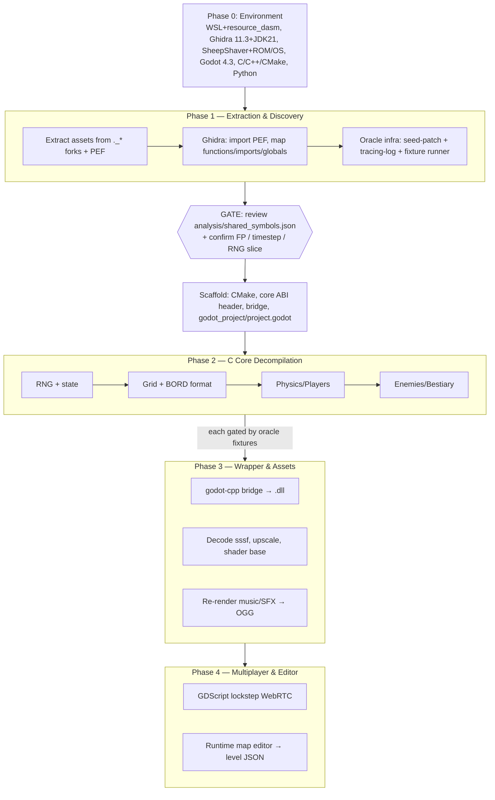

# Execution Plan — "Step On It!" Remaster

Step-by-step plan to build the remaster. This is the **operational companion** to
[`MASTER_PLAN.md`](MASTER_PLAN.md) (architecture & specs) and [`../docs/`](../docs/) (verified
reverse-engineering findings). It replaces the earlier custom-agent orchestration.

## Working model

- **Driven from a single chat.** You (the developer) run the steps in order and **review at each gate**.
  No custom agents or a manager persona are required — the pipeline is sequential and human-gated.
- **Language stack** (per MASTER_PLAN §1): **C** core (freestanding, deterministic), a thin **C++
  `godot-cpp`** GDExtension wrapper, **GDScript** for UI/editor/netcode, **Python** for tooling.
- **Optional parallelism (read-only only).** Independent *analysis* of the original — reversing the
  `BORD` / `sssf` / `DMKY` formats, mining the PEF, cross-referencing assets — can be fanned out to
  parallel read-only analysis, since each just reads files and writes its own notes.
  **Building/porting is serial** (it edits shared code and is gated). Byte-level confirmation still needs
  a tool run in a terminal-enabled session.
- **Keep docs current.** Whenever a format/behavior is confirmed, update the relevant file under
  `docs/original_game/` (with a CONFIRMED/HYPOTHESIS/TODO tag).

## Target repo layout

```
# INPUTS (committed)
raw_game/                 # untouched original Mac game (source of truth)
refs/{text,images}/       # human reference material

# OUR SOURCE (committed)
tools/                    # Python: parse_bord.py, rezfork.py, parse_pef.py, analyze_formats.py,
                          #   pef_patch.py, trace_parse.py (oracle infra, exist);
                          #   + to create: extract_assets.py, sssf_decode.py, dmky_decode.py
analysis/                 # Phase-1 RE working dir (created up front, independent of core/)
  shared_symbols.json     #   symbol map; symbols.<domain>.json per subsystem
  fixtures/               #   oracle fixtures (§6.4)
  ghidra/                 #   Ghidra scripts + project exports (discover.py, decompile.py, seed_and_loop.py)
  trace/                  #   trace-log OUTPUTS (the runnable patchers live in tools/)
core/                     # C core — ported game logic (freestanding)
  include/soi_core.h      #   C ABI: tick_engine, soi_load_level, soi_read_state, soi_set_seed
  src/{rng,state,grid,physics,enemies,modes}.c
  CMakeLists.txt
bridge/                   # C++ godot-cpp GDExtension shim (glue only): src/soi_bridge.cpp, CMakeLists.txt
godot_project/            # the single Godot 4.3 project: project.godot, soi.gdextension, assets/{retro,remastered,audio}
tests/                    # verification harness (host driver replaying analysis/fixtures/)
docs/  plan/              # findings + design
CMakeLists.txt            # top-level: builds core + bridge into the .dll

# GENERATED (.gitignored, reproducible via tools/)
extracted/{art,sprites,ui,audio,music,levels}/
bin/core_pef.bin          # the PowerPC PEF for Ghidra
```

## Phase diagram



## Phase 0 — Environment (one-time)

Stand up and **pin** (MASTER_PLAN §8). **Ghidra runs natively on Windows** (it is Java) — no WSL is needed to reach the gate; `resource_dasm`/WSL is deferred to Phase 3 (PICT/`snd` art). Install to **D:** where possible:
* **Ghidra 11.3 + Temurin JDK 21** (native Windows).
* **SheepShaver** (PowerPC) + your pinned **New World PPC ROM** + **Mac OS 9.0.4** — record the ROM SHA-256 into §8's environment lock. (No special CPU mode needed: gameplay is integer-only per §2a, so SheepShaver's JIT is fine — §6.1.)
* Later phases: Godot 4.3 + godot-cpp, a C/C++ toolchain + CMake 3.28+, Python 3.10+, FluidSynth + `FluidR3_GM`, Real-ESRGAN, and `resource_dasm` (WSL Ubuntu or a native build).
**DoD:** Ghidra opens a PowerPC PEF; the emulator boots the game and its **ROM SHA-256 + `Mac OS 9.0.4`** are recorded; `bin/core_pef.bin` exists (from `tools/extract_pef.py`).

## Phase 1 — Extraction & Discovery

| # | Task | Deliverable | Notes |
|---|---|---|---|
| 1 | Seed the knowledge base | `analysis/shared_symbols.json` (names block) | Full 13-nasty roster + goodies (docs §gameplay). |
| 2 | Write `tools/extract_assets.py`; extract | `extracted/*`, `bin/core_pef.bin`, `manifest.json` | Dump **bare resource forks** with `rezfork.py`, then `resource_dasm` for `PICT`→PNG (`extracted/art/`) and `snd `→WAV (`extracted/audio/`); carve `sssf`+`clut`→`sprites/`, `cicn`→`ui/`, movies→`music/`, `BORD`→`levels/`. |
| 3 | Reverse open formats | `sssf_decode.py`, `dmky_decode.py`, docs updates | Own the `sssf` pixel encoding, `DMKY` framing, `DATA:` block (currently HYPOTHESIS — docs). |
| 4 | Ghidra discovery (PEF) | functions/imports/globals + decompiled C in `analysis/shared_symbols.json`; **the `Random()` 16-bit slice + sign (FIRST deliverable)**, the **end-of-tick hook site**, and the `randSeed` seed-init site | Use named CODE segments (Bad Guy/Graphics/Players/Misc) to pre-tag domains. **Settle §2a gates: FP usage, per-Tick-vs-per-frame + `TICK_HZ`, RNG slice.** |
| 5 | Oracle infra (only) | `tools/pef_patch.py` + `tools/trace_parse.py` + fixture runner + ≥1 fixture in `analysis/fixtures/` | Per MASTER_PLAN §6: patch the **PPC PEF** end-of-tick hook (SheepShaver); log the **minimal scalar globals + the `GetKeys` input bitmask** (§6.3); seed-patch the app demo (`BORD 300` + `DMKY 1000`). **`TickCount` pin is conditional** — only if **task 4** recon finds gameplay reads `TickCount` do we read-hook the CFM import (§5.6); it needs `ticks_per_step` from **task 4**, so *run task 4 first* (recon leans pacing-only ⇒ likely no pin). Also capture one short **2-player** session for the §6.4 fidelity gate — **provisional** (Phase-1 logs only scalars; re-capture in Phase 2, task 8b). |

**→ GATE:** review `analysis/shared_symbols.json` and the resolved open questions before writing any core code.

## Scaffold (after the gate)

Create the CMake/core/bridge skeleton per MASTER_PLAN §11 (C ABI header, empty subsystem `.c` files,
godot-cpp shim, the single `godot_project/project.godot` + `soi.gdextension`, `tests/` driver).

## Phase 2 — C Core Decompilation (verified, in order)

Port from Ghidra PPC pseudocode into C, honoring the determinism contract (§5) and verifying every
function against the oracle (§6). **First, before the table: RNG & state** — port the `Random()` LCG
(§5.3) + the shared game-state struct to `core/src/rng.c` / `state.c` and verify the RNG sequence for N
draws; everything below depends on them. Then, **Grid first** (physics collision needs the grid struct):

| # | Task | Output | Depends on |
|---|---|---|---|
| 6 | **Grid** + reverse `BORD` → level JSON converter (block-prop bits + badguy type/dir — gated task, §7.4) | `core/src/grid.c`, `analysis/symbols.grid.json` | RNG/state, oracle |
| 7 | **Physics/Players** (movement, jump, gravity, block create/destroy) | `core/src/physics.c`, `analysis/symbols.physics.json` | grid struct |
| 8 | **Enemies** (all 13 nasties + Gargoyle/UltraBuster) | `core/src/enemies.c`, `analysis/symbols.enemies.json` | RNG/state, oracle |
| 8b | **Match flow & 2-player modes** (One Player / Alternate / Cooperate / Compete: mode select, separate keys/doors, the P2 entity, per-mode win/lose + scoring) — gated by a **Phase-2 re-capture** of the §6.4 2-player fidelity trace (the Phase-1 capture was provisional — struct fields like the P2 entity / per-player score / key–door state only become loggable now) | `core/src/modes.c`, `analysis/symbols.modes.json` | grid, physics, enemies |

Each is done when its fixtures (incl. a long-horizon trace) pass; merge each `symbols.<domain>.json` into
`analysis/shared_symbols.json` after it lands. Task 8b additionally passes the §6.4 2-player fidelity trace
(seed- and time-patched per §6.2).

## Phase 3 — Wrapper & Assets (parallel-friendly once inputs exist)

| # | Task | Output |
|---|---|---|
| 9 | **godot-cpp bridge** → Windows `.dll`; expose `tick_engine(uint8_t,uint8_t)`; `godot_project/` + `soi.gdextension` load it | `bridge/`, `.dll` |
| 10 | **Graphics** — decode `sssf` (run-length **confirmed**; **fallback:** ship the frames that decode cleanly + placeholders for the rest until the blit RLE opcodes are pinned; presentational, non-blocking), upscale to 4K aligned to 640×480, grayscale-Ted base for the recolor shader | `godot_project/assets/remastered/` |
| 11 | **Audio** — re-render QuickTime MIDI → OGG (FluidSynth), `snd `→OGG | `godot_project/assets/audio/` |

## Phase 4 — Multiplayer & Editor

| # | Task | Output |
|---|---|---|
| 12 | **Lockstep netcode** (GDScript + WebRTC, 2P; input-delay buffer + reliable ordered channel, §12; validate on the **two-process** distinct-input fixture that round-trips serialization + the input-delay buffer, §6.4) | `network_manager.gd` |
| 13 | **Runtime map editor** → canonical level JSON (§7.3) | `map_editor.tscn` |

## Kickoff

There is no special trigger — just start Phase 0/1 in a chat, e.g.:

> Set up Phase 1: extract the assets and load the PEF into Ghidra, then build the oracle infra. Stop at
> the gate for me to review `analysis/shared_symbols.json`.

Then proceed phase by phase, reviewing at each gate. Fan out read-only analysis (BORD/`sssf`/`DMKY`
format reversing) in parallel whenever it helps; keep the porting itself sequential.
